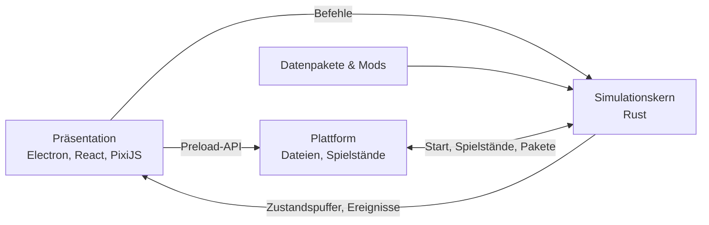

# OpenAirside

<!-- README von OpenAirside nach templates/docs/readme-vorlage.md.
     Aktualisierungs-Pflicht nach CLAUDE.md Abschnitt 16; Inhalte stammen aus den Pflicht-Dokumenten.
     Drift zwischen README und Pflicht-Dokumenten ist ein Bug. -->


[](https://github.com/Paddel87/OpenAirside/actions/workflows/ci.yml)


<!-- Coverage-Badge folgt mit einem Coverage-Dienst (freigabepflichtig, Kategorie 3); der Build-Badge deckt seit Schritt 2.1 Lint, Typen, Security und Tests ab. Badges zeigen nur reale Zustände. -->

> Ein Open-Source-Flughafen-Tycoon für Windows, Linux und macOS: Plane, baue und betreibe deinen eigenen Flughafen, vom Regionalflughafen bis zum internationalen Drehkreuz.

## Über das Projekt

OpenAirside ist ein Open-Source-Nachbau des eingestellten Tycoon-Spiels *Airport CEO*. Spielprinzip und Funktionsumfang folgen dem Original einschließlich seiner Add-ons: Start- und Landebahnen, Rollwege, Terminals über mehrere Etagen, Gepäckanlagen, Flugpläne, Personal, Wirtschaft, Forschung und Notfälle. Die technische Grundlage ist dagegen von Anfang an auf sehr große Flughäfen ausgelegt, und Abläufe wie Check-in, Sicherheits- und Gepäckkontrolle entsprechen dem heutigen Flughafenbetrieb.

**Was es löst:** Das Original wird nicht mehr weiterentwickelt und bricht bei großen Flughäfen ein: Das Bild ruckelt, Bauaufträge brauchen Sekunden, Passagiere und Fahrzeuge bleiben stecken. OpenAirside will das gleiche fesselnde Spielerlebnis bieten, auch mit über 10.000 gleichzeitig simulierten Personen.

**Für wen:** Spieler von Aufbau- und Wirtschaftssimulationen, insbesondere die Community von Airport CEO.

**Was es bewusst nicht ist:**

- kein Projekt mit Material aus dem Original: kein Code, keine Grafiken, Texte oder Töne, keine Kompatibilität zu dessen Mods oder Spielständen
- kein Spiel mit Kurven beim Bauen: gebaut wird im rechtwinkligen Raster
- kein Store-Spiel: Vertrieb über GitHub, kostenlos und ohne Gewinnabsicht

## Aktueller Status

- **Projektphase:** Phase 3: Vertikaler Schnitt „Kleiner Flughafen“ (UMSETZUNG), Entwurfsschritte 3.7 (Personengruppen, Begehbarkeit und Querungen, ADR-037) und 3.8 (Weltdarstellung im Spielfeld, ADR-038) sowie die Messung 3.14, die Korrektur 3.15 (Ruckeln unter Windows) und die Umbauten 3.9 (Kernstruktur der Fachmodule, ADR-039) und 3.10 (Aufteilung der Plattform-Datei `main.ts`) erledigt; Schritt 3.1 (Bauen im Raster) in Stufen: 3.1a Kern erledigt, 3.1b Darstellung und Bedienung erledigt (Messungen auf Referenz-PC und Mac bestanden, ADR-044; Grafik-Abnahme verschoben auf 3.1b-N1), 3.1c Bauaufträge und Bauarbeiter offen; Phase 2 (Fundament: Projektgerüst und CI, Weltmaßstab, Schnittstellenverträge, Takt, Raster und Wegweiser, Brücke und Plattform, Datenpakete, Spielstände, Lokalisierung, Grafik-Pipeline) abgeschlossen am 2026-10-19 mit „gezielt umbauen“ (ADR-036); Phase 1 (Technischer Durchstich und Leistungsnachweis) abgeschlossen (ADR-014, ADR-016)
- **Version:** v0.0.0
- **Status:** Konzeption
- **Letzte Änderung:** 2026-10-25
- **Architektur-Reife:** Plattformen und Auslieferungsform BELASTBAR; Stack (Electron 44, TypeScript 6, React 19, PixiJS 8, Rust-Simulationskern), Architektur-Pattern, Betriebsart des Rust-Kerns (natives Modul im Hilfsprozess, ADR-009), Datenmodell im Kern (ADR-010; Weltmaßstab 2 m je Zelle mit Luftseite im Raster und Speicherung in Blöcken nach ADR-020; Personengruppen mit eigenen begehbaren Flächen nach ADR-037), Wegweiser-Prinzip und Leistung von Simulation und Zustandsübergabe BELASTBAR seit dem Leistungsnachweis (ADR-014; Linux-Messung in 7.2); Leistung der Darstellung mit echten Grafiken BELASTBAR im gemessenen Umfang (20.000 Objekte, Windows und macOS, ADR-034), Nahansicht mit Weltdarstellung BELASTBAR unter macOS und Windows (Ruckeln auf dem Referenz-PC in 3.15 behoben; Nachmessung mit dem Bauen in 3.1), Fahrzeuge und Flugzeuge VORLÄUFIG; Bauaktion im nächsten Bild BELASTBAR (ADR-044, Vorschau im ersten Bild auf Referenz-PC und Mac); Zustandsübergabe Kern → Darstellung und große Tabellen BELASTBAR (Windows und macOS gemessen); Schnittstellenverträge für Befehle, Ereignisse, Abfragen, Datenpakete, Spielstände und Plattform BELASTBAR (ADR-021, fortgeschrieben durch ADR-032), Steuerung des Kern-Prozesses durch die Plattform BELASTBAR (ADR-032); Weg der Bauten in die Darstellung BELASTBAR (Blöcke im Bild, Zeichnung mit Shader, ADR-038; umgesetzt in 3.1b, Speicher auf Referenz-PC und Mac gemessen und BELASTBAR); Takt des Simulationskerns BELASTBAR (Umsetzung 2.2; Fachmodule mit fester Reihenfolge und internen Ereignissen seit 3.9, ADR-039); Grundraster der Welt BELASTBAR (Umsetzung 2.3); Brücke zwischen Kern und Oberfläche sowie Plattformschicht BELASTBAR (Umsetzung und Messung 2.7); Lader für Datenpakete BELASTBAR (Umsetzung 2.4); Spielstand-Format durch Umsetzung bestätigt (2.5); Lokalisierung BELASTBAR (Umsetzung 2.6); Grafik-Pipeline (SVG → Atlanten) BELASTBAR (Umsetzung 2.10, ADR-033)
- **Aktive Blocker:** 0

## Quick Start

Lauffähig ist ein Spielfenster mit Simulationskern, Personen auf dem Spielfeld, einem Debug-Panel (Schritt 2.7) und seit Schritt 3.1b dem Bauen von Böden, Wänden und Sitzbänken in einem neuen Spiel (Schaltfläche „Neues Spiel“ unten in der Mitte oder Konsole `newgame`); ein spielbares Spiel ist es noch nicht.

### Voraussetzungen (für Entwicklung)

- Node.js 26.11.1
- Rust über rustup (Version 1.98.1 aus `rust-toolchain.toml`); unter Windows Visual Studio Build Tools mit C++, unter macOS die Xcode Command Line Tools
- Git, Python 3 mit `pre-commit`

```bash
git clone https://github.com/Paddel87/OpenAirside.git
cd OpenAirside
npm ci
pre-commit install
npm start        # baut Rust-Kern, Brücke und Oberfläche, öffnet das Fenster
```

→ Ausführliche Anleitung pro Plattform, alle Prüfungen und Troubleshooting: [`docs/onboarding-runbook.md`](docs/onboarding-runbook.md)

## Architektur (Überblick)

Das Spiel ist aufgebaut wie eine Web-Anwendung mit Backend und Frontend auf demselben Rechner: Ein Rust-Simulationskern enthält die gesamte Spiellogik, eine TypeScript-Präsentation zeigt den Zustand an.



**Module (Auswahl):**

- **Simulationskern:** Takt, Weltzustand und alle Spielregeln, auf mehrere CPU-Kerne verteilt.
- **Wegfindung & Passagierführung:** Wegweiser je Ziel statt Wegsuche pro Person; Schilder und Bodenmarkierungen lenken die Passagiere.
- **Verkehr & Verkehrssteuerung:** Straßen- und Rollverkehr nach festen Vorrangregeln, ohne Blockaden.
- **Spielfeld:** Draufsicht-Darstellung mit PixiJS.
- **Oberfläche:** Panels, Tabellen und Werkzeuge mit React.
- **Inhalte & Mods:** Flugzeugtypen, Airlines und Objekte als Datenpakete.

→ Vollständige Architektur: [`docs/architecture.md`](docs/architecture.md)

## Verwendung

Noch nicht spielbar. `npm start` öffnet das Spielfenster mit leerer Karte; der Simulationskern läuft in einem eigenen Prozess. Im Debug-Panel oben links zeigt `help` die Konsolenbefehle (z. B. `spawn 1000`, `speed x3`, `scenario reference 10000`). Das Referenz-Terminal aus dem Leistungsnachweis startet direkt mit `npx electron . --scenario=referenceTerminal --persons=10000`. `measure` startet eine zehnminütige Messreihe mit 20.000 Objekt-Grafiken und speichert das Ergebnis als JSON-Datei im Download-Ordner.

Grafiken sind eigene SVG-Dateien unter `assets/` (eine je Objekt in `assets/graphics/base/`, Regeln im [Stilleitfaden](docs/stilleitfaden.md)); `npm run build` rastert sie zu Atlanten und zum Programmsymbol, `npm run check:graphics` prüft sie gegen den Leitfaden.

Inhalte kommen aus Datenpaketen: Das Basispaket liegt in `content/base/`, eigene Pakete gehören in den Ordner `packs` im Datenordner des Spiels (eins je Unterordner, Aufbau und Fehlercodes in [`docs/architecture-schnittstellen.md`](docs/architecture-schnittstellen.md), S-4). Editoren prüfen die Dateien mit den Schemas aus `content/schema/`, wenn die Datei `"$schema"` setzt. In der Konsole zeigt `packs` alle gefundenen Pakete mit Fehlern, `packs set <id> …` wählt die aktiven Pakete ab der nächsten Sitzung (z. B. nach `scenario hall`), `build <paket:eintrag> <x> <y>` schickt den Bau-Befehl an den Kern, der seit Schritt 3.1a Möbel (Boden darunter nötig, Antwort `blocked` oder `needsFloor` sonst) im Weltzustand platziert; sichtbar wird das Gebaute erst mit Schritt 3.1b. Böden und Wände (`buildArea`) und Abriss (`demolish`) wirken im Kern ebenso, bisher nur über den Befehlskanal.

Spielstände: `save [Name]` speichert, F5 oder `quicksave` speichert schnell, alle 10 Minuten laufender Spielzeit entsteht ein Autosave (5 Plätze im Wechsel; beides einstellbar, siehe unten). `saves` zeigt die Liste mit Vorschaubildern zum Laden und Löschen, `load <id>` und `delete <id>` gehen auch in der Konsole. Endet der Simulationskern unerwartet, startet das Spiel ihn neu und bietet an, den letzten Autosave zu laden. Spielstände liegen im Ordner `saves`, die Logdatei im Ordner `logs` des Datenordners. Spielstände von Ständen vor Schritt 3.9 (Format-Version 1) lassen sich nicht mehr laden; vor Version 1.0 ist das zulässig (Vertrag S-5).

Sprache und Einstellungen: Die Oberfläche gibt es auf Deutsch und Englisch, beim ersten Start nach der Systemsprache. Der Knopf „Einstellungen“ unten links (oder `settings` in der Konsole) wechselt die Sprache ohne Neustart und stellt das Autosave-Intervall (1–60 Minuten) und die Zahl der Autosaves (1–20) ein; `lang` listet die Sprachen, `lang <Code>` wechselt direkt. Weitere Sprachen kommen als Datenpaket mit dem Ordner `lang/` (Aufbau in [`docs/architecture-schnittstellen.md`](docs/architecture-schnittstellen.md), S-4; Schema `content/schema/lang.schema.json`); fehlende Texte erscheinen auf Englisch. Konsole und Leistungsanzeige bleiben englisch. Die Einstellungen liegen in `settings.json` im Datenordner.

## Nächste Schritte

- 3.1c: Bauaufträge mit Bauarbeitern
- 3.1b-N1: Abnahme der Grafiken für Boden, Wand und Sitzbank, Zeitpunkt nennt der Projektinhaber
- 3.2: Kleines Terminal und Passagierablauf

→ Vollständiger Fahrplan: [`docs/fahrplan.md`](docs/fahrplan.md)

## Mitwirken

Beiträge sind willkommen, sobald ein lauffähiger Stand existiert, insbesondere Grafiken, Airlines, Lackierungen und Übersetzungen.

- **Branch-Konvention:** `<präfix>/<schritt-id>-<kurztitel>`, z. B. `erkundung/1-3-zustandsuebergabe`; Präfix nach Inhalt (`feat/`, `fix/`, `docs/`, `erkundung/` usw., Tabelle in `CLAUDE.md` Abschnitt 11); ein Branch je PR
- **Commit-Format:** `<bereich>: <kurze beschreibung im imperativ>` mit Fahrplan-Referenz (siehe `CLAUDE.md` Abschnitt 11)
- **Code-Standards:** siehe [`docs/project-context.md`](docs/project-context.md) Abschnitt 7
- **Wichtig:** Kein Material aus Airport CEO oder dessen Mods, auch nicht als Vorlage.

## Dokumentation

| Dokument | Inhalt |
|---|---|
| [`docs/vision.md`](docs/vision.md) | Ursprüngliche Projektvision (eingefroren) |
| [`docs/requirements.md`](docs/requirements.md) | Beteiligte, Anwendungsfälle, Anforderungen |
| [`docs/funktionsinventar.md`](docs/funktionsinventar.md) | Funktionsumfang des Originals als Maßstab |
| [`docs/modernisierung.md`](docs/modernisierung.md) | Entschiedene Abweichungen vom Original |
| [`docs/project-context.md`](docs/project-context.md) | Aktueller Stack, Constraints, Qualitätsziele |
| [`docs/architecture.md`](docs/architecture.md) | Systemarchitektur, Module, Schnittstellen |
| [`docs/architecture-schnittstellen.md`](docs/architecture-schnittstellen.md) | Schnittstellenverträge S-1 bis S-8 mit Änderungsprotokoll |
| [`docs/fahrplan.md`](docs/fahrplan.md) | Entwicklungsplan und Fortschritt |
| [`docs/decisions.md`](docs/decisions.md) | Architekturentscheidungen (ADRs) |
| [`docs/blockers.md`](docs/blockers.md) | Aktive Blocker und gelöste Probleme |
| [`docs/logbuch.md`](docs/logbuch.md) | Chronologisches Arbeitsprotokoll |
| [`docs/onboarding-runbook.md`](docs/onboarding-runbook.md) | Einrichtung vom Klon bis zum laufenden Spiel |
| [`CLAUDE.md`](CLAUDE.md) | Arbeitsregeln für die KI-gestützte Entwicklung |
| [`templates/`](templates/) | Methodik-Vorlagen (aus Dev-Templates) |
| [`CHANGELOG.md`](CHANGELOG.md) | Versionshistorie (ab erster Version) |

## Lizenz

Code unter der [MIT-Lizenz](LICENSE). Eigene Grafiken unter CC0. Die Methodik-Vorlagen unter `templates/` und `CLAUDE.md` stammen aus dem Template-Repo Dev-Templates (CC0). Audio-Dateien mit abweichenden Bedingungen sind in einem eigenen Verzeichnis mit Lizenzhinweis gekennzeichnet.

OpenAirside ist ein unabhängiges Projekt und steht in keiner Verbindung zu Apog Labs oder Airport CEO.
