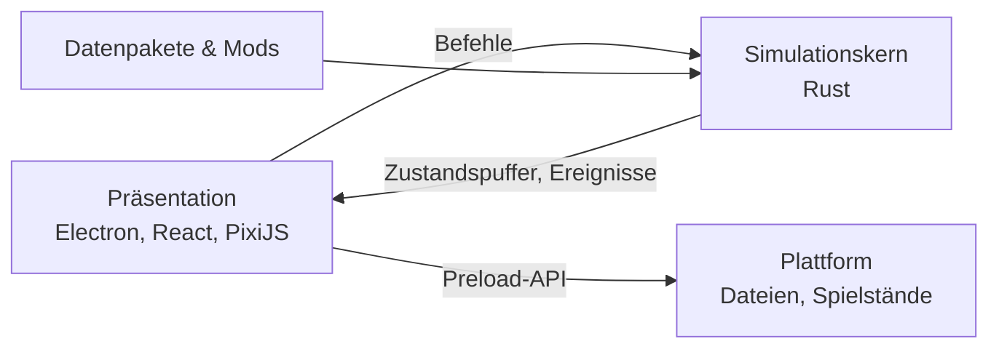

# OpenAirside

<!-- README von OpenAirside nach templates/docs/readme-vorlage.md.
     Aktualisierungs-Pflicht nach CLAUDE.md Abschnitt 16; Inhalte stammen aus den Pflicht-Dokumenten.
     Drift zwischen README und Pflicht-Dokumenten ist ein Bug. -->

<!-- Coverage-, Lint- und Security-Badges folgen, sobald es Code gibt (Schritt 2.1); Badges zeigen nur reale Zustände. -->

> Ein Open-Source-Flughafen-Tycoon für Windows, Linux und macOS: Plane, baue und betreibe deinen eigenen Flughafen, vom Regionalflughafen bis zum internationalen Drehkreuz.

## Über das Projekt

OpenAirside ist ein Open-Source-Nachbau des eingestellten Tycoon-Spiels *Airport CEO*. Spielprinzip und Funktionsumfang folgen dem Original einschließlich seiner Add-ons: Start- und Landebahnen, Rollwege, Terminals über mehrere Etagen, Gepäckanlagen, Flugpläne, Personal, Wirtschaft, Forschung und Notfälle. Die technische Grundlage ist dagegen von Anfang an auf sehr große Flughäfen ausgelegt, und Abläufe wie Check-in, Sicherheits- und Gepäckkontrolle entsprechen dem heutigen Flughafenbetrieb.

**Was es löst:** Das Original wird nicht mehr weiterentwickelt und bricht bei großen Flughäfen ein: Das Bild ruckelt, Bauaufträge brauchen Sekunden, Passagiere und Fahrzeuge bleiben stecken. OpenAirside will das gleiche fesselnde Spielerlebnis bieten, auch mit über 10.000 gleichzeitig simulierten Personen.

**Für wen:** Spieler von Aufbau- und Wirtschaftssimulationen, insbesondere die Community von Airport CEO.

**Was es bewusst nicht ist:**

- kein Projekt mit Material aus dem Original: kein Code, keine Grafiken, Texte oder Töne, keine Kompatibilität zu dessen Mods oder Spielständen
- kein Spiel mit Kurven beim Bauen: gebaut wird im rechtwinkligen Raster
- kein Store-Spiel: Vertrieb über GitHub, kostenlos und ohne Gewinnabsicht

## Aktueller Status

- **Projektphase:** Phase 1: Technischer Durchstich und Leistungsnachweis (ERKUNDUNG); Schritte 1.1–1.6 erledigt; Leistungsnachweis erbracht (ADR-014)
- **Version:** v0.0.0
- **Status:** Konzeption
- **Letzte Änderung:** 2026-10-13
- **Architektur-Reife:** Plattformen und Auslieferungsform BELASTBAR; Stack (Electron 44, TypeScript 6, React 19, PixiJS 8, Rust-Simulationskern), Architektur-Pattern, Betriebsart des Rust-Kerns (natives Modul im Hilfsprozess, ADR-009), Datenmodell im Kern (ADR-010), Wegweiser-Prinzip und Leistungsziele BELASTBAR seit dem Leistungsnachweis (ADR-014; Linux-Messung in 7.2); Bauaktion im nächsten Bild VORLÄUFIG; Zustandsübergabe Kern → Darstellung und große Tabellen BELASTBAR (Windows und macOS gemessen); Datenpaket- und Spielstand-Format OFFEN
- **Aktive Blocker:** 0

## Quick Start

Noch nicht lauffähig. Installations- und Startanleitung folgen mit dem ersten lauffähigen Stand.

### Voraussetzungen (für Entwicklung, vorläufig)

- Node.js 26 (LTS)
- Rust 1.98.1 über rustup (festgeschrieben in `rust-toolchain.toml` ab Schritt 2.1)
- Git, Python 3 mit `pre-commit`

→ Ausführliche Anleitung pro Plattform: [`docs/onboarding-runbook.md`](docs/onboarding-runbook.md)

## Architektur (Überblick)

Das Spiel ist aufgebaut wie eine Web-Anwendung mit Backend und Frontend auf demselben Rechner: Ein Rust-Simulationskern enthält die gesamte Spiellogik, eine TypeScript-Präsentation zeigt den Zustand an.

**Module (Auswahl):**

- **Simulationskern:** Takt, Weltzustand und alle Spielregeln, auf mehrere CPU-Kerne verteilt.
- **Wegfindung & Passagierführung:** Wegweiser je Ziel statt Wegsuche pro Person; Schilder und Bodenmarkierungen lenken die Passagiere.
- **Verkehr & Verkehrssteuerung:** Straßen- und Rollverkehr nach festen Vorrangregeln, ohne Blockaden.
- **Spielfeld:** Draufsicht-Darstellung mit PixiJS.
- **Oberfläche:** Panels, Tabellen und Werkzeuge mit React.
- **Inhalte & Mods:** Flugzeugtypen, Airlines und Objekte als Datenpakete.

→ Vollständige Architektur: [`docs/architecture.md`](docs/architecture.md)

## Verwendung

Noch nicht verfügbar.

## Nächste Schritte

- Auswertung von Phase 1 und Planung von Phase 2 (Schritt 1.7)
- Phase 2: lauffähiger, leerer Spielrahmen mit grüner CI auf drei Plattformen

→ Vollständiger Fahrplan: [`docs/fahrplan.md`](docs/fahrplan.md)

## Mitwirken

Beiträge sind willkommen, sobald ein lauffähiger Stand existiert, insbesondere Grafiken, Airlines, Lackierungen und Übersetzungen.

- **Branch-Konvention:** `<präfix>/<schritt-id>-<kurztitel>`, z. B. `erkundung/1-3-zustandsuebergabe`; Präfix nach Inhalt (`feat/`, `fix/`, `docs/`, `erkundung/` usw., Tabelle in `CLAUDE.md` Abschnitt 11); ein Branch je PR
- **Commit-Format:** `<bereich>: <kurze beschreibung im imperativ>` mit Fahrplan-Referenz (siehe `CLAUDE.md` Abschnitt 11)
- **Code-Standards:** siehe [`docs/project-context.md`](docs/project-context.md) Abschnitt 7
- **Wichtig:** Kein Material aus Airport CEO oder dessen Mods, auch nicht als Vorlage.

## Dokumentation

| Dokument | Inhalt |
|---|---|
| [`docs/vision.md`](docs/vision.md) | Ursprüngliche Projektvision (eingefroren) |
| [`docs/requirements.md`](docs/requirements.md) | Beteiligte, Anwendungsfälle, Anforderungen |
| [`docs/funktionsinventar.md`](docs/funktionsinventar.md) | Funktionsumfang des Originals als Maßstab |
| [`docs/modernisierung.md`](docs/modernisierung.md) | Entschiedene Abweichungen vom Original |
| [`docs/project-context.md`](docs/project-context.md) | Aktueller Stack, Constraints, Qualitätsziele |
| [`docs/architecture.md`](docs/architecture.md) | Systemarchitektur, Module, Schnittstellen |
| [`docs/fahrplan.md`](docs/fahrplan.md) | Entwicklungsplan und Fortschritt |
| [`docs/decisions.md`](docs/decisions.md) | Architekturentscheidungen (ADRs) |
| [`docs/blockers.md`](docs/blockers.md) | Aktive Blocker und gelöste Probleme |
| [`docs/logbuch.md`](docs/logbuch.md) | Chronologisches Arbeitsprotokoll |
| [`docs/onboarding-runbook.md`](docs/onboarding-runbook.md) | Einrichtung vom Klon bis zum laufenden Spiel |
| [`CLAUDE.md`](CLAUDE.md) | Arbeitsregeln für die KI-gestützte Entwicklung |
| [`templates/`](templates/) | Methodik-Vorlagen (aus Dev-Templates) |
| [`CHANGELOG.md`](CHANGELOG.md) | Versionshistorie (ab erster Version) |

## Lizenz

Code unter der [MIT-Lizenz](LICENSE). Eigene Grafiken unter CC0. Die Methodik-Vorlagen unter `templates/` und `CLAUDE.md` stammen aus dem Template-Repo Dev-Templates (CC0). Audio-Dateien mit abweichenden Bedingungen sind in einem eigenen Verzeichnis mit Lizenzhinweis gekennzeichnet.

OpenAirside ist ein unabhängiges Projekt und steht in keiner Verbindung zu Apog Labs oder Airport CEO.
