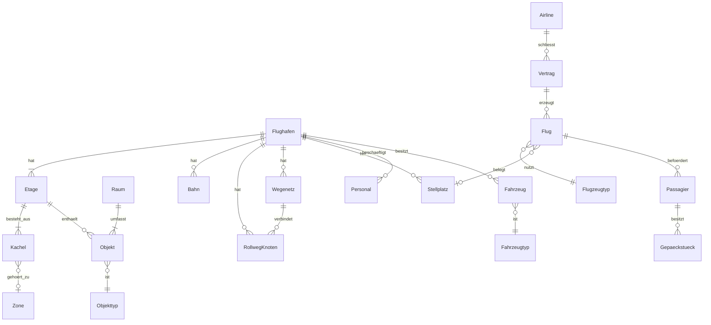

# Architecture

<!-- Systemarchitektur von OpenAirside. Lebendes Dokument, Stand Initialisierung (Modus 2) 2026-10-13.
     Klasse G: ein Hauptdokument; Auslagerung in architecture-<modul>.md, sobald > 500 Zeilen
     oder > 5 Module eigene detaillierte Schnittstellen haben (ADR-001).
     Änderungen an [BELASTBAR]-Bestandteilen sind freigabepflichtig (CLAUDE.md Abschnitt 4); rein additive,
     rückwärtskompatible Ergänzungen von Schnittstellen nach Regel-008 ohne ADR (ADR-036).
     Abschnitt 4 ausgelagert nach architecture-schnittstellen.md (ADR-036). -->

<!-- ANCHOR:reifegrad-system -->
## 0. Reifegrad-System

Jedes Modul, jede Schnittstelle und jede Architektur-Aussage trägt einen der folgenden Marker:

- `[BELASTBAR]` – Entscheidung getroffen, durch Umsetzung validiert oder durch ADR fixiert. Änderung ist freigabepflichtig und erzeugt einen ADR. Ausnahme: rein additive, rückwärtskompatible Ergänzungen einer Schnittstelle nach Regel-008 (ADR-036) stehen im Änderungsprotokoll von `architecture-schnittstellen.md`.
- `[VORLÄUFIG]` – Entwurfshypothese, plausibel aber nicht durch Umsetzung validiert. Darf in der Implementierung verfeinert werden, jede Verfeinerung wird hier mit Datum vermerkt. Wird nach Validierung auf `[BELASTBAR]` befördert.
- `[OFFEN]` – bewusst nicht entschieden. Kein Code in Bereichen, die davon abhängen, bevor die Lücke geschlossen ist.

**Beförderungsregel:** von `[VORLÄUFIG]` auf `[BELASTBAR]` durch funktionierende Implementierung oder ADR, jeweils mit Datum und Begründung am Eintrag.

**Rückstufungsregel:** `[BELASTBAR]` nur per ADR zurückstufbar. Stille Rückstufung ist verboten.

**Besonderheit der Initialisierung:** Der Stack (ADR-002) war unter der Bedingung des Leistungsnachweises in Phase 1 entschieden. Der Nachweis ist mit Auflagen erbracht (ADR-014, 2026-10-13); Stack, Pattern, Betriebsart, Datenmodell und Wegweiser-Prinzip sind seitdem `[BELASTBAR]`. Module und Schnittstellen bleiben `[VORLÄUFIG]`, bis ihre eigene Umsetzung sie belegt.

**Reifegrad vor Umsetzungsschritten (Regel-007, ADR-016):** Grundsatzentscheidungen und jede Schnittstelle, die ein Umsetzungsschritt nutzt oder umsetzt, müssen vorher `[BELASTBAR]` sein; Module dürfen `[VORLÄUFIG]` in ihre erste Umsetzung gehen.

<!-- ANCHOR:ueberblick -->
## 1. Überblick

OpenAirside ist ein lokal laufendes Desktop-Spiel. Es ist aufgebaut wie eine Web-Anwendung mit Backend und Frontend auf demselben Rechner: Ein Simulationskern in Rust enthält die gesamte Spiellogik und läuft in festen Simulationsschritten auf mehreren Kernen. Eine Präsentation in TypeScript (Electron, React, PixiJS) zeigt den Zustand an und nimmt Befehle des Spielers entgegen. Prägende Kernentscheidung ist die strikte Trennung: Der Kern kennt keine Darstellung, und Spiellogik liegt nie in der Präsentation. Das sichert Testbarkeit ohne Grafik, Leistung und Austauschbarkeit der Darstellung (etwa für eine spätere isometrische Ansicht oder einen Wechsel der Präsentationstechnik, siehe ADR-002).

**Architektur-Pattern:** Simulationskern mit austauschbarer Präsentationsschicht (Kern/Hülle-Trennung, datengetriebene Inhalte) `[BELASTBAR]` seit 2026-10-13 – siehe ADR-003; validiert durch Spikes 1.1–1.5 (ADR-014).

**Kommunikations-Grundmodus:** Präsentation → Kern: Befehlsnachrichten. Kern → Präsentation: Zustandspuffer im Kern-Prozess, je Bild als Kopie per `MessagePort` an den Renderer übertragen (ADR-009), plus Ereignisstrom. Präsentation ↔ Plattform: typisierte Electron-Preload-Schnittstelle (S-6). Plattform ↔ Kern-Prozess: Nachrichten des Utility-Prozesses (S-8, ADR-032). `[BELASTBAR]` seit 2026-10-15 – umgesetzt in 2.7, gemessen auf Mac und Referenz-PC.

**Plattformen:** Windows, Linux, macOS (nur Apple-Chips, ADR-012) `[BELASTBAR]` – harte Randbedingung aus der Vision.

**Auslieferungseinheit:** eine Desktop-Anwendung je Plattform, keine Server, keine Online-Dienste `[BELASTBAR]` – harte Randbedingung aus der Vision.

<!-- ANCHOR:modul-karte -->
## 2. Modul-Karte

Durchgezogene Linie = `[VORLÄUFIG]` festgelegt, gestrichelt = `[OFFEN]`. Nur diese Beziehungen sind erlaubt.

```mermaid
graph TB
  subgraph Electron-Hauptprozess
    PLAT[Plattform<br/>Fenster, Dateien, Spielstände, Logs, Start des Kern-Prozesses]
  end
  subgraph Präsentation – TypeScript, Renderer
    UI[Oberfläche<br/>React, Panels, Werkzeuge]
    FELD[Spielfeld<br/>PixiJS, Kamera, Overlays]
    AUD[Audio]
    LOC[Lokalisierung]
    BENCHTS[Benchmark & Leistung<br/>Leistungsanzeige, Messwerkzeug]
  end
  subgraph Brücke
    BEF[Befehlskanal S-2]
    ZUS[Zustandspuffer S-1]
    EVT[Ereignisstrom S-3]
    QRY[Abfrage S-7]
  end
  subgraph Simulationskern – Rust, napi-rs im Electron-Utility-Prozess
    TAKT[Takt & Weltzustand]
    WELT[Welt & Bau]
    WEG[Wegfindung & Passagierführung]
    VERK[Verkehr & Verkehrssteuerung]
    FLUG[Flugbetrieb]
    ABFG[Abfertigung & Gepäck]
    PERS[Personen]
    WIRT[Wirtschaft & Management]
    EREIG[Ereignisse]
    BENCH[Benchmark & Leistung]
  end
  INH[Inhalte & Mods<br/>Datenpakete, Lader im Kern-Prozess]

  UI -->|Befehle| BEF
  FELD -->|Befehle| BEF
  BENCHTS -->|Debug-Befehle| BEF
  BEF --> TAKT
  TAKT --> ZUS
  TAKT --> EVT
  ZUS --> FELD
  ZUS --> UI
  ZUS --> BENCHTS
  EVT --> UI
  EVT --> FELD
  EVT --> AUD
  EVT -->|Ereignisse, coreStats| BENCHTS
  UI -->|Tabellen, Details, Katalog| QRY
  BENCHTS -->|Test-Tabelle| QRY
  QRY --> TAKT
  LOC --> UI
  INH -->|Sprachpakete lang/, geprüft im Kern-Prozess, über Plattform lang.*, ADR-031| LOC
  INH -->|Atlanten aus dem Build, Bildname = Objekt-ID, ADR-032| FELD
  UI -->|Preload-API S-6| PLAT
  LOC -->|lang.*, settings.* S-6| PLAT
  BENCHTS -->|measure.* S-6| PLAT
  PLAT <-->|S-8: Start, Port, Spielstände, Pakete, Sprachen, Autosave| TAKT
  PLAT -->|S-8: Pakete wählen, Texte holen| INH
  INH --> TAKT
  TAKT --- WELT & WEG & VERK & FLUG & ABFG & PERS & WIRT & EREIG & BENCH
  INH -.->|Code-Mods OFFEN| UI
```

Kennungen der Knoten sind eindeutig (ADR-032, K-1: zuvor standen Abfrage und Abfertigung & Gepäck unter derselben Kennung). Die Kern-Module untereinander kommunizieren ausschließlich über den gemeinsamen Weltzustand und interne Ereignisse des Takts, nicht durch direkten Zugriff auf interne Strukturen anderer Module. Stand 2026-10-19: Interne Ereignisse gibt es im Code noch nicht, und `World` hält bisher nur Raster, Ziele, Wegenetze, Wegweiser und Personen. Reihenfolge der Fachmodule im Takt, Zustand und Spielstand je Modul und die Weitergabe von Wirkungen entwirft Schritt 3.9 vor 3.1 (ADR-036). Die Datenhaltung ist entschieden (ADR-010): eigene Felder je Objektart, kein ECS-Paket.

<!-- ANCHOR:module -->
## 3. Module (detailliert)

### Modul: Takt & Weltzustand [BELASTBAR]

- **Reifegrad:** `[BELASTBAR]`, seit 2026-10-13, durch Umsetzung in Schritt 2.2 (Regel-007): Takt, Zeitsteuerung, S-2, S-3 und Prüfmodus mit Tests, Kern-Benchmark als CI-Gate (ADR-022); Weltzustand mit Raster und Wegweisern bestätigt 2.3
- **Verantwortung:** Führt die Simulation in festen Simulationsschritten aus, unabhängig von der Bildrate; nimmt Befehle aus dem Befehlskanal entgegen, verteilt Arbeit auf die Kern-Module und auf mehrere Threads, schreibt den sichtbaren Zustand in den Zustandspuffer.
- **Nicht-Verantwortung:** keine Darstellung, keine Dateizugriffe, keine Spielregeln einzelner Fachbereiche.
- **Öffentliche Schnittstellen:** S-1, S-2, S-3, S-5
- **Interne Struktur:** Je Objektart getrennte Felder „heiß" (je Tick gebraucht) und „kalt" (nur bei Ereignissen) in eigenem Rust-Code, kein ECS-Paket; Tick in zwei Phasen (Bewegung liest Zustand des Vortick, danach vertauschbare Zählungen), parallel mit rayon; bitgleich über Threadzahlen (ADR-010, `[BELASTBAR]` seit ADR-014).
- **Abhängigkeiten (andere Module):** ruft alle Kern-Module je Simulationsschritt auf
- **Abhängigkeiten (extern):** `rayon`, `serde`; `ts-rs` nur hinter dem Feature `ts` (Typen-Export, ADR-021)
- **Technologie:** Rust
- **NFRs:** Rechenzeit pro Simulationsschritt muss bei höchster Spielgeschwindigkeit im Referenzszenario in das Zeitbudget passen (Abschnitt 6)
- **Betriebsart:** natives Node-Modul (napi-rs) in einem Electron-Utility-Prozess, Simulation auf eigenen Rust-Threads (ADR-009, `[BELASTBAR]` seit ADR-014); Kern-Crates ohne Anbindungscode (Regel-006).
- **Determinismus:** bitgleich, solange neue Wegweiser zu festem Tick übernommen werden (Prüfmodus für Tests); im normalen Spiel werden sie übernommen, sobald fertig, Spiellogik darf davon nicht abhängen (ADR-010).
- **Zeitmodell (ADR-020):** feste Tick-Länge von 1/3 Spielsekunde; 1× = 60, 2× = 120, 3× = 180 Ticks je Sekunde (Spieltag 72 bzw. 24 Minuten); Geschwindigkeiten als Spielwerte in Zellen je Spielsekunde aus Datenpaketen.
- **Umsetzung (Schritt 2.2, `core/src/`):** `time` (Zeitmodell, Kalender: Tick 0 = Tag 1 des Jahres 1, 00:00; Uhrzeit des Spielbeginns über `start_tick` der Sitzung), `command` (S-2 mit Strukturprüfung), `event` (S-3 mit `seq` je Sitzung, Flusssteuerung und Überlauf), `simulation` (Sitzungen, Kern-Zustände, Befehlsverarbeitung, Takt), `adoption` (Übernahme von Hintergrund-Ergebnissen: sobald fertig oder im Prüfmodus zu festem Tick), `pacer` (Echtzeit-Takt und Rückstandsmeldung), `runner` (Takt auf eigenem Thread), `world` (Personen mit heißen Feldern in zwei Phasen; Bewegung bis 2.3 synthetisch), `hash` (deterministische Zustands-Prüfsumme). Seit Stufe 2.5a speichert und lädt `savegame` den Weltzustand nach S-5; eine `FieldSet` behält dafür ihre Eingabe (Schnappschuss des Rasters und Ziele). Seit Schritt 2.3 hält `world` den vollständigen Weltzustand (Raster, Ziele, Wegenetze, Wegweiser, Personen; siehe Module Welt & Bau und Wegfindung), die Übernahme neuer Wegweiser läuft über `adoption`, die Neuberechnung auf einem eigenen Hintergrund-Pool (`background_threads`), damit lange Berechnungen den Takt nicht verzögern; die alten Wegweiser werden im Hintergrund freigegeben. Der Echtzeit-Takt rechnet aufgelaufene Ticks in Arbeitsscheiben von höchstens 16 ms ab; der Rückstand ist auf eine Sekunde Echtzeit begrenzt, darüber verfällt Zeit (das Spiel läuft dann langsamer, statt Arbeit aufzustauen).

### Modul: Welt & Bau [BELASTBAR]

- **Reifegrad:** `[BELASTBAR]` (Grundraster), seit 2026-10-14, durch Umsetzung in Schritt 2.3 (Regel-007): Raster in Blöcken, Zonen, Wegenetze als Datenstrukturen, Ziele mit Ladungsart; Tests gegen eine dichte Referenz, Benchmark als CI-Gate (ADR-023). Bauaufträge, Bauarbeiter und Abriss mit Wirkung folgen in 3.1, Verkehrslogik der Wegenetze in 3.4
- **Verantwortung:** Rechtwinkliges Raster mit fünf Etagen (2 m je Zelle, ADR-020) für Gebäude, Straßen, Vorfeld, Rollwege und Bahnen, Fundamente, Wände, Objekte, Zonen, Räume, Terminalbereiche; Bauplanung, Bauaufträge, simulierter Bau durch Bauarbeiter, Abriss und Versetzen; meldet Änderungen an Wegfindung und Verkehr.
- **Nicht-Verantwortung:** keine Wegberechnung, keine Darstellung der Bauvorschau (das macht das Spielfeld anhand des Zustands).
- **Öffentliche Schnittstellen:** Bau-Befehle über S-2
- **Interne Struktur:** Raster je Etage in Blöcken von 32 × 32 Zellen; das Erdgeschoss ist voll belegt, die übrigen Etagen nur dort, wo gebaut ist (ADR-020). Aus den Bauten abgeleitete Wegenetze (Fahrspuren, Rollweg-Knoten, Bahnen) liegen im Weltzustand und werden vom Verkehr genutzt. Änderungen werden an abhängige Module gemeldet. Jede Zelle trägt eine Flächenart (öffentliche Gehfläche, Vorfeld-Gehweg, Querung, Stellplatzfläche, Vorfeld und Rollweg, Bahn, Straße, Gelände) und das Merkmal Personalzone in freien Bits des Flag-Bytes; jedes Ziel trägt ein Zugangsprofil (ADR-037, Umsetzung 3.1 und 3.2).
- **Abhängigkeiten:** Inhalte (Objektdefinitionen), Wirtschaft (Kosten)
- **NFRs:** Bauaktion im nächsten Bild sichtbar; Neuberechnungen inkrementell und im Hintergrund
- **Umsetzung (Schritt 2.3, `core/src/`):** `grid` (Raster in 32 × 32-Blöcken je Etage −2 … +2; Erdgeschoss mit allen Blöcken, übrige Etagen nur bei Bedarf; nicht gespeicherte Zellen sind Leere und nicht begehbar; Zelle = Flags `WALL`/`STAIRS`, Zone, Kostenfaktor 1 … 40 in Zehnteln; Blöcke teilen sich per `Arc`, ein Schnappschuss für die Hintergrundberechnung kostet einen Zeiger je Block; Änderung wird mit Fehlercode abgelehnt, nicht still korrigiert), `network` (Wegenetze für Straßen, Rollwege und Bahnen als gerichtete Graphen auf Rasterzellen, ohne Verkehrslogik: Fahrspur-Eigenschaften, Vorrang und Reservierung folgen in 3.4), `target` (Ziele als Startzellen der Wegweiser, höchstens 255; Ladungsart `Passengers`/`Freight`, Fracht ohne Spielmechanik, FR-046), `scenario` (prozedurales Referenz-Terminal 768² × 5 für Benchmark und Tests, ersetzt durch das Referenzszenario aus Datenpaketen in 4.1). Zonen: Landseite → Sicherheit → Luftseite → Ausgang → Landseite als Einbahnregeln (aus Spike 1.2). Heiße Felder der Personen liegen in `world`; kalte Felder entstehen mit den Objektarten, die sie brauchen (Personen: 3.2).
- **Offene Fragen:** Granularität der Änderungsbereiche – geklärt in ADR-010: Wegweiser werden nach Bauänderungen vollständig im Hintergrund neu berechnet; feinere Änderungsbereiche nur, wenn eine Messung es verlangt. Zellgröße in Metern und Lage der Luftseite – geklärt in ADR-020 (2 m, Luftseite im selben Raster)

### Modul: Wegfindung & Passagierführung [VORLÄUFIG]

- **Reifegrad:** `[VORLÄUFIG]`, seit 2026-10-13, Begründung: Modul noch nicht umgesetzt; das Wegweiser-Prinzip selbst ist seit 2026-10-13 `[BELASTBAR]` (ADR-014)
- **Verantwortung:** Berechnet je Ziel Wegweiser für die ganze Karte (alle Etagen, unter Beachtung von Zonen und Kontrollen); bewertet Kacheln anhand von Bodenmarkierungen und Beschilderung; liefert Grundorientierung ohne Beschilderung (längere Wege, Suchverhalten); erkennt Unerreichbarkeit und deren Ursache für die Erklärung an den Spieler.
- **Nicht-Verantwortung:** kein Fahrzeug- und Rollverkehr (eigenes Modul); keine Entscheidung, welches Ziel eine Person wählt (Modul Personen).
- **Interne Struktur:** Ein Wegweiser je Ziel bzw. Zielgruppe, 1 Byte je Zelle, gespeichert nur in 32 × 32-Blöcken mit begehbaren Zellen (ADR-020), berechnet mit den Regeln des Zugangsprofils des Ziels (ADR-037: Fluggäste und Besucher, Personal, Sicherheitsbeamte, Vorfeldpersonal, Bauarbeiter; Personalzone für Fluggäste nur zum Verlassen; landseitige Ziele ohne Weg über die Kontrolle); ein Feldsatz für alle Profile außer Bauarbeitern, ein eigener Satz über dem Erdgeschoss für Bauarbeiter (je Anlieferstelle ein Feld, ein Feld zu allen Baustellen); keine Einzelweg-Suche je Fahrt (Messung 3.7), Dijkstra rückwärts vom Ziel mit Zonenregeln (Land → Kontrolle → Luft, Luft → Ausgang → Land) und Kostenfaktoren aus Bodenmarkierungen; Neuberechnung nach Bauänderungen vollständig im Hintergrund auf allen Kernen, Übernahme sobald fertig (ADR-010); Unerreichbarkeit mit Ursache (Zonenregel oder eingeschlossen). Feinwege für die letzten Meter zu Einzelzielen (z. B. Sitzplatz) offen.
- **Gemessen (Spike 1.2, 4 vCPU):** 512 × 512 × 2 Zellen, 29 Ziele: 14,5 MB, Neuberechnung 0,2–0,4 s; Aufwand linear in Zellen × Ziele.
- **Abhängigkeiten:** Welt & Bau (Raster, Zonen), Personen (Nachfrage nach Zielen)
- **NFRs:** Aufwand abhängig von der Zahl der Ziele, nicht der Personen; 10.000 Personen im Referenzszenario
- **Gemessen (Spike 1.5, 4 vCPU):** fünf Etagen, 768 × 768 (Terminal, ADR-013): 101 MB / 0,98 s mit 36 Zielen, 180 MB / 1,7 s mit 64; Speicherspitze während der Neuberechnung etwa doppelt.
- **Gemessen (Messung 2.8, 4 vCPU):** Terminal in Welten bis 3072² eingebettet: dicht 720 MB / 2,3 s (2048²) bis 1.620 MB / 5,2 s (3072²); in Blöcken 25,5 MB / 0,4 s (Terminal 512², 36 Ziele) bzw. 98 MB / 1,6 s (768², 64 Ziele) unabhängig von der Weltgröße (Rechenzeit ersatzweise gemessen, ADR-020).
- **Gemessen (Spike 1.5, Referenz-PC und Mac M3 Pro):** volle Neuberechnung 768 × 768 × 5 mit 36 Zielen im Hintergrund 0,29 s (22 Threads), 0,66 s (6 Threads), 0,60 s (Mac, 9 Threads); Prinzip `[BELASTBAR]` seit 2026-10-13 (ADR-014).
- **Umsetzung (Schritt 2.3, `core/src/flowfield.rs`):** Rückwärts-Dijkstra mit Bucket-Queue (ganzzahlige Kosten: gerade 10, diagonal 14, mal Kostenfaktor der verlassenen Zelle, Treppe 40; keine Abkürzung über Ecken; Zonenregeln) je Ziel, gespeichert als ein Byte je Zelle (Richtung 0 … 9, `ARRIVED`, `UNREACHABLE`) nur in Blöcken mit begehbaren Zellen. Eine `FieldSet` entsteht vollständig aus einem Schnappschuss des Rasters, ist danach unveränderlich und wird als Ganzes übernommen (ADR-010); die Felder werden parallel berechnet, jedes sequenziell, das Ergebnis ist unabhängig von der Threadzahl. Die Ursache der Unerreichbarkeit (Zonenregel oder eingeschlossen) für die Erklärung an den Spieler folgt in 3.3 (FR-018), die inkrementelle Reparatur aus dem Spike entfällt (ADR-010: volle Neuberechnung).
- **Gemessen (Schritt 2.3, 4 vCPU, `core/benches/flowfield.rs`):** Terminal 768² × 5 in Welt 2048², 64 Ziele: 1,5 Mio. Zellen in Blöcken, 101 MB, volle Neuberechnung 1,13–1,23 s auf allen vier Kernen (vor der Optimierung der Nachbarzugriffe 1,65 s; GitHub-Runner 2,48 s, Lauf 38486734288 ff.); Schritt mit 10.000 Personen im Echtzeit-Takt 3× während zwei Neuberechnungen im Hintergrund: Mittel 0,3 ms, p99 0,9 ms, Übernahme-Schritt unter 1 ms (mit 2 Simulations- und 2 Hintergrund-Threads; mit mehr Threads als Kernen schwankt p99 zwischen 2 und 4 ms).
- **Gemessen (Schritt 3.7, 4 vCPU, `spikes/3.7-personengruppen/`):** Referenz-Terminal mit Vorplatz, 6 Walk-out-Gehwegen und 17 Stellplatzflächen in Welt 2048²: 1,65 statt 1,50 Mio. Zellen; ein Satz für Fluggäste und Personal mit 79 Zielen 130 MB, 2,6 s; Bauarbeiter 5,1 MB je Feld, zwei Felder 10 MB, 0,6 s; ein Satz für alle Gruppen 444 MB, 9–11 s; A* je Fahrt im Terminal Median 18–61 ms, p99 170–272 ms.
- **Offene Fragen:** Modell für „Suchen ohne Schilder" und Feinwege – Erkundung 3.11 vor 3.3 (ADR-036); Aufgabenfelder für wechselnde Einzelziele des Personals `[VORLÄUFIG]` – Entscheidung in 5.6 (ADR-037)

### Modul: Verkehr & Verkehrssteuerung [VORLÄUFIG]

- **Reifegrad:** `[VORLÄUFIG]`, seit 2026-10-13
- **Verantwortung:** Straßenverkehr (Fahrspuren je Richtung, Vorfahrt automatisch oder je Kreuzung manuell, kein Einfahren in blockierte Kreuzungen), Rollverkehr auf vom Spieler gezogenen Rollweg-Knoten, Vorrang-Rangfolge (ADR-005), automatische Verkehrssteuerung in der Rolle von Tower und Rollkontrolle (Rollrouten, Abflugreihenfolge, Startfreigabe am Gate, „Aufrollen und Warten", Eingriff bei drohender Blockade).
- **Nicht-Verantwortung:** keine Fußgänger (Wegfindung); keine Abfertigungslogik am Stellplatz (Abfertigung).
- **Interne Struktur:** Wegenetze im Weltzustand für Straßen (Fahrspuren), Rollwege (Rollweg-Knoten) und Bahnen, abgeleitet aus den Bauten im Raster (ADR-020); Reservierung von Abschnitten; Konfliktlösung nach Rangfolge; Querungen mit dem Raster der Personen (Zebrastreifen, Vorfeld-Gehwege): Der Verkehr führt je Querung einen Zustand, Personen und Fahrzeuge kommen im Wechsel dran, bei Rang 1 betritt niemand die Querung neu (ADR-037).
- **Abhängigkeiten:** Welt & Bau, Flugbetrieb, Abfertigung, Ereignisse (Einsatzfahrzeuge)
- **NFRs:** kein Stillstand, der sich nicht selbst auflöst; Wartegründe sind abfragbar
- **Offene Fragen:** Verfahren zur Blockadevermeidung – Erkundung 3.12 vor 3.4 (ADR-036)

### Modul: Flugbetrieb [VORLÄUFIG]

- **Reifegrad:** `[VORLÄUFIG]`, seit 2026-10-13
- **Verantwortung:** Airlines, Verträge, Flugangebote, Flugplanung (manuell und automatisch), Bahnen und Bahnbetrieb, Tower- und Radarlimits, Flugstatus, GA-Verkehr, Hubschrauber (DLC-Umfang), später Cargo.
- **Nicht-Verantwortung:** keine Bewegung der Flugzeuge am Boden (Verkehr); keine Services am Stellplatz (Abfertigung).
- **Abhängigkeiten:** Inhalte (Flugzeugtypen, Airlines), Verkehr, Abfertigung, Wirtschaft
- **Offene Fragen:** Datenmodell erweiterbar für Cargo (ADR-006) – Erkundung vor Umsetzung

### Modul: Abfertigung & Gepäck [VORLÄUFIG]

- **Reifegrad:** `[VORLÄUFIG]`, seit 2026-10-13
- **Verantwortung:** Check-in (inkl. Online-Check-in-Anteil, Self Bag Drop), Sicherheits- und Grenzkontrolle mit Technikstufen, Boarding, Turnaround-Services, Gepäckanlage mit dreistufiger Gepäckkontrolle, Versorgungsketten (Treibstoff, Catering, Enteisung, Reinigung).
- **Nicht-Verantwortung:** keine Fahrzeugbewegung (Verkehr), keine Personalverwaltung (Personen).
- **Abhängigkeiten:** Welt & Bau, Personen, Verkehr, Flugbetrieb, Wirtschaft
- **Offene Fragen:** Simulationsmodell der Gepäckbänder (Einzelstücke vs. Ströme) bei großen Mengen – Erkundung vor Umsetzung

### Modul: Personen [VORLÄUFIG]

- **Reifegrad:** `[VORLÄUFIG]`, seit 2026-10-13
- **Verantwortung:** Passagiere (Bedürfnisse, Zielwahl, Verhalten, Zufriedenheit), Personal (Typen, Können, Schichten, Pausen, Zufriedenheit, Gewerkschaft), Aufgabenverteilung.
- **Gruppen (ADR-037):** Fluggäste, Besucher, Personal und Franchise-Personal, Sicherheitsbeamte, Vorfeldpersonal (zu Fuß, wo verbunden, sonst per Servicewagen), Bauarbeiter; keine Crew, keine Einweiser. Jede Gruppe nutzt nur Ziele ihres Zugangsprofils; Personal nutzt für öffentliche Ziele die Wegweiser der Fluggäste.
- **Nicht-Verantwortung:** keine Wegberechnung (Wegfindung).
- **Abhängigkeiten:** Wegfindung, Welt & Bau, Abfertigung, Wirtschaft
- **NFRs:** Personen als kompakte Daten; keine sich ansammelnden Prozesse über die Spielzeit (Lehre aus dem Original)

### Modul: Wirtschaft & Management [VORLÄUFIG]

- **Reifegrad:** `[VORLÄUFIG]`, seit 2026-10-13
- **Verantwortung:** Einnahmen, Ausgaben, Gebühren, Kredite, Budget, Führungskräfte, Forschung und Programme, Bewertungen und Serviceziele, Auszeichnungen, Beschaffung.
- **Abhängigkeiten:** alle Fachmodule liefern Kennzahlen; Inhalte (Forschungsbaum, Preise)

### Modul: Ereignisse [VORLÄUFIG]

- **Reifegrad:** `[VORLÄUFIG]`, seit 2026-10-13
- **Verantwortung:** Notfälle, Wetter und Klima, Tiere, Störungen (Drohne, IT-Ausfall, Stromausfall), passive Ereignisse, Bewertung von Notfällen.
- **Abhängigkeiten:** Flugbetrieb, Verkehr, Abfertigung, Wirtschaft

### Modul: Benchmark & Leistung [VORLÄUFIG]

- **Reifegrad:** `[VORLÄUFIG]`, seit 2026-10-13
- **Verantwortung:** Integrierter Benchmark (wachsender Flughafen im Zeitraffer, Empfehlung zur Kartengröße), laufende Leistungsüberwachung und Warnungen, Leistungstest in der CI.
- **Teile:** Rust (Benchmarks unter `core/benches/`, Kennzahlen des Takts) und TypeScript im Renderer (Leistungsanzeige, Messwerkzeug `app/renderer/measure.ts`); der TypeScript-Teil nutzt S-1, S-2 (`debug`), S-3 mit `coreStats`, S-7 (Test-Tabelle) und S-6 `measure.*` (Modul-Karte seit ADR-032).
- **Abhängigkeiten:** Takt, Spielfeld (Bildrate), Inhalte (Benchmark-Szenario)
- **Leistungstest in der CI (seit Schritt 2.2, ADR-022; erweitert in 2.3, ADR-023):** `core/benches/flowfield.rs` misst die Neuberechnung der Wegweiser im Referenz-Terminal (rot über 4 s) und den Schritt während der Neuberechnung (rot bei p99 über 4 ms). `core/benches/tick.rs` misst 2.000 Simulationsschritte mit 10.000 Personen im Referenz-Terminal (4 Threads, Karte 2048²); Pflicht-Check „Kern-Benchmark" rot bei Mittelwert > 1 ms oder p99 > 4 ms; Trend nur als Anzeige in der Job-Zusammenfassung (`scripts/bench-report.mjs`).
- **Messwerkzeug (Schritt 2.7):** Konsolenbefehl `measure [Minuten]` (`app/renderer/measure.ts`): Langzeitlauf wie Spike 1.5 auf Produktionscode – Referenz-Terminal mit 10.000 Personen bei 3×, 10 s Aufwärmen, je 30-s-Fenster Bildrate und Bildzeiten, Rundlauf der Bildanforderung, lange Aufgaben des Renderers, Ticks/s, Schrittzeit und Rückstand (`coreStats`), Rückstandsmeldungen, Neuberechnung nach einer Bauaktion alle 10 s (`setWalls` im Erdgeschoss), Bauaktion bis zum Bild, Tabellenabfrage mit 1.000 Zeilen 4-mal je Sekunde; die Kamera wechselt je Fenster zwischen Übersicht und Kreisen über der dichtesten Stelle des Erdgeschosses. Ergebnis als JSON-Datei über S-6 `measure.report`, mit Speicher aller Prozesse. Seit Schritt 2.10 legt die Reihe nach dem Laden eine Szene mit 20.000 Objekt-Sprites aus den Atlanten (jedes 100. mit Ersatzgrafik) und 64 Zonenflächen über das Erdgeschoss des Terminals (`measureScene`) und schreibt Szene und Atlas-Stufe je Fenster ins Ergebnis; Anleitung und Probelauf `docs/research/2.10-messung.md`. Seit Schritt 3.15 je Fenster auch die Zahl der Antworten (`answers`) und der späten Antworten (`rttLate`: Rundlauf länger als ein Bildtakt, gemessen als Bildabstand p50), als Näherung der Zählung „spät“ aus dem Spike 3.14 ohne Zeitstempel im Kern-Prozess.
- **Offene Fragen:** Messgrößen und Schwellen der Empfehlung – nach Phase 1

### Modul: Brücke [BELASTBAR]

- **Reifegrad:** `[BELASTBAR]`, seit 2026-10-15, Begründung: Umsetzung 2.7 (Regel-007) mit Tests und Rauchtest auf drei Plattformen; Messung 2.7 auf Mac M3 Pro und Referenz-PC am 2026-10-15, `docs/research/2.7-messung.md`; zuvor `[VORLÄUFIG]` seit 2026-10-13
- **Verantwortung:** Überträgt Befehle von der Präsentation in den Kern und den sichtbaren Zustand vom Kern in die Präsentation, ohne JSON-Serialisierung großer Datenmengen je Bild.
- **Nicht-Verantwortung:** keine Spiellogik, keine Darstellung.
- **Öffentliche Schnittstellen:** S-1, S-2, S-3
- **Technologie:** Rust (eigene Brücken-Crate mit napi-rs, Regel-006) und TypeScript; TypeScript-Typen werden aus Rust-Typen erzeugt
- **Übertragungsweg:** `MessagePort` zwischen Kern-Prozess und Renderer, Bild je Frame als Kopie (ADR-009)
- **Offene Fragen:** Übertragungsumfang – geklärt in Spike 1.3: kompaktes Vollbild mit Filter auf Etage und Kamera-Ausschnitt, keine Änderungslisten (97–99 % der Personen bewegen sich je Tick). Abfrage-Schnittstelle für Tabellen – geklärt in ADR-021 (S-7)
- **Umsetzung (Schritt 2.7, Stand 2026-10-14, Schritt noch offen):** Der Rust-Teil ohne Anbindungscode liegt im Kern-Crate, damit er ohne Electron testbar ist (Regel-006 bleibt gewahrt: kein napi im Kern, keine Spiellogik in der Brücken-Crate): `core/src/port.rs` (Nachrichten, Handshake, Sitzungsprüfung, Zähler verworfener Nachrichten), `core/src/host.rs` (ein Port mit dem Takt-Thread, Ereignisse mit dem Bild oder spätestens alle 250 ms), Dreifachpuffer in `core/src/runner.rs`. Die Brücken-Crate `bridge/` wandelt nur um (Klasse `Core`, napi `serde-json`, ADR-024). Auf der TypeScript-Seite: `app/src/main/core-host.ts` (Utility-Prozess), `app/renderer/core-client.ts` (Renderer). Handles in der Test-Tabelle tragen die Sitzung als Generation.

### Modul: Spielfeld [VORLÄUFIG]

- **Reifegrad:** `[VORLÄUFIG]`, seit 2026-10-13
- **Verantwortung:** Draufsicht-Darstellung mit PixiJS über WebGL2: Raster, Gebäude, Personen, Fahrzeuge, Flugzeuge, Etagenwechsel, Overlays (Zonen, Wege, Wartegründe, Heatmaps), Bauvorschau, Kamera mit Zoom und Verschieben, Detailstufen.
- **Nicht-Verantwortung:** keine Spielregeln; wertet nur den Zustand aus und schickt Befehle.
- **Abhängigkeiten:** Zustandspuffer (S-1), Ereignisstrom (S-3, Befehlsantworten für das vorläufige Zeichnen), Katalog der Sitzung (S-7, ab 3.1), Grafik-Atlanten aus der SVG-Pipeline (Bildname = volle Objekt-ID, ADR-032)
- **Weltdarstellung** (Raster, Böden, Wände, Objekte, Zonen) `[BELASTBAR]` seit 2026-10-20 (ADR-038): Blöcke im Bild (S-1 Layout 2), Datentextur je 512² Zellen mit Shader (Kachel bzw. Mittelfarbe unter 4 Bildpunkten je Zelle), Objekte als Sprites je Block mit Zuschnitt; vereinfachte Übersicht mit Einstellung „alle Einzelheiten“ (5.1). Umsetzung 3.1, Speicher dort nachgemessen
- **NFRs:** 60 Bilder pro Sekunde im Referenzszenario auf der Zielhardware
- **Umsetzung (Schritt 2.7, Stand 2026-10-14):** `app/renderer/playfield.ts` mit PixiJS 8.20.1, Personen als Partikel eines `ParticleContainer` (Mindestgröße 2 Pixel), Kamera mit Zoom und Verschieben (`camera.ts`), Etagenwechsel; `pixi.js/unsafe-eval` ersetzt den eval-basierten Partikel-Upload, die CSP bleibt ohne `unsafe-eval`. Ohne WebGL fällt PixiJS auf das Canvas-Zeichnen zurück; die Leistungsanzeige nennt dann „renderer canvas". Das Raster selbst wird noch nicht gezeichnet (3.1).
- **Umsetzung (Schritt 2.10, Stand 2026-10-19):** `app/renderer/atlas.ts` liest die Bildliste der Atlanten (im Bündel über `import.meta.glob`, ohne `fetch`; Seiten als Bilder unter `img-src 'self'`, CSP unverändert), wählt die Stufe (8, 16, 32 px je Zelle) nach Vergrößerung und Pixelverhältnis und findet ein Bild über die volle Objekt-ID, sonst die Ersatzgrafik `missing` (ADR-032, L-4). `playfield.ts` zeichnet Objekt-Sprites in einer eigenen Render-Gruppe und Zonenflächen; vorerst nur für die Szene des Messwerkzeugs, bis 3.8 den Weg der Weltdarstellung festlegt. Ohne gebaute Atlanten zeichnet es neutrale Zellen. Der Rauchtest prüft das Laden der Atlanten auf drei Plattformen (`data-atlas`).
- **Regel: synchrone WebGL-Abfragen nur beim Start** (Schritt 3.15, Ursache in 3.14, `docs/research/3.14-spaete-bilder.md`): `getParameter`, `getExtension`, `getError`, `readPixels` und ähnliche Aufrufe laufen nie je Bild oder aus einem Zeitgeber. Jeder ist ein Rundlauf zum GPU-Prozess und hält den Hauptthread des Renderers an, bis der GPU-Prozess antwortet; unter ANGLE/D3D11 kostete das ein oder zwei Bildtakte. Der GPU-Name wird beim Anlegen des Spielfelds einmal gelesen (`app/renderer/gpu-name.ts`). PixiJS 8.20.1 selbst fragt nur beim Anlegen von Kontext, Shader-Programmen und Texturen ab; `readPixels` nur über `extract`, das das Spielfeld nicht nutzt (geprüft 2026-10-20).

### Modul: Oberfläche [VORLÄUFIG]

- **Reifegrad:** `[VORLÄUFIG]`, seit 2026-10-13
- **Verantwortung:** Alle Panels und Werkzeuge (Bau, Flugplaner, Flugmonitor, Personal, Verträge, Forschung, Budget, Bewertungen, Benachrichtigungen, Einstellungen, Hauptmenü, Tutorial).
- **Nicht-Verantwortung:** keine Spiellogik.
- **Technologie:** React, Tailwind CSS, TanStack Table (virtualisierte Tabellen)
- **NFRs:** Aktualisierung höchstens wenige Male pro Sekunde; darf die Bildrate des Spielfelds nicht drücken
- **Große Tabellen** `[BELASTBAR]` seit 2026-10-13 (Spike 1.4, Windows und macOS gemessen): nur virtualisiert (rund 46 Zeilen im DOM); bis 5.000 sortierte Zeilen bei jeder Rate, bis 20.000 bei wenigen Aktualisierungen je Sekunde; Sortierung sehr großer Tabellen nach Entscheidung in 1.7

### Modul: Audio [VORLÄUFIG]

- **Reifegrad:** `[VORLÄUFIG]`, seit 2026-10-13
- **Verantwortung:** Atmosphäre, Effekte, Musik, Durchsagen passend zu Flügen im Spiel (Bausteine oder Sprachausgabe).
- **Offene Fragen:** Verfahren für Durchsagen – Erkundung vor Umsetzung

### Modul: Plattform [BELASTBAR]

- **Reifegrad:** `[BELASTBAR]`, seit 2026-10-15, Begründung: Umsetzung 2.7 (Regel-007) mit Härtungstests (Sandbox, `contextIsolation`, Absenderprüfung, Navigation) und Rauchtest auf drei Plattformen; Messung 2.7 auf Mac M3 Pro und Referenz-PC am 2026-10-15, `docs/research/2.7-messung.md`; zuvor `[VORLÄUFIG]` seit 2026-10-13
- **Verantwortung:** Electron-Hauptprozess: Fenster, Dateisystem (Spielstände, Mods, Logs, Einstellungen), Start und Überwachung des Kern-Prozesses (Electron-Utility-Prozess, ADR-009) einschließlich Neustart nach Absturz, Vermittlung des `MessagePort` zwischen Kern-Prozess und Renderer, typisierte Preload-Schnittstelle.
- **Öffentliche Schnittstellen:** S-6 (zum Renderer), S-8 (zum Kern-Prozess, ADR-032); Datei-Teil von S-5
- **Offene Fragen:** ob der Kern-Prozess Spielstände selbst schreibt oder über die Plattform – geklärt in ADR-021: der Kern liefert die Bytes, die Plattform schreibt die Datei (S-5, S-6)
- **Nicht-Verantwortung:** keine Spiellogik, keine Oberfläche.
- **NFRs:** Electron-Härtung laut `project-context.md` Abschnitt 6
- **Umsetzung (Schritt 2.7, Stand 2026-10-14):** `app/src/main/main.ts` vermittelt je geladener Seite einen frischen Port (`MessageChannelMain`), startet den Kern-Prozess nach einem Absturz neu (höchstens 3-mal in 60 s, `restartDecision`) und meldet das Ende über `core:exit`; Absenderprüfung jedes IPC-Aufrufs mit `isTrustedSender` (Hauptframe, Fenster-ID, Startseite per URL-Parser); Navigation per URL-Parser (`isAllowedNavigation`); in Release-Builds Entwicklerwerkzeuge aus und Menü ohne „Reload" (`menuTemplate`). Preload `app/src/main/preload.cts` (CommonJS wegen Sandbox). Befehlszeilen-Schalter für den Kern: `--scenario=openHall|referenceTerminal`, `--persons=`, `--threads=`, `--background-threads=`, `--map-size=1536|2048`.

### Modul: Inhalte & Mods [BELASTBAR] (Lader)

- **Reifegrad:** Lader `[BELASTBAR]` seit 2026-10-18 (Umsetzung 2.4 nach Regel-007, ADR-025, ADR-026; getrennte Prüfung `docs/research/2.4-getrennte-pruefung.md`); Mod-Verwaltung `[VORLÄUFIG]` (6.1); Code-Mods `[OFFEN]`
- **Verantwortung:** Laden und Validieren von Datenpaketen (Flugzeugtypen, Airlines, Lackierungen, Objekte, Fahrzeuge, Forschungsbaum, Sprachpakete); Mod-Verwaltung; Grafik-Pipeline (SVG → Atlanten in mehreren Auflösungen im Build).
- **Abhängigkeiten (extern):** `serde_json`, `serde_path_to_error`, `semver`; `schemars` nur für die Schema-Dateien (Feature `schema`); ADR-025
- **Umsetzung (Schritt 2.4):** `core/src/datapack/` im Kern-Crate (kein Anbindungscode, Regel-006): `scan.rs` (Grenzen-Vorprüfung vor dem Parsen), `files.rs` (Aufzählen und Lesen), `model.rs` (Dateiformat als Rust-Typen), `load.rs` (Manifeste, Abhängigkeiten, Ladereihenfolge, Inhalt in zwei Stufen), `catalog.rs` (Katalog der Sitzung), `schema.rs` (Schema-Dateien). Basis-Datenpaket `content/base/` (Objekttypen `base:floor_concrete`, `base:wall_concrete`, `base:bench`), Schema-Dateien `content/schema/` aus `npm run gen:schema`, beides im Programmpaket. Die Simulation hält den Katalog der Sitzung (`Simulation::content`); `build` und `buildArea` lehnen IDs ab, die nicht geladen sind (`unknownContent`). Brücke: Start-Optionen `basePack`, `userPacks`, `activePacks`, Methoden `packs()` und `setActivePacks()`. Tests `core/tests/datapacks.rs` (26 Fälle, darunter fehlerhafte Pakete, Junctions unter Windows, Links und harte Links unter Unix), Coverage `core/src/datapack/` 90,5–100 % Lines je Datei.
- **Grafik-Pipeline (Schritt 2.10, ADR-008, ADR-033):** Werkzeug-Crate `tools/assets` (Rust, resvg 0.48.1, nur im Build) rastert die SVG-Quellen aus `assets/graphics/base/` (außerhalb des Paketordners, nicht ausgeliefert; S-4 unverändert), die Ersatzgrafik und das Programmsymbol; Atlasseiten bis 2.048 px mit 1-px-Rand in drei Stufen, Bildliste `app/renderer/atlas/atlas.json`, Symbol `build/icon.png`. `npm run build:assets` läuft in `npm run build`. Regeln der Quellen: `docs/stilleitfaden.md`, geprüft von `scripts/assets.mjs`.
- **Offene Fragen:** Code-Mods (z. B. JavaScript-Plugins mit Sandbox) – eigene Erkundung

### Modul: Lokalisierung [BELASTBAR]

- **Reifegrad:** `[BELASTBAR]`, seit 2026-10-19 (Umsetzung 2.6, Regel-007; vorher `[VORLÄUFIG]` seit 2026-10-13)
- **Verantwortung:** Deutsch und Englisch zum Start, weitere Sprachen als Sprachpakete; Texte der Simulation werden als Schlüssel übergeben, die Präsentation übersetzt.
- **Nicht-Verantwortung:** kein Laden oder Prüfen von Dateien (das leisten Inhalte & Mods im Kern-Prozess, S-4); keine Spiellogik.
- **Schnittstellen (ADR-031):** Sprachpakete sind die Inhaltsart `lang/` in Datenpaketen (S-4); der Renderer holt Sprachliste und Texte über S-6 `lang.list`/`lang.texts`, die gewählte Sprache über `settings.*`. Die Sprachdateien des Basispakets sind zusätzlich beim Build eingebunden, damit Meldungen ohne laufenden Kern lesbar sind.
- **Umsetzung (2.6):** `app/renderer/i18n.ts` (`Localizer`, `loadTexts`, eingebundene Basis-Texte), Einstellungs-Panel `app/renderer/settings-panel.ts`; Konsole und Leistungsanzeige bleiben englische Entwicklerwerkzeuge.
- **Technologie:** eigenes Modul ohne Bibliothek (ADR-031): Nachschlagen mit Rückfall gewählte Sprache → Englisch → Schlüssel, Platzhalter `{name}` nur als Text eingesetzt (S-3), Zahlen über `Intl.NumberFormat`.

<!-- ANCHOR:schnittstellenvertraege -->
## 4. Schnittstellenverträge

Ausgelagert nach [`docs/architecture-schnittstellen.md`](architecture-schnittstellen.md) (ADR-036). Dort stehen die gemeinsamen Grundlagen und die Verträge mit Eingabe, Ausgabe, Fehlern und Versionierung sowie das Änderungsprotokoll für additive Ergänzungen (Regel-008). Reifegrade: Abschnitt 9.

- Gemeinsame Grundlagen der Schnittstellen S-1 bis S-7 [BELASTBAR]
- Schnittstelle: S-1 Zustandspuffer (Kern → Präsentation) [BELASTBAR]
- Schnittstelle: S-2 Befehlskanal (Präsentation → Kern) [BELASTBAR]
- Schnittstelle: S-3 Ereignisstrom (Kern → Präsentation) [BELASTBAR]
- Schnittstelle: S-7 Abfrage (Präsentation → Kern → Präsentation) [BELASTBAR]
- Schnittstelle: S-4 Datenpaket-Schema (Inhalte → Kern) [BELASTBAR]
- Schnittstelle: S-5 Spielstand-Format [BELASTBAR]
- Schnittstelle: S-6 Plattform-API (Präsentation ↔ Plattform) [BELASTBAR]
- Schnittstelle: S-8 Kern-Prozess-Steuerung (Plattform ↔ Kern-Prozess) [BELASTBAR]

<!-- ANCHOR:datenfluss -->
## 5. Datenfluss

### Flow: Simulationsschritt und Darstellung [VORLÄUFIG]

1. Die Präsentation schickt Befehle des Spielers über S-2.
2. Zu Beginn eines Simulationsschritts verarbeitet der Takt alle eingegangenen Befehle.
3. Die Kern-Module schreiben ihren Teil des Weltzustands fort, parallel wo möglich.
4. Der Takt schreibt den sichtbaren Zustand in den freien Puffer von S-1 und gibt ihn frei; Ereignisse gehen über S-3.
5. Die Präsentation liest je Bild den jüngsten freigegebenen Puffer und zeichnet; die Oberfläche aktualisiert Panels gedrosselt.

**Fehlerpfade:** Schafft der Kern das Zeitbudget nicht, sinkt das tatsächliche Simulationstempo, und der Kern meldet den Rückstand über S-3 (Leistungswarnung). Die Darstellung bleibt flüssig, weil sie nicht auf den Kern wartet.

### Flow: Bauaktion [VORLÄUFIG]

1. Der Spieler platziert ein Objekt; das Spielfeld zeichnet es sofort als Vorschau und schickt einen Bau-Befehl (S-2).
2. Welt & Bau prüft Zulässigkeit und Kosten und legt den Bauauftrag an; sichtbar im nächsten Bild.
3. Welt & Bau meldet den Änderungsbereich an Wegfindung und Verkehr.
4. Wegfindung und Verkehr aktualisieren betroffene Wegweiser und Graphen im Hintergrund.

**Fehlerpfade:** Unzulässiger Bau wird mit Grund abgelehnt (S-3). Neu unerreichbare Ziele werden mit Ursache gemeldet.

### Flow: Erster Start mit Benchmark [VORLÄUFIG]

1. Die Plattform erkennt den ersten Start.
2. Der Kern lädt das Benchmark-Szenario und lässt den Flughafen im Zeitraffer wachsen; Benchmark & Leistung misst Simulationszeit, Spielfeld die Bildrate.
3. Die Oberfläche zeigt das Ergebnis mit unverbindlicher Empfehlung zur Kartengröße.

**Fehlerpfade:** Abbruch durch den Spieler ist jederzeit möglich; der Benchmark kann später aus den Einstellungen wiederholt werden.

<!-- ANCHOR:nicht-funktionale-anforderungen -->
## 6. Nicht-funktionale Anforderungen

### Performance

- **Gesamtsystem:** 60 Bilder pro Sekunde im Referenzszenario auf der Zielhardware; Simulation ohne Rückstand bei höchster Spielgeschwindigkeit; mindestens 10.000 Personen. Geteilt nach ADR-017: Simulationsschritt mit 10.000 Personen, Wegweiser 768² × 5 (Terminal, nach ADR-020 in Blöcken in einer Welt 2048²) und Übergabe S-1 `[BELASTBAR]` seit 2026-10-13 – Spike 1.5 auf Referenz-PC und Mac M3 Pro (ADR-014); Linux in 7.2 (ADR-011), echte 8-Kern-Hardware spätestens 4.1. Darstellung statischer Objekt-Sprites (Atlas-Stufe 8 px je Zelle) mit Zonen und 10.000 Personen `[BELASTBAR]` seit 2026-10-19 – Messung 2.10 auf Referenz-PC und Mac M3 Pro (ADR-034). Atlas-Stufen 16/32 px je Zelle und Atlanten mit 512 Grafiken mit Weltdarstellung `[BELASTBAR]` für macOS seit 2026-10-20 (Messung 3.8, ADR-038), für Windows `[VORLÄUFIG]` bis 3.14 (späte Bilder auf dem Referenz-PC); bewegte Sprites und Last durch Fahrzeuge, Flugzeuge, Gepäck, Personal `[VORLÄUFIG]` – vor 3.4/5.5 und im Referenzszenario 4.1
- **Bauen:** Bauaktion im nächsten Bild sichtbar `[VORLÄUFIG]` – in 1.5 nach 2–6 Bildern, weil erst nach Bestätigung durch den Kern gezeichnet; Maßnahme (vorläufiges Zeichnen im Fenster, Abgleich über Befehlskennung): Vertrag S-2 (ADR-021), Umsetzung in 3.1 (ADR-016)
- **Langzeit:** konstante Rechenzeit und Speicher pro Simulationsschritt über lange Spielzeit `[BELASTBAR]` seit 2026-10-13 – 10-Minuten-Läufe in Spike 1.5 ohne Anstieg (ADR-014)
- **Oberfläche:** gedrosselte Aktualisierung, virtualisierte Listen `[VORLÄUFIG]`

### Skalierung

- **Horizontal skalierbare Module:** nicht anwendbar (lokales Einzelspieler-Spiel) `[BELASTBAR]`
- **Vertikal (Mehrkern):** Kern-Module parallelisieren über alle verfügbaren Kerne; Ziel 8 Kerne der Referenzhardware `[VORLÄUFIG]`

### Security

- **Bedrohungsmodell:** manipulierte Spielstände und Mod-Dateien; schädliche Mods (bei späteren Code-Mods); nicht betrachtet: Mehrspieler-Betrug (kein Mehrspieler) `[VORLÄUFIG]`
- **Schutzmaßnahmen:** Schema-Validierung beim Laden; Mods nur als Daten; Electron-Härtung; keine entfernten Inhalte; Lizenz- und Schwachstellenprüfung der Abhängigkeiten in der CI
- **Sensitive Datenflüsse:** keine

### Observability

- **Logging:** lokale Logdatei, Level `INFO` in Releases, `DEBUG` in Entwicklungs-Builds
- **Metriken:** Bildrate, Rechenzeit pro Simulationsschritt, Rückstand, Speicher; sichtbar in einer Leistungsanzeige
- **Tracing:** nicht vorgesehen

### Datenschutz

Keine personenbezogenen Daten, keine Telemetrie. Abschnitt entfällt im Übrigen.

<!-- ANCHOR:datenmodell -->
## 7. Datenmodell

Grobübersicht der wichtigsten Entitäten. Alle Entitäten `[VORLÄUFIG]`; interne Datenhaltung im Kern: je Objektart getrennte Felder heiß/kalt, kein ECS-Paket (ADR-010, `[BELASTBAR]` seit ADR-014).

**Weltmaßstab und Zeit (ADR-020):**

| Größe | Festlegung |
|---|---|
| Zelle | 2 m × 2 m; ein Raster für Gebäude, Straßen, Vorfeld, Rollwege und Bahnen |
| Kartengrößen | normal 1536 × 1536, groß 2048 × 2048 Zellen (3,1 bzw. 4,1 km), fünf Etagen |
| Speicherung | Blöcke von 32 × 32 Zellen je Etage; Erdgeschoss voll, übrige Etagen und Wegweiser nur in belegten bzw. begehbaren Blöcken |
| Abmessungen | echte Maße als Datenwerte; Richtwert große Bahn 3.000 m = 1.500 Zellen, Stellplatz Mittelstrecke rund 20 × 20 Zellen |
| Bewegung | Personen auf dem Raster (Wegweiser); Fahrzeuge und Flugzeuge auf Wegenetzen (Fahrspuren, Rollweg-Knoten, Bahnen) im Weltzustand |
| Vorfeld | für Fluggäste und Besucher nur auf gebauten Vorfeld-Gehwegen begehbar; Vorfeldpersonal zusätzlich auf Stellplatzflächen, Bauarbeiter auf allen Bodenflächen außer Bahnen in Betrieb (ADR-037) |
| Flächenart und Zugang (ADR-037) | Flächenart und Merkmal Personalzone je Zelle im Flag-Byte; Zugangsprofil je Ziel; Querungen nach Querungszustand des Verkehrs |
| Zeit | Tick = 1/3 Spielsekunde; 1× = 60 Ticks/s (Spieltag 72 min), 2× = 120, 3× = 180 (Spieltag 24 min) |
| Leistungsmaßstab | Terminal 768² × 5 aus Spike 1.5, eingebettet in eine Welt 2048² |



Flugzeugtyp, Objekttyp, Fahrzeugtyp und Airline stammen aus Datenpaketen (S-4). Das Modell muss Fracht als spätere Erweiterung aufnehmen können (ADR-006): Die Ladungsart (`LoadKind`: `passengers`, `freight`) ist seit Schritt 2.3 Teil des Schemas und hängt an den Zielen; Fracht hat keine Spielmechanik (FR-046, FR-048). Der Typ wird mit ts-rs nach TypeScript erzeugt.

<!-- ANCHOR:verworfene-alternativen -->
## 8. Verworfene Alternativen

- **Godot 4 + C# als Stack:** gute Alternative mit echter Spiele-Engine, aber schwächer bei oberflächenlastigen Spielen und KI-Unterstützung als die gewählte Web-Präsentation; bleibt Rückfalloption für die Darstellung mit Rust-Kern (über godot-rust) – siehe ADR-002
- **Bevy (Rust, ECS):** häufige Umbauten, kein Tabellen-Element, Mod-Skripte nur experimentell, ein Kolonie-Spiel-Team wechselte 2025 aus genau diesen Gründen weg – siehe ADR-002
- **Eigenbau mit .NET + MonoGame/FNA:** Oberfläche, Werkzeuge und Mod-Lader komplett selbst zu bauen – siehe ADR-002
- **Unity:** proprietärer Editor mit Konto für Mitwirkende – siehe ADR-002
- **Tauri statt Electron:** unzuverlässiges WebGL unter Linux (WebKitGTK), drei verschiedene Browser-Kerne zu testen – siehe ADR-002
- **Stride, Fyrox:** Windows-zentrierter Editor bzw. sehr junge 1.0 mit einem Hauptentwickler – siehe ADR-002
- **Wegsuche pro Person (A*) als Hauptverfahren:** skaliert mit der Zahl der Personen, Ursache der Leistungsprobleme des Originals – siehe ADR-004
- **Spiellogik in TypeScript:** würde die Trennung aufweichen und Leistung kosten – siehe ADR-003
- **Inkrementelle Reparatur der Wegweiser:** gleiche Wege, aber bei Türen langsamer und fünffacher Speicher – siehe ADR-010
- **Fester Übernahme-Tick für Wegweiser im normalen Spiel:** Stocken nach Umbauten, widerspricht „Bauen ohne Wartezeit"; nur als Prüfmodus für Tests – siehe ADR-010
- **Hierarchische Wegweiser in Sektoren:** für die gewählte Kartengröße (Referenzszenario mit Reserve) nicht nötig – siehe ADR-010
- **ECS-Paket für den Weltzustand:** neue Abhängigkeit ohne gemessenen Vorteil – siehe ADR-010
- **Einzelweg-Suche (A*) je Fahrt für Personal:** im Terminal Median 18–61 ms, p99 bis 272 ms je Fahrt, weit über dem Zeitbudget eines Simulationsschritts – siehe ADR-037
- **Ein Feldsatz für alle Personengruppen:** Bauarbeiter-Flächen ziehen jedes Feld über das ganze Erdgeschoss (444 MB, 9–11 s) – siehe ADR-037
- **Kern als WebAssembly mit einem Thread:** nur ein Prozessorkern, bei schwerer Last 3,9 × langsamer als nativ mit 4 Threads – siehe ADR-009
- **Kern als WebAssembly mit mehreren Threads:** derzeit nur mit Nightly-Rust baubar, 1,37–1,50 × langsamer als nativ; nicht endgültig verworfen, sondern zurückgestellt: Neubewertung in Fahrplan-Schritt Q.2 – siehe ADR-009

<!-- ANCHOR:reifegrad-uebersicht -->
## 9. Reifegrad-Übersicht (Stand vom 2026-10-20, Schritt 3.15)

| Bestandteil | Reifegrad | Seit | Validiert durch / wartet auf |
|---|---|---|---|
| Plattformen Windows, Linux, macOS | BELASTBAR | 2026-10-13 | harte Randbedingung (Vision) |
| Lokale Desktop-Anwendung ohne Server | BELASTBAR | 2026-10-13 | harte Randbedingung (Vision) |
| Pattern Kern/Präsentation (ADR-003) | BELASTBAR | 2026-10-13 | Spikes 1.1–1.5, ADR-014 |
| Stack Electron/TypeScript/PixiJS/React + Rust (ADR-002) | BELASTBAR | 2026-10-13 | Leistungsnachweis 1.5 auf Referenz-PC und Mac M3 Pro, ADR-014; Auflagen: Linux 7.2, schwache integrierte Grafik 5.8 |
| Betriebsart des Rust-Kerns (napi-rs, Utility-Prozess) | BELASTBAR | 2026-10-13 | ADR-009; Leistungsnachweis 1.5, ADR-014; Linux 7.2 |
| Datenmodell und Parallelisierung im Kern | BELASTBAR | 2026-10-13 | ADR-010; Leistungsnachweis 1.5 (Schritt 0,4–0,8 ms bei 10.000 Personen), ADR-014; Weltmaßstab, Blöcke und Wegenetze nach ADR-020 (Messung 2.8); Block-Speicherung bestätigt durch Umsetzung und Benchmark in 2.3 (101 MB, 1,1–1,2 s für 64 Ziele auf 4 vCPU); Personengruppen, Flächenarten und Zugangsprofile nach ADR-037 (Messung 3.7 mit dem Produktions-Code, Umsetzung 3.1, 3.2) |
| Wegfindung per Wegweiser-Prinzip (ADR-004, ADR-010, ADR-013) | BELASTBAR | 2026-10-13 | Spike 1.2; Leistungsnachweis 1.5 mit 768² × 5 auf Referenz-PC und Mac, ADR-014; Luftseite im Raster, Speicherung in Blöcken (ADR-020); offen: Feinwege und Suchen ohne Schilder (3.11) |
| S-1 Zustandspuffer | BELASTBAR | 2026-10-13 | Spike 1.3 auf Referenz-PC (Windows, 60 Bilder/s) und Mac M3 Pro (120 Bilder/s); Linux in 7.2 (ADR-011) |
| S-2 Befehlskanal, S-3 Ereignisstrom, S-7 Abfrage | BELASTBAR | 2026-10-13 | ADR-021 (Entwurf 2.9, getrennte Prüfung), fortgeschrieben durch ADR-032 (Sammelprüfung 2.11: Katalog, Parameter `{ key }`, Wörterbuch, `sessionEnded` gestrichen); S-2 und S-3 im Kern umgesetzt in 2.2 (Tests `core/tests/commands.rs`, `time.rs`); Anbindung an den Port und S-7 umgesetzt in 2.7 (Tabellenabfrage 1.000 Zeilen im Median 1,6–3,8 ms gemessen) |
| Modul Welt & Bau (Grundraster) | BELASTBAR | 2026-10-14 | Umsetzung 2.3 (Regel-007), Wegweiser gleich dichter Referenz, Benchmark im CI-Job „Kern-Benchmark“ (ADR-023); Bauen mit Wirkung 3.1 |
| Modul Brücke | BELASTBAR | 2026-10-15 | Umsetzung 2.7 (Regel-007, ADR-024), Bildformat S-1 mit Dreifachpuffer, Port-Protokoll; Messung 2.7 auf Mac M3 Pro und Referenz-PC am 2026-10-15, `docs/research/2.7-messung.md`: 180 Ticks/s mit 10.000 Personen, Bild an der Grenze des Bildschirms |
| Modul Plattform | BELASTBAR | 2026-10-15 | Umsetzung 2.7 (Regel-007), Härtung durch Tests belegt, Rauchtest auf drei Plattformen, gepackte Programme auf Mac und Windows gemessen; Linux auf echter Hardware 7.2 (ADR-011) |
| Modul Takt & Weltzustand | BELASTBAR | 2026-10-13 | Umsetzung 2.2 (Regel-007), Prüfmodus bitgleich über Threadzahlen, Kern-Benchmark als CI-Gate (ADR-022) |
| S-4 Datenpaket-Schema | BELASTBAR | 2026-10-13 | ADR-021; bestätigt durch die Umsetzung in 2.4 (ADR-025, `core/tests/datapacks.rs`, Präzisierungen in Abschnitt 4) |
| Modul Inhalte & Mods (Lader) | BELASTBAR | 2026-10-18 | Umsetzung 2.4 (Regel-007, ADR-025, ADR-026): Lader mit Grenzen, Pfadprüfung und zweistufiger Prüfung, 26 Integrationstests mit fehlerhaften Paketen (Junctions unter Windows in der CI), Rauchtest mit Mod-Paket auf drei Plattformen, getrennte Prüfung mit Erledigung aller Befunde (`docs/research/2.4-getrennte-pruefung.md`); Restrisiken dort; Mod-Verwaltung 6.1 |
| S-5 Spielstand-Format | BELASTBAR | 2026-10-13 | ADR-021, ADR-027, ADR-030; bestätigt durch die Umsetzung in 2.5 (`core/tests/savegame_roundtrip.rs`: gleiche Zustands-Prüfsumme nach Laden, auch während einer Neuberechnung; beschädigte und manipulierte Dateien ohne Absturz; Rauchtest auf drei Plattformen; getrennte Prüfung `docs/research/2.5-getrennte-pruefung.md`); Grenzen nachmessen in 4.1 |
| Modul Lokalisierung | BELASTBAR | 2026-10-19 | Umsetzung 2.6 (Regel-007, ADR-031): Sprachpakete `lang/` im Lader mit Grenzen und Tests (`core/tests/lang.rs`), Deutsch und Englisch mit Abdeckung aller Schlüssel, Sprachwechsel ohne Neustart und Sprachpaket aus dem Ordner `packs` im Rauchtest auf drei Plattformen, getrennte Prüfung (`docs/research/2.6-getrennte-pruefung.md`); Gesamtgrenze über alle Pakete in 6.1 |
| S-6 Plattform-API | BELASTBAR | 2026-10-13 | ADR-021, ADR-026, ADR-028, ADR-029, ADR-031, ADR-032 (`game.new` ab 3.1); Grundgerüst umgesetzt in 2.7 (`app.*`, `measure.*`), `packs.*` in 2.4, Fehlerform, `saves.*`, `logs.*` und `onCoreExit` mit `restarting` in 2.5 (Rauchtest mit erzwungenem Absturz des Kern-Prozesses); `settings.*` und `lang.*` in 2.6 (ADR-031, Rauchtest mit Sprachwechsel und Sprachpaket) |
| S-8 Kern-Prozess-Steuerung | BELASTBAR | 2026-10-19 | ADR-032: beschreibt den in 2.4–2.6 umgesetzten Kanal Hauptprozess ↔ Kern-Prozess (Prüfung beider Seiten, Tests `core-status.test.ts`, Rauchtest auf drei Plattformen) |
| Weltdarstellung im Spielfeld (Raster, Bauten, Zonen) | BELASTBAR | 2026-10-20 | ADR-038: Blöcke im Bild (S-1 Layout 2) und Datentextur mit Shader, gemessen in 3.8 auf Referenz-PC und Mac gegen Abruf über S-7 und vorgerenderte Blöcke (`docs/research/3.8-weltdarstellung.md`); vorher `[OFFEN]` seit 2026-10-19 (ADR-032, L-1) |
| Speicher der Weltdarstellung | VORLÄUFIG | 2026-10-20 | ADR-038: Prototyp auf dem Mac bis +339 MB gegenüber 2.10 (Schwelle +256 MB), auf dem Referenz-PC darunter; Nachmessung als Akzeptanzkriterium in 3.1 |
| Oberfläche mit großen Tabellen | BELASTBAR | 2026-10-13 | Spike 1.4 auf Referenz-PC (Windows) und Mac M3 Pro: virtualisiert bis 5.000 sortierte Zeilen ohne Einfluss auf die Bildrate, bis 20.000 bei wenigen Aktualisierungen/s; Bedingungen: Virtualisierung Pflicht; Abfrage-Schnittstelle S-7 mit Sortierung im Kern (ADR-021), fachliche Tabellen ab 3.6 (ADR-016); Linux in 7.2 (ADR-011) |
| Grafik-Pipeline (SVG → Atlanten, ADR-008, ADR-033) | BELASTBAR | 2026-10-19 | Umsetzung 2.10: `tools/assets` mit 7 cargo-Tests, Prüfer `scripts/assets.mjs`, Atlanten in jedem `npm run build`; CI-Lauf 39290398392 grün auf drei Plattformen, Rauchtest lädt die Atlanten unter der CSP (`data-atlas`); vorher `[VORLÄUFIG]` seit 2026-10-13 (ADR-008); Grafiken in Mods 6.1 |
| Verpackung für drei Plattformen | VORLÄUFIG | 2026-10-13 | Schritt 1.6 erledigt (Bau und Start auf allen drei Plattformen); bleibt vorläufig: unsigniert (Entscheidung 7.1), Linux-Sandbox (7.2) |
| Verkehr, Blockadevermeidung | VORLÄUFIG | 2026-10-13 | Erkundung 3.12 vor 3.4 (ADR-036); Querungen im Wechsel nach ADR-037 |
| Aufgabenfelder für wechselnde Einzelziele des Personals | VORLÄUFIG | 2026-10-20 | ADR-037; Vermeiden doppelter Zuteilung offen, Entscheidung in 5.6 |
| Code-Mods | OFFEN | 2026-10-13 | eigene Erkundung |
| NFR Performance: Simulationsschritt, Wegweiser, Übergabe S-1, Langzeit | BELASTBAR | 2026-10-13 | Leistungsnachweis 1.5, ADR-014, Grenze nach ADR-017; Linux 7.2, echte 8-Kern-Hardware spätestens 4.1 |
| NFR Performance: Darstellung statischer Objekt-Sprites (Atlas-Stufe 8 px je Zelle) mit Zonen und 10.000 Personen, Windows und macOS | BELASTBAR | 2026-10-19 | ADR-034: Messung 2.10 auf Referenz-PC (59,9–60,0 Bilder/s bei 60 Hz) und Mac M3 Pro (119,1–120,1 Bilder/s bei 120 Hz) mit 20.000 Sprites, `docs/research/2.10-messung.md`; Schrittzeit-Spitzen auf Apple-Chips in 3.13 (vorgezogen aus 4.3, ADR-036) |
| NFR Performance: Weltdarstellung mit Atlas-Stufen 16/32 px je Zelle und Atlanten mit 512 Grafiken, 20.000 Objekten und 10.000 Personen, macOS | BELASTBAR | 2026-10-20 | ADR-038: Messung 3.8 auf Mac M3 Pro, 119,8–120,0 Bilder/s, Bildabstand p99 ≤ 11,7 ms in allen Ansichten (`docs/research/3.8-ergebnisse/`) |
| NFR Performance: dasselbe unter Windows | BELASTBAR | 2026-10-20 | Schritt 3.15 nach Antwort des Projektinhabers: Ursache der späten Bilder in 3.14 belegt (synchrone Abfrage des GPU-Namens alle 250 ms, `docs/research/3.14-spaete-bilder.md`), GPU-Name einmal gelesen; Welt-Nachmessung am Prototyp mit Korrektur 0,01 % späte Antworten, Bildabstand p99 17,3–18,1 ms; Messung auf dem Stand für `main` (`41786ec`) 0 späte Antworten, p99 17,3–17,5 ms, 59,9–60,0 Bilder/s (`docs/research/3.15-messung.md`). Auflage: Nachmessung mit der Weltdarstellung auf `main` in 3.1, sonst zurück auf `[VORLÄUFIG]`; vorher `[VORLÄUFIG]` seit 2026-10-20 (ADR-038) |
| NFR Performance: bewegte Sprites und Last durch Fahrzeuge, Flugzeuge, Gepäck, Personal; Linux; integrierte Grafik | VORLÄUFIG | 2026-10-13 | ADR-017, geteilt durch ADR-034 und ADR-038; Verkehr vor 3.4 und 5.5, Referenzszenario 4.1, Linux 7.2, integrierte Grafik 5.8 |
| NFR Bauaktion im nächsten Bild | VORLÄUFIG | 2026-10-13 | in 1.5 nicht erreicht (2–6 Bilder); in 2.7 1–3 Bilder (Mac 120 Hz) bzw. 1–2 Bilder (Referenz-PC 60 Hz), weiter nicht im nächsten Bild; Vertrag S-2 mit vorläufigem Zeichnen (ADR-021), Umsetzung 3.1 (ADR-016) |

<!-- ANCHOR:tooling-inventar -->
## 10. Tooling-Inventar

Reifegrad-Skala `[ROH]` → `[GEHÄRTET]` → `[KRITISCH]` und Beförderungsregeln nach `CLAUDE.md` Abschnitt 15 („Pflichtkategorien für Hilfsskripts", Pflichten A–H). Hilfsskripte sind Node-Skripte (`scripts/*.mjs`), damit sie auf allen drei Plattformen ohne Zusatzwerkzeuge laufen (`project-context.md` Abschnitt 3).

| Skript | Zweck | Reifegrad | Plattform-Matrix | Voraussetzungen | Idempotenz |
|---|---|---|---|---|---|
| `scripts/check-licenses.mjs` | prüft die Lizenzen aller npm-Pakete aus `package-lock.json` gegen die erlaubte Liste (`project-context.md` Abschnitt 6, ADR-019); CI-Job `ts-security` | ROH (seit 2026-10-13, Schritt 2.1; Unit-Tests `scripts/check-licenses.test.mjs`, erzwungener Fehlerfall in Tests belegt) | Linux, macOS, Windows | Node 26.11.1, `package-lock.json` v3 | ja, nur lesend |
| `scripts/gen-types.mjs` | erzeugt die TypeScript-Typen der Verträge aus den Rust-Typen (ts-rs, Feature `ts`) nach `app/src/generated/`, wendet die automatisch behebbaren ESLint-Stilregeln an und formatiert mit Prettier; mit `--check` Vergleich mit dem eingecheckten Stand (CI-Job `rust-lint`, ADR-022) | ROH (seit 2026-10-13, Schritt 2.2; Unit-Tests `scripts/gen-types.test.mjs`, Abweichung in Tests belegt) | Linux, macOS, Windows | Node 26.11.1, Rust 1.98.1 mit cargo, git, npm-Abhängigkeiten | ja, erzeugt den Ordner vollständig neu |
| `scripts/gen-schema.mjs` | erzeugt die JSON-Schema-Dateien der Datenpakete aus den Rust-Typen (schemars, Feature `schema`) nach `content/schema/` und formatiert mit Prettier; mit `--check` Vergleich mit dem eingecheckten Stand (CI-Job `rust-lint`, ADR-025) | ROH (seit 2026-10-18, Schritt 2.4; Unit-Tests `scripts/gen-schema.test.mjs`, Abweichung in Tests und durch erzwungenen Fehler in der CI belegt) | Linux, macOS, Windows | Node 26.11.1, Rust 1.98.1 mit cargo, git, npm-Abhängigkeiten | ja, erzeugt den Ordner vollständig neu |
| `scripts/assets.mjs` | prüft die SVG-Quellen gegen den Stilleitfaden (Elemente, Attribute, Palette, Strichstärken, Größe gegen die Grundfläche) und die Zuordnung Objekt ↔ Grafik des Basispakets (Schritt 2.10); im CI-Job `ts-test` über `scripts/assets.test.mjs` | ROH (seit 2026-10-19, Schritt 2.10; Unit-Tests mit erzwungenen Verstößen) | Linux, macOS, Windows | Node 26.11.1 | ja, nur lesend |
| `tools/assets` (Rust-Werkzeug-Crate, `npm run build:assets`) | rastert SVG-Quellen zu Atlanten, Bildliste und Programmsymbol (ADR-033); in jedem `npm run build`, damit im Rauchtest und in den Release-Paketen auf drei Plattformen | ROH (seit 2026-10-19, Schritt 2.10; 7 cargo-Tests, darunter abgelehnte Quellen und gleiche Bytes bei Wiederholung) | Linux, macOS, Windows | Rust 1.98.1 mit cargo | ja, löscht die Atlasseiten und schreibt alles neu; gleiche Quellen ergeben dieselben Dateien |
| `scripts/bench-report.mjs` | schreibt das Ergebnis des Kern-Benchmarks als Tabelle mit Vergleich zum letzten Lauf auf `main` in die Job-Zusammenfassung (CI-Job `rust-bench`, ADR-022) | ROH (seit 2026-10-13, Schritt 2.2; Unit-Tests `scripts/bench-report.test.mjs`) | Linux, macOS, Windows | Node 26.11.1 | ja, nur lesend |
