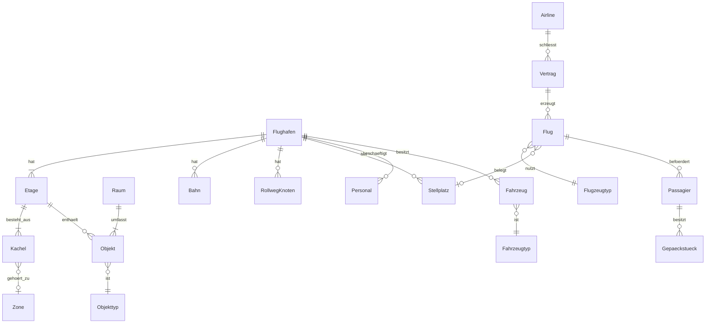

# Architecture

<!-- Systemarchitektur von OpenAirside. Lebendes Dokument, Stand Initialisierung (Modus 2) 2026-10-13.
     Klasse G: ein Hauptdokument; Auslagerung in architecture-<modul>.md, sobald > 500 Zeilen
     oder > 5 Module eigene detaillierte Schnittstellen haben (ADR-001).
     Änderungen an [BELASTBAR]-Bestandteilen sind freigabepflichtig (CLAUDE.md Abschnitt 4). -->

<!-- ANCHOR:reifegrad-system -->
## 0. Reifegrad-System

Jedes Modul, jede Schnittstelle und jede Architektur-Aussage trägt einen der folgenden Marker:

- `[BELASTBAR]` – Entscheidung getroffen, durch Umsetzung validiert oder durch ADR fixiert. Änderung ist freigabepflichtig und erzeugt einen ADR.
- `[VORLÄUFIG]` – Entwurfshypothese, plausibel aber nicht durch Umsetzung validiert. Darf in der Implementierung verfeinert werden, jede Verfeinerung wird hier mit Datum vermerkt. Wird nach Validierung auf `[BELASTBAR]` befördert.
- `[OFFEN]` – bewusst nicht entschieden. Kein Code in Bereichen, die davon abhängen, bevor die Lücke geschlossen ist.

**Beförderungsregel:** von `[VORLÄUFIG]` auf `[BELASTBAR]` durch funktionierende Implementierung oder ADR, jeweils mit Datum und Begründung am Eintrag.

**Rückstufungsregel:** `[BELASTBAR]` nur per ADR zurückstufbar. Stille Rückstufung ist verboten.

**Besonderheit der Initialisierung:** Der Stack (ADR-002) ist unter der Bedingung des Leistungsnachweises in Phase 1 entschieden. Deshalb sind alle stack-abhängigen Bestandteile bis zum Abschluss von Phase 1 `[VORLÄUFIG]`, auch wenn sie per ADR festgelegt sind.

<!-- ANCHOR:ueberblick -->
## 1. Überblick

OpenAirside ist ein lokal laufendes Desktop-Spiel. Es ist aufgebaut wie eine Web-Anwendung mit Backend und Frontend auf demselben Rechner: Ein Simulationskern in Rust enthält die gesamte Spiellogik und läuft in festen Simulationsschritten auf mehreren Kernen. Eine Präsentation in TypeScript (Electron, React, PixiJS) zeigt den Zustand an und nimmt Befehle des Spielers entgegen. Prägende Kernentscheidung ist die strikte Trennung: Der Kern kennt keine Darstellung, und Spiellogik liegt nie in der Präsentation. Das sichert Testbarkeit ohne Grafik, Leistung und Austauschbarkeit der Darstellung (etwa für eine spätere isometrische Ansicht oder einen Wechsel der Präsentationstechnik, siehe ADR-002).

**Architektur-Pattern:** Simulationskern mit austauschbarer Präsentationsschicht (Kern/Hülle-Trennung, datengetriebene Inhalte) `[VORLÄUFIG]` – siehe ADR-003. Validierung durch Phase 1.

**Kommunikations-Grundmodus:** Präsentation → Kern: Befehlsnachrichten. Kern → Präsentation: Zustandspuffer im Kern-Prozess, je Bild als Kopie per `MessagePort` an den Renderer übertragen (ADR-009), plus Ereignisstrom. Präsentation ↔ Plattform: typisierte Electron-Preload-Schnittstelle. `[VORLÄUFIG]`

**Plattformen:** Windows, Linux, macOS (Universal) `[BELASTBAR]` – harte Randbedingung aus der Vision.

**Auslieferungseinheit:** eine Desktop-Anwendung je Plattform, keine Server, keine Online-Dienste `[BELASTBAR]` – harte Randbedingung aus der Vision.

<!-- ANCHOR:modul-karte -->
## 2. Modul-Karte

Durchgezogene Linie = `[VORLÄUFIG]` festgelegt, gestrichelt = `[OFFEN]`. Nur diese Beziehungen sind erlaubt.

```mermaid
graph TB
  subgraph Electron-Hauptprozess
    PLAT[Plattform<br/>Fenster, Dateien, Spielstände, Logs, Start des Kern-Prozesses]
  end
  subgraph Präsentation – TypeScript, Renderer
    UI[Oberfläche<br/>React, Panels, Werkzeuge]
    FELD[Spielfeld<br/>PixiJS, Kamera, Overlays]
    AUD[Audio]
    LOC[Lokalisierung]
  end
  subgraph Brücke
    BEF[Befehlskanal]
    ZUS[Zustandspuffer]
    EVT[Ereignisstrom]
  end
  subgraph Simulationskern – Rust, napi-rs im Electron-Utility-Prozess
    TAKT[Takt & Weltzustand]
    WELT[Welt & Bau]
    WEG[Wegfindung & Passagierführung]
    VERK[Verkehr & Verkehrssteuerung]
    FLUG[Flugbetrieb]
    ABF[Abfertigung & Gepäck]
    PERS[Personen]
    WIRT[Wirtschaft & Management]
    EREIG[Ereignisse]
    BENCH[Benchmark & Leistung]
  end
  INH[Inhalte & Mods<br/>Datenpakete]

  UI -->|Befehle| BEF
  FELD -->|Befehle| BEF
  BEF --> TAKT
  TAKT --> ZUS
  TAKT --> EVT
  ZUS --> FELD
  ZUS --> UI
  EVT --> UI
  EVT --> AUD
  LOC --> UI
  UI -->|Preload-API| PLAT
  PLAT -->|Spielstand laden/speichern| TAKT
  INH --> TAKT
  TAKT --- WELT & WEG & VERK & FLUG & ABF & PERS & WIRT & EREIG & BENCH
  INH -.->|Code-Mods OFFEN| UI
```

Die Kern-Module untereinander kommunizieren ausschließlich über den gemeinsamen Weltzustand und interne Ereignisse des Takts, nicht durch direkten Zugriff auf interne Strukturen anderer Module. Die genaue Ausgestaltung (z. B. ECS-artige Datenhaltung) ist `[OFFEN]` bis Phase 1, Schritt 1.2.

<!-- ANCHOR:module -->
## 3. Module (detailliert)

### Modul: Takt & Weltzustand [VORLÄUFIG]

- **Reifegrad:** `[VORLÄUFIG]`, seit 2026-10-13, Begründung: Grundstruktur aus ADR-003, Leistungsfähigkeit unbelegt
- **Verantwortung:** Führt die Simulation in festen Simulationsschritten aus, unabhängig von der Bildrate; nimmt Befehle aus dem Befehlskanal entgegen, verteilt Arbeit auf die Kern-Module und auf mehrere Threads, schreibt den sichtbaren Zustand in den Zustandspuffer.
- **Nicht-Verantwortung:** keine Darstellung, keine Dateizugriffe, keine Spielregeln einzelner Fachbereiche.
- **Öffentliche Schnittstellen:** S-1, S-2, S-3, S-5
- **Interne Struktur:** Je Objektart getrennte Felder „heiß" (je Tick gebraucht) und „kalt" (nur bei Ereignissen) in eigenem Rust-Code, kein ECS-Paket; Tick in zwei Phasen (Bewegung liest Zustand des Vortick, danach vertauschbare Zählungen), parallel mit rayon; bitgleich über Threadzahlen (ADR-010, `[VORLÄUFIG]`).
- **Abhängigkeiten (andere Module):** ruft alle Kern-Module je Simulationsschritt auf
- **Abhängigkeiten (extern):** `rayon` (vorgesehen), `serde`
- **Technologie:** Rust
- **NFRs:** Rechenzeit pro Simulationsschritt muss bei höchster Spielgeschwindigkeit im Referenzszenario in das Zeitbudget passen (Abschnitt 6)
- **Betriebsart:** natives Node-Modul (napi-rs) in einem Electron-Utility-Prozess, Simulation auf eigenen Rust-Threads (ADR-009, `[VORLÄUFIG]`); Kern-Crates ohne Anbindungscode (Regel-006).
- **Determinismus:** bitgleich, solange neue Wegweiser zu festem Tick übernommen werden (Prüfmodus für Tests); im normalen Spiel werden sie übernommen, sobald fertig, Spiellogik darf davon nicht abhängen (ADR-010).

### Modul: Welt & Bau [VORLÄUFIG]

- **Reifegrad:** `[VORLÄUFIG]`, seit 2026-10-13
- **Verantwortung:** Rechtwinkliges Raster mit fünf Etagen, Fundamente, Wände, Objekte, Zonen, Räume, Terminalbereiche; Bauplanung, Bauaufträge, simulierter Bau durch Bauarbeiter, Abriss und Versetzen; meldet Änderungen an Wegfindung und Verkehr.
- **Nicht-Verantwortung:** keine Wegberechnung, keine Darstellung der Bauvorschau (das macht das Spielfeld anhand des Zustands).
- **Öffentliche Schnittstellen:** Bau-Befehle über S-2
- **Interne Struktur:** Kachelraster je Etage; Änderungen werden als Änderungsbereiche an abhängige Module gemeldet, damit nur betroffene Teile neu berechnet werden.
- **Abhängigkeiten:** Inhalte (Objektdefinitionen), Wirtschaft (Kosten)
- **NFRs:** Bauaktion im nächsten Bild sichtbar; Neuberechnungen inkrementell und im Hintergrund
- **Offene Fragen:** Granularität der Änderungsbereiche – Schritt 1.2

### Modul: Wegfindung & Passagierführung [VORLÄUFIG]

- **Reifegrad:** `[VORLÄUFIG]`, seit 2026-10-13, Begründung: Wegweiser-Prinzip per ADR-004 gewählt, Leistung unbelegt
- **Verantwortung:** Berechnet je Ziel Wegweiser für die ganze Karte (alle Etagen, unter Beachtung von Zonen und Kontrollen); bewertet Kacheln anhand von Bodenmarkierungen und Beschilderung; liefert Grundorientierung ohne Beschilderung (längere Wege, Suchverhalten); erkennt Unerreichbarkeit und deren Ursache für die Erklärung an den Spieler.
- **Nicht-Verantwortung:** kein Fahrzeug- und Rollverkehr (eigenes Modul); keine Entscheidung, welches Ziel eine Person wählt (Modul Personen).
- **Interne Struktur:** Ein Wegweiser je Ziel bzw. Zielgruppe, 1 Byte je Zelle, Dijkstra rückwärts vom Ziel mit Zonenregeln (Land → Kontrolle → Luft, Luft → Ausgang → Land) und Kostenfaktoren aus Bodenmarkierungen; Neuberechnung nach Bauänderungen vollständig im Hintergrund auf allen Kernen, Übernahme sobald fertig (ADR-010); Unerreichbarkeit mit Ursache (Zonenregel oder eingeschlossen). Feinwege für die letzten Meter zu Einzelzielen (z. B. Sitzplatz) offen.
- **Gemessen (Spike 1.2, 4 vCPU):** 512 × 512 × 2 Zellen, 29 Ziele: 14,5 MB, Neuberechnung 0,2–0,4 s; Aufwand linear in Zellen × Ziele.
- **Abhängigkeiten:** Welt & Bau (Raster, Zonen), Personen (Nachfrage nach Zielen)
- **NFRs:** Aufwand abhängig von der Zahl der Ziele, nicht der Personen; 10.000 Personen im Referenzszenario
- **Offene Fragen:** Rastergröße des Referenzszenarios mit Reserve und fünf Etagen – Schritt 1.5; Modell für „Suchen ohne Schilder" und Feinwege – Erkundung vor Schritt 3.3

### Modul: Verkehr & Verkehrssteuerung [VORLÄUFIG]

- **Reifegrad:** `[VORLÄUFIG]`, seit 2026-10-13
- **Verantwortung:** Straßenverkehr (Fahrspuren je Richtung, Vorfahrt automatisch oder je Kreuzung manuell, kein Einfahren in blockierte Kreuzungen), Rollverkehr auf vom Spieler gezogenen Rollweg-Knoten, Vorrang-Rangfolge (ADR-005), automatische Verkehrssteuerung in der Rolle von Tower und Rollkontrolle (Rollrouten, Abflugreihenfolge, Startfreigabe am Gate, „Aufrollen und Warten", Eingriff bei drohender Blockade).
- **Nicht-Verantwortung:** keine Fußgänger (Wegfindung); keine Abfertigungslogik am Stellplatz (Abfertigung).
- **Interne Struktur:** Graphen für Straßen und Rollwege; Reservierung von Abschnitten; Konfliktlösung nach Rangfolge.
- **Abhängigkeiten:** Welt & Bau, Flugbetrieb, Abfertigung, Ereignisse (Einsatzfahrzeuge)
- **NFRs:** kein Stillstand, der sich nicht selbst auflöst; Wartegründe sind abfragbar
- **Offene Fragen:** Verfahren zur Blockadevermeidung – Erkundung vor Umsetzung des Verkehrs

### Modul: Flugbetrieb [VORLÄUFIG]

- **Reifegrad:** `[VORLÄUFIG]`, seit 2026-10-13
- **Verantwortung:** Airlines, Verträge, Flugangebote, Flugplanung (manuell und automatisch), Bahnen und Bahnbetrieb, Tower- und Radarlimits, Flugstatus, GA-Verkehr, Hubschrauber (DLC-Umfang), später Cargo.
- **Nicht-Verantwortung:** keine Bewegung der Flugzeuge am Boden (Verkehr); keine Services am Stellplatz (Abfertigung).
- **Abhängigkeiten:** Inhalte (Flugzeugtypen, Airlines), Verkehr, Abfertigung, Wirtschaft
- **Offene Fragen:** Datenmodell erweiterbar für Cargo (ADR-006) – Erkundung vor Umsetzung

### Modul: Abfertigung & Gepäck [VORLÄUFIG]

- **Reifegrad:** `[VORLÄUFIG]`, seit 2026-10-13
- **Verantwortung:** Check-in (inkl. Online-Check-in-Anteil, Self Bag Drop), Sicherheits- und Grenzkontrolle mit Technikstufen, Boarding, Turnaround-Services, Gepäckanlage mit dreistufiger Gepäckkontrolle, Versorgungsketten (Treibstoff, Catering, Enteisung, Reinigung).
- **Nicht-Verantwortung:** keine Fahrzeugbewegung (Verkehr), keine Personalverwaltung (Personen).
- **Abhängigkeiten:** Welt & Bau, Personen, Verkehr, Flugbetrieb, Wirtschaft
- **Offene Fragen:** Simulationsmodell der Gepäckbänder (Einzelstücke vs. Ströme) bei großen Mengen – Erkundung vor Umsetzung

### Modul: Personen [VORLÄUFIG]

- **Reifegrad:** `[VORLÄUFIG]`, seit 2026-10-13
- **Verantwortung:** Passagiere (Bedürfnisse, Zielwahl, Verhalten, Zufriedenheit), Personal (Typen, Können, Schichten, Pausen, Zufriedenheit, Gewerkschaft), Aufgabenverteilung.
- **Nicht-Verantwortung:** keine Wegberechnung (Wegfindung).
- **Abhängigkeiten:** Wegfindung, Welt & Bau, Abfertigung, Wirtschaft
- **NFRs:** Personen als kompakte Daten; keine sich ansammelnden Prozesse über die Spielzeit (Lehre aus dem Original)

### Modul: Wirtschaft & Management [VORLÄUFIG]

- **Reifegrad:** `[VORLÄUFIG]`, seit 2026-10-13
- **Verantwortung:** Einnahmen, Ausgaben, Gebühren, Kredite, Budget, Führungskräfte, Forschung und Programme, Bewertungen und Serviceziele, Auszeichnungen, Beschaffung.
- **Abhängigkeiten:** alle Fachmodule liefern Kennzahlen; Inhalte (Forschungsbaum, Preise)

### Modul: Ereignisse [VORLÄUFIG]

- **Reifegrad:** `[VORLÄUFIG]`, seit 2026-10-13
- **Verantwortung:** Notfälle, Wetter und Klima, Tiere, Störungen (Drohne, IT-Ausfall, Stromausfall), passive Ereignisse, Bewertung von Notfällen.
- **Abhängigkeiten:** Flugbetrieb, Verkehr, Abfertigung, Wirtschaft

### Modul: Benchmark & Leistung [VORLÄUFIG]

- **Reifegrad:** `[VORLÄUFIG]`, seit 2026-10-13
- **Verantwortung:** Integrierter Benchmark (wachsender Flughafen im Zeitraffer, Empfehlung zur Kartengröße), laufende Leistungsüberwachung und Warnungen, Leistungstest in der CI.
- **Abhängigkeiten:** Takt, Spielfeld (Bildrate), Inhalte (Benchmark-Szenario)
- **Offene Fragen:** Messgrößen und Schwellen der Empfehlung – nach Phase 1

### Modul: Brücke [VORLÄUFIG]

- **Reifegrad:** `[VORLÄUFIG]`, seit 2026-10-13, Begründung: Prinzip festgelegt, Umsetzung hängt an der Betriebsart
- **Verantwortung:** Überträgt Befehle von der Präsentation in den Kern und den sichtbaren Zustand vom Kern in die Präsentation, ohne JSON-Serialisierung großer Datenmengen je Bild.
- **Nicht-Verantwortung:** keine Spiellogik, keine Darstellung.
- **Öffentliche Schnittstellen:** S-1, S-2, S-3
- **Technologie:** Rust (eigene Brücken-Crate mit napi-rs, Regel-006) und TypeScript; TypeScript-Typen werden aus Rust-Typen erzeugt
- **Übertragungsweg:** `MessagePort` zwischen Kern-Prozess und Renderer, Bild je Frame als Kopie (ADR-009)
- **Offene Fragen:** nur sichtbare oder geänderte Daten übertragen bei großen Datenmengen – Schritt 1.3

### Modul: Spielfeld [VORLÄUFIG]

- **Reifegrad:** `[VORLÄUFIG]`, seit 2026-10-13
- **Verantwortung:** Draufsicht-Darstellung mit PixiJS über WebGL2: Raster, Gebäude, Personen, Fahrzeuge, Flugzeuge, Etagenwechsel, Overlays (Zonen, Wege, Wartegründe, Heatmaps), Bauvorschau, Kamera mit Zoom und Verschieben, Detailstufen.
- **Nicht-Verantwortung:** keine Spielregeln; wertet nur den Zustand aus und schickt Befehle.
- **Abhängigkeiten:** Zustandspuffer, Grafik-Atlanten aus der SVG-Pipeline
- **NFRs:** 60 Bilder pro Sekunde im Referenzszenario auf der Zielhardware

### Modul: Oberfläche [VORLÄUFIG]

- **Reifegrad:** `[VORLÄUFIG]`, seit 2026-10-13
- **Verantwortung:** Alle Panels und Werkzeuge (Bau, Flugplaner, Flugmonitor, Personal, Verträge, Forschung, Budget, Bewertungen, Benachrichtigungen, Einstellungen, Hauptmenü, Tutorial).
- **Nicht-Verantwortung:** keine Spiellogik.
- **Technologie:** React, Tailwind CSS, TanStack Table (virtualisierte Tabellen)
- **NFRs:** Aktualisierung höchstens wenige Male pro Sekunde; darf die Bildrate des Spielfelds nicht drücken

### Modul: Audio [VORLÄUFIG]

- **Reifegrad:** `[VORLÄUFIG]`, seit 2026-10-13
- **Verantwortung:** Atmosphäre, Effekte, Musik, Durchsagen passend zu Flügen im Spiel (Bausteine oder Sprachausgabe).
- **Offene Fragen:** Verfahren für Durchsagen – Erkundung vor Umsetzung

### Modul: Plattform [VORLÄUFIG]

- **Reifegrad:** `[VORLÄUFIG]`, seit 2026-10-13
- **Verantwortung:** Electron-Hauptprozess: Fenster, Dateisystem (Spielstände, Mods, Logs, Einstellungen), Start und Überwachung des Kern-Prozesses (Electron-Utility-Prozess, ADR-009) einschließlich Neustart nach Absturz, Vermittlung des `MessagePort` zwischen Kern-Prozess und Renderer, typisierte Preload-Schnittstelle.
- **Offene Fragen:** ob der Kern-Prozess Spielstände selbst schreibt oder über die Plattform – mit S-5 in Phase 2
- **Nicht-Verantwortung:** keine Spiellogik, keine Oberfläche.
- **NFRs:** Electron-Härtung laut `project-context.md` Abschnitt 6

### Modul: Inhalte & Mods [VORLÄUFIG]

- **Reifegrad:** `[VORLÄUFIG]`, seit 2026-10-13; Code-Mods `[OFFEN]`
- **Verantwortung:** Laden und Validieren von Datenpaketen (Flugzeugtypen, Airlines, Lackierungen, Objekte, Fahrzeuge, Forschungsbaum, Sprachpakete); Mod-Verwaltung; Grafik-Pipeline (SVG → Atlanten in mehreren Auflösungen im Build).
- **Abhängigkeiten (extern):** Schema-Validierung (Werkzeug beim Setup wählen)
- **Offene Fragen:** Code-Mods (z. B. JavaScript-Plugins mit Sandbox) – eigene Erkundung

### Modul: Lokalisierung [VORLÄUFIG]

- **Reifegrad:** `[VORLÄUFIG]`, seit 2026-10-13
- **Verantwortung:** Deutsch und Englisch zum Start, weitere Sprachen als Sprachpakete; Texte der Simulation werden als Schlüssel übergeben, die Präsentation übersetzt.

<!-- ANCHOR:schnittstellenvertraege -->
## 4. Schnittstellenverträge

### Schnittstelle: S-1 Zustandspuffer (Kern → Präsentation) [VORLÄUFIG]

- **Reifegrad:** `[VORLÄUFIG]`, seit 2026-10-13
- **Typ:** Puffer im Kern-Prozess, je Bild als Kopie per `MessagePort` an den Renderer übertragen (ADR-009); im Spike 160 KB bei 10.000 Personen, 1,1 ms Übertragung im Mittel
- **Anbieter:** Takt & Weltzustand
- **Konsument:** Spielfeld, Oberfläche
- **Spezifikation:**
  - **Inhalt:** sichtbarer Zustand in kompakter Binärform (z. B. Positionen, Typ, Status, Ausrichtung je Person, Fahrzeug, Flugzeug), plus Zähler für Simulationszeit und Simulationsschritt
  - **Konsistenz:** Doppel- oder Dreifachpuffer im Kern-Prozess, damit nie ein halb geschriebener Zustand übertragen wird
  - **Ausgabe (Fehler):** nicht anwendbar; bei Rückstand meldet der Kern über S-3
  - **Idempotenz:** Lesen ist seiteneffektfrei
- **Versionierung:** Layout wird aus Rust-Typen erzeugt, eine Layout-Version im Kopf des Puffers
- **Offene Fragen:** Umfang je Bild (vollständig, nur Sichtbares oder nur Änderungen) – Schritt 1.3

### Schnittstelle: S-2 Befehlskanal (Präsentation → Kern) [VORLÄUFIG]

- **Reifegrad:** `[VORLÄUFIG]`, seit 2026-10-13
- **Typ:** Nachrichten (typisierte Befehle)
- **Anbieter:** Takt & Weltzustand
- **Konsument:** Oberfläche, Spielfeld
- **Spezifikation:**
  - **Eingabe:** Befehle wie Bauen, Abreißen, Flug planen, Einstellung ändern, Spielgeschwindigkeit, Pause; jeder Befehl mit Typ und Nutzdaten
  - **Ausgabe (Erfolg):** Bestätigung über S-3 bzw. sichtbare Änderung über S-1
  - **Ausgabe (Fehler):** Ablehnung mit Grund (z. B. „kein Geld", „Zone unzulässig") über S-3
  - **Idempotenz:** Befehle tragen eine Kennung; doppelte Zustellung wird verworfen
  - **Reihenfolge:** Befehle werden in Eingangsreihenfolge zu Beginn eines Simulationsschritts verarbeitet
- **Versionierung:** Typen aus Rust erzeugt

### Schnittstelle: S-3 Ereignisstrom (Kern → Präsentation) [VORLÄUFIG]

- **Reifegrad:** `[VORLÄUFIG]`, seit 2026-10-13
- **Typ:** Ereignisse (Benachrichtigungen, Bestätigungen, Ablehnungen, Warnungen, Leistungshinweise)
- **Anbieter:** Takt & Weltzustand
- **Konsument:** Oberfläche, Audio
- **Spezifikation:** Ereignis mit Typ, Zeitpunkt, Bezug (Objekt, Flug, Person) und Textschlüssel für die Lokalisierung

### Schnittstelle: S-4 Datenpaket-Schema (Inhalte → Kern) [OFFEN]

- **Reifegrad:** `[OFFEN]`, seit 2026-10-13
- **Typ:** Dateiformat (JSON mit Schema)
- **Anbieter:** Inhalte & Mods
- **Konsument:** Takt & Weltzustand
- **Offene Fragen:** Schema für Flugzeugtypen, Airlines, Objekte, Forschungsbaum; Versionierung der Pakete; Konfliktregeln zwischen Mods – Phase 2

### Schnittstelle: S-5 Spielstand-Format [OFFEN]

- **Reifegrad:** `[OFFEN]`, seit 2026-10-13
- **Typ:** Dateiformat
- **Anbieter:** Takt & Weltzustand (Serialisierung), Plattform (Datei)
- **Offene Fragen:** Format (binär oder Text), Versionierung und Migration älterer Spielstände – Phase 2

### Schnittstelle: S-6 Plattform-API (Präsentation ↔ Plattform) [VORLÄUFIG]

- **Reifegrad:** `[VORLÄUFIG]`, seit 2026-10-13
- **Typ:** Electron-Preload mit typisierten Funktionen (IPC)
- **Anbieter:** Plattform
- **Konsument:** Oberfläche
- **Spezifikation:** nur benannte Funktionen (Spielstand speichern/laden/auflisten, Mods auflisten, Einstellungen, Logs), keine generischen Dateizugriffe
- **Sicherheit:** Electron-Härtung laut `project-context.md`

<!-- ANCHOR:datenfluss -->
## 5. Datenfluss

### Flow: Simulationsschritt und Darstellung [VORLÄUFIG]

1. Die Präsentation schickt Befehle des Spielers über S-2.
2. Zu Beginn eines Simulationsschritts verarbeitet der Takt alle eingegangenen Befehle.
3. Die Kern-Module schreiben ihren Teil des Weltzustands fort, parallel wo möglich.
4. Der Takt schreibt den sichtbaren Zustand in den freien Puffer von S-1 und gibt ihn frei; Ereignisse gehen über S-3.
5. Die Präsentation liest je Bild den jüngsten freigegebenen Puffer und zeichnet; die Oberfläche aktualisiert Panels gedrosselt.

**Fehlerpfade:** Schafft der Kern das Zeitbudget nicht, sinkt das tatsächliche Simulationstempo, und der Kern meldet den Rückstand über S-3 (Leistungswarnung). Die Darstellung bleibt flüssig, weil sie nicht auf den Kern wartet.

### Flow: Bauaktion [VORLÄUFIG]

1. Der Spieler platziert ein Objekt; das Spielfeld schickt einen Bau-Befehl.
2. Welt & Bau prüft Zulässigkeit und Kosten und legt den Bauauftrag an; sichtbar im nächsten Bild.
3. Welt & Bau meldet den Änderungsbereich an Wegfindung und Verkehr.
4. Wegfindung und Verkehr aktualisieren betroffene Wegweiser und Graphen im Hintergrund.

**Fehlerpfade:** Unzulässiger Bau wird mit Grund abgelehnt (S-3). Neu unerreichbare Ziele werden mit Ursache gemeldet.

### Flow: Erster Start mit Benchmark [VORLÄUFIG]

1. Die Plattform erkennt den ersten Start.
2. Der Kern lädt das Benchmark-Szenario und lässt den Flughafen im Zeitraffer wachsen; Benchmark & Leistung misst Simulationszeit, Spielfeld die Bildrate.
3. Die Oberfläche zeigt das Ergebnis mit unverbindlicher Empfehlung zur Kartengröße.

**Fehlerpfade:** Abbruch durch den Spieler ist jederzeit möglich; der Benchmark kann später aus den Einstellungen wiederholt werden.

<!-- ANCHOR:nicht-funktionale-anforderungen -->
## 6. Nicht-funktionale Anforderungen

### Performance

- **Gesamtsystem:** 60 Bilder pro Sekunde im Referenzszenario auf der Zielhardware; Simulation ohne Rückstand bei höchster Spielgeschwindigkeit; mindestens 10.000 Personen `[VORLÄUFIG]` – Nachweis in Phase 1, Schritt 1.5
- **Bauen:** Bauaktion im nächsten Bild sichtbar `[VORLÄUFIG]`
- **Langzeit:** konstante Rechenzeit und Speicher pro Simulationsschritt über lange Spielzeit `[VORLÄUFIG]`
- **Oberfläche:** gedrosselte Aktualisierung, virtualisierte Listen `[VORLÄUFIG]`

### Skalierung

- **Horizontal skalierbare Module:** nicht anwendbar (lokales Einzelspieler-Spiel) `[BELASTBAR]`
- **Vertikal (Mehrkern):** Kern-Module parallelisieren über alle verfügbaren Kerne; Ziel 8 Kerne der Referenzhardware `[VORLÄUFIG]`

### Security

- **Bedrohungsmodell:** manipulierte Spielstände und Mod-Dateien; schädliche Mods (bei späteren Code-Mods); nicht betrachtet: Mehrspieler-Betrug (kein Mehrspieler) `[VORLÄUFIG]`
- **Schutzmaßnahmen:** Schema-Validierung beim Laden; Mods nur als Daten; Electron-Härtung; keine entfernten Inhalte; Lizenz- und Schwachstellenprüfung der Abhängigkeiten in der CI
- **Sensitive Datenflüsse:** keine

### Observability

- **Logging:** lokale Logdatei, Level `INFO` in Releases, `DEBUG` in Entwicklungs-Builds
- **Metriken:** Bildrate, Rechenzeit pro Simulationsschritt, Rückstand, Speicher; sichtbar in einer Leistungsanzeige
- **Tracing:** nicht vorgesehen

### Datenschutz

Keine personenbezogenen Daten, keine Telemetrie. Abschnitt entfällt im Übrigen.

<!-- ANCHOR:datenmodell -->
## 7. Datenmodell

Grobübersicht der wichtigsten Entitäten. Alle Entitäten `[VORLÄUFIG]`; interne Datenhaltung im Kern: je Objektart getrennte Felder heiß/kalt, kein ECS-Paket (ADR-010, `[VORLÄUFIG]`).



Flugzeugtyp, Objekttyp, Fahrzeugtyp und Airline stammen aus Datenpaketen (S-4). Das Modell muss Fracht als spätere Erweiterung aufnehmen können (ADR-006).

<!-- ANCHOR:verworfene-alternativen -->
## 8. Verworfene Alternativen

- **Godot 4 + C# als Stack:** gute Alternative mit echter Spiele-Engine, aber schwächer bei oberflächenlastigen Spielen und KI-Unterstützung als die gewählte Web-Präsentation; bleibt Rückfalloption für die Darstellung mit Rust-Kern (über godot-rust) – siehe ADR-002
- **Bevy (Rust, ECS):** häufige Umbauten, kein Tabellen-Element, Mod-Skripte nur experimentell, ein Kolonie-Spiel-Team wechselte 2025 aus genau diesen Gründen weg – siehe ADR-002
- **Eigenbau mit .NET + MonoGame/FNA:** Oberfläche, Werkzeuge und Mod-Lader komplett selbst zu bauen – siehe ADR-002
- **Unity:** proprietärer Editor mit Konto für Mitwirkende – siehe ADR-002
- **Tauri statt Electron:** unzuverlässiges WebGL unter Linux (WebKitGTK), drei verschiedene Browser-Kerne zu testen – siehe ADR-002
- **Stride, Fyrox:** Windows-zentrierter Editor bzw. sehr junge 1.0 mit einem Hauptentwickler – siehe ADR-002
- **Wegsuche pro Person (A*) als Hauptverfahren:** skaliert mit der Zahl der Personen, Ursache der Leistungsprobleme des Originals – siehe ADR-004
- **Spiellogik in TypeScript:** würde die Trennung aufweichen und Leistung kosten – siehe ADR-003
- **Inkrementelle Reparatur der Wegweiser:** gleiche Wege, aber bei Türen langsamer und fünffacher Speicher – siehe ADR-010
- **Fester Übernahme-Tick für Wegweiser im normalen Spiel:** Stocken nach Umbauten, widerspricht „Bauen ohne Wartezeit"; nur als Prüfmodus für Tests – siehe ADR-010
- **Hierarchische Wegweiser in Sektoren:** für die gewählte Kartengröße (Referenzszenario mit Reserve) nicht nötig – siehe ADR-010
- **ECS-Paket für den Weltzustand:** neue Abhängigkeit ohne gemessenen Vorteil – siehe ADR-010
- **Kern als WebAssembly mit einem Thread:** nur ein Prozessorkern, bei schwerer Last 3,9 × langsamer als nativ mit 4 Threads – siehe ADR-009
- **Kern als WebAssembly mit mehreren Threads:** derzeit nur mit Nightly-Rust baubar, 1,37–1,50 × langsamer als nativ; nicht endgültig verworfen, sondern zurückgestellt: Neubewertung in Fahrplan-Schritt Q.2 – siehe ADR-009

<!-- ANCHOR:reifegrad-uebersicht -->
## 9. Reifegrad-Übersicht (Stand vom 2026-10-13, nach ADR-010)

| Bestandteil | Reifegrad | Seit | Validiert durch / wartet auf |
|---|---|---|---|
| Plattformen Windows, Linux, macOS | BELASTBAR | 2026-10-13 | harte Randbedingung (Vision) |
| Lokale Desktop-Anwendung ohne Server | BELASTBAR | 2026-10-13 | harte Randbedingung (Vision) |
| Pattern Kern/Präsentation (ADR-003) | VORLÄUFIG | 2026-10-13 | Phase 1, Schritte 1.2–1.5 |
| Stack Electron/TypeScript/PixiJS/React + Rust (ADR-002) | VORLÄUFIG | 2026-10-13 | Phase 1, Schritt 1.5 (Leistungsnachweis) |
| Betriebsart des Rust-Kerns (napi-rs, Utility-Prozess) | VORLÄUFIG | 2026-10-13 | ADR-009; Bestätigung durch Leistungsnachweis Schritt 1.5 |
| Datenmodell und Parallelisierung im Kern | VORLÄUFIG | 2026-10-13 | ADR-010; Bestätigung im Leistungsnachweis 1.5 |
| Wegfindung per Wegweiser-Prinzip (ADR-004, ADR-010) | VORLÄUFIG | 2026-10-13 | Spike 1.2 bestanden für 512² × 2; fünf Etagen und Rastergröße in Schritt 1.5 |
| S-1 Zustandspuffer | VORLÄUFIG | 2026-10-13 | Spike 1.3: Dreifachpuffer und Übergabe gemessen (0,5–2,6 ms je Bild); wartet auf Bildrate auf echter Grafik (Testprogramm 1.3) |
| S-2 Befehlskanal, S-3 Ereignisstrom | VORLÄUFIG | 2026-10-13 | Phase 2 |
| S-4 Datenpaket-Schema | OFFEN | 2026-10-13 | Phase 2 |
| S-5 Spielstand-Format | OFFEN | 2026-10-13 | Phase 2 |
| S-6 Plattform-API | VORLÄUFIG | 2026-10-13 | Phase 2 |
| Oberfläche mit großen Tabellen | VORLÄUFIG | 2026-10-13 | Phase 1, Schritt 1.4 |
| Verpackung für drei Plattformen | VORLÄUFIG | 2026-10-13 | Phase 1, Schritt 1.6 |
| Verkehr, Blockadevermeidung | VORLÄUFIG | 2026-10-13 | Erkundung vor Umsetzung des Verkehrs |
| Code-Mods | OFFEN | 2026-10-13 | eigene Erkundung |
| NFR Performance | VORLÄUFIG | 2026-10-13 | Phase 1, Schritt 1.5 |

<!-- ANCHOR:tooling-inventar -->
## 10. Tooling-Inventar

Reifegrad-Skala `[ROH]` → `[GEHÄRTET]` → `[KRITISCH]` und Beförderungsregeln nach `CLAUDE.md` Abschnitt 15 („Pflichtkategorien für Hilfsskripts", Pflichten A–H). Hilfsskripte sind Node-Skripte (`scripts/*.mjs`), damit sie auf allen drei Plattformen ohne Zusatzwerkzeuge laufen (`project-context.md` Abschnitt 3).

| Skript | Zweck | Reifegrad | Plattform-Matrix | Voraussetzungen | Idempotenz |
|---|---|---|---|---|---|
| – | noch keine Skripte; erste entstehen in Schritt 2.1 (Grundgerüst) und 2.6 (Grafik-Pipeline) | – | – | – | – |
