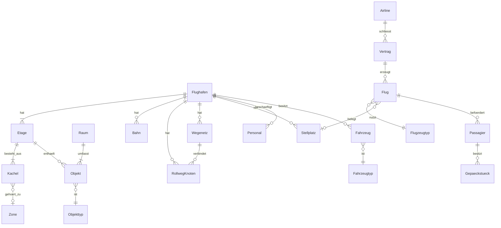

# Architecture

<!-- Systemarchitektur von OpenAirside. Lebendes Dokument, Stand Initialisierung (Modus 2) 2026-10-13.
     Klasse G: ein Hauptdokument; Auslagerung in architecture-<modul>.md, sobald > 500 Zeilen
     oder > 5 Module eigene detaillierte Schnittstellen haben (ADR-001).
     Änderungen an [BELASTBAR]-Bestandteilen sind freigabepflichtig (CLAUDE.md Abschnitt 4). -->

<!-- ANCHOR:reifegrad-system -->
## 0. Reifegrad-System

Jedes Modul, jede Schnittstelle und jede Architektur-Aussage trägt einen der folgenden Marker:

- `[BELASTBAR]` – Entscheidung getroffen, durch Umsetzung validiert oder durch ADR fixiert. Änderung ist freigabepflichtig und erzeugt einen ADR.
- `[VORLÄUFIG]` – Entwurfshypothese, plausibel aber nicht durch Umsetzung validiert. Darf in der Implementierung verfeinert werden, jede Verfeinerung wird hier mit Datum vermerkt. Wird nach Validierung auf `[BELASTBAR]` befördert.
- `[OFFEN]` – bewusst nicht entschieden. Kein Code in Bereichen, die davon abhängen, bevor die Lücke geschlossen ist.

**Beförderungsregel:** von `[VORLÄUFIG]` auf `[BELASTBAR]` durch funktionierende Implementierung oder ADR, jeweils mit Datum und Begründung am Eintrag.

**Rückstufungsregel:** `[BELASTBAR]` nur per ADR zurückstufbar. Stille Rückstufung ist verboten.

**Besonderheit der Initialisierung:** Der Stack (ADR-002) war unter der Bedingung des Leistungsnachweises in Phase 1 entschieden. Der Nachweis ist mit Auflagen erbracht (ADR-014, 2026-10-13); Stack, Pattern, Betriebsart, Datenmodell und Wegweiser-Prinzip sind seitdem `[BELASTBAR]`. Module und Schnittstellen bleiben `[VORLÄUFIG]`, bis ihre eigene Umsetzung sie belegt.

**Reifegrad vor Umsetzungsschritten (Regel-007, ADR-016):** Grundsatzentscheidungen und jede Schnittstelle, die ein Umsetzungsschritt nutzt oder umsetzt, müssen vorher `[BELASTBAR]` sein; Module dürfen `[VORLÄUFIG]` in ihre erste Umsetzung gehen.

<!-- ANCHOR:ueberblick -->
## 1. Überblick

OpenAirside ist ein lokal laufendes Desktop-Spiel. Es ist aufgebaut wie eine Web-Anwendung mit Backend und Frontend auf demselben Rechner: Ein Simulationskern in Rust enthält die gesamte Spiellogik und läuft in festen Simulationsschritten auf mehreren Kernen. Eine Präsentation in TypeScript (Electron, React, PixiJS) zeigt den Zustand an und nimmt Befehle des Spielers entgegen. Prägende Kernentscheidung ist die strikte Trennung: Der Kern kennt keine Darstellung, und Spiellogik liegt nie in der Präsentation. Das sichert Testbarkeit ohne Grafik, Leistung und Austauschbarkeit der Darstellung (etwa für eine spätere isometrische Ansicht oder einen Wechsel der Präsentationstechnik, siehe ADR-002).

**Architektur-Pattern:** Simulationskern mit austauschbarer Präsentationsschicht (Kern/Hülle-Trennung, datengetriebene Inhalte) `[BELASTBAR]` seit 2026-10-13 – siehe ADR-003; validiert durch Spikes 1.1–1.5 (ADR-014).

**Kommunikations-Grundmodus:** Präsentation → Kern: Befehlsnachrichten. Kern → Präsentation: Zustandspuffer im Kern-Prozess, je Bild als Kopie per `MessagePort` an den Renderer übertragen (ADR-009), plus Ereignisstrom. Präsentation ↔ Plattform: typisierte Electron-Preload-Schnittstelle (S-6). Plattform ↔ Kern-Prozess: Nachrichten des Utility-Prozesses (S-8, ADR-032). `[BELASTBAR]` seit 2026-10-15 – umgesetzt in 2.7, gemessen auf Mac und Referenz-PC.

**Plattformen:** Windows, Linux, macOS (nur Apple-Chips, ADR-012) `[BELASTBAR]` – harte Randbedingung aus der Vision.

**Auslieferungseinheit:** eine Desktop-Anwendung je Plattform, keine Server, keine Online-Dienste `[BELASTBAR]` – harte Randbedingung aus der Vision.

<!-- ANCHOR:modul-karte -->
## 2. Modul-Karte

Durchgezogene Linie = `[VORLÄUFIG]` festgelegt, gestrichelt = `[OFFEN]`. Nur diese Beziehungen sind erlaubt.

```mermaid
graph TB
  subgraph Electron-Hauptprozess
    PLAT[Plattform<br/>Fenster, Dateien, Spielstände, Logs, Start des Kern-Prozesses]
  end
  subgraph Präsentation – TypeScript, Renderer
    UI[Oberfläche<br/>React, Panels, Werkzeuge]
    FELD[Spielfeld<br/>PixiJS, Kamera, Overlays]
    AUD[Audio]
    LOC[Lokalisierung]
    BENCHTS[Benchmark & Leistung<br/>Leistungsanzeige, Messwerkzeug]
  end
  subgraph Brücke
    BEF[Befehlskanal S-2]
    ZUS[Zustandspuffer S-1]
    EVT[Ereignisstrom S-3]
    QRY[Abfrage S-7]
  end
  subgraph Simulationskern – Rust, napi-rs im Electron-Utility-Prozess
    TAKT[Takt & Weltzustand]
    WELT[Welt & Bau]
    WEG[Wegfindung & Passagierführung]
    VERK[Verkehr & Verkehrssteuerung]
    FLUG[Flugbetrieb]
    ABFG[Abfertigung & Gepäck]
    PERS[Personen]
    WIRT[Wirtschaft & Management]
    EREIG[Ereignisse]
    BENCH[Benchmark & Leistung]
  end
  INH[Inhalte & Mods<br/>Datenpakete, Lader im Kern-Prozess]

  UI -->|Befehle| BEF
  FELD -->|Befehle| BEF
  BENCHTS -->|Debug-Befehle| BEF
  BEF --> TAKT
  TAKT --> ZUS
  TAKT --> EVT
  ZUS --> FELD
  ZUS --> UI
  ZUS --> BENCHTS
  EVT --> UI
  EVT --> FELD
  EVT --> AUD
  EVT -->|Ereignisse, coreStats| BENCHTS
  UI -->|Tabellen, Details, Katalog| QRY
  BENCHTS -->|Test-Tabelle| QRY
  QRY --> TAKT
  LOC --> UI
  INH -->|Sprachpakete lang/, geprüft im Kern-Prozess, über Plattform lang.*, ADR-031| LOC
  INH -->|Atlanten aus dem Build, Bildname = Objekt-ID, ADR-032| FELD
  UI -->|Preload-API S-6| PLAT
  LOC -->|lang.*, settings.* S-6| PLAT
  BENCHTS -->|measure.* S-6| PLAT
  PLAT <-->|S-8: Start, Port, Spielstände, Pakete, Sprachen, Autosave| TAKT
  PLAT -->|S-8: Pakete wählen, Texte holen| INH
  INH --> TAKT
  TAKT --- WELT & WEG & VERK & FLUG & ABFG & PERS & WIRT & EREIG & BENCH
  INH -.->|Code-Mods OFFEN| UI
```

Kennungen der Knoten sind eindeutig (ADR-032, K-1: zuvor standen Abfrage und Abfertigung & Gepäck unter derselben Kennung). Die Kern-Module untereinander kommunizieren ausschließlich über den gemeinsamen Weltzustand und interne Ereignisse des Takts, nicht durch direkten Zugriff auf interne Strukturen anderer Module. Die Datenhaltung ist entschieden (ADR-010): eigene Felder je Objektart, kein ECS-Paket.

<!-- ANCHOR:module -->
## 3. Module (detailliert)

### Modul: Takt & Weltzustand [BELASTBAR]

- **Reifegrad:** `[BELASTBAR]`, seit 2026-10-13, durch Umsetzung in Schritt 2.2 (Regel-007): Takt, Zeitsteuerung, S-2, S-3 und Prüfmodus mit Tests, Kern-Benchmark als CI-Gate (ADR-022); Weltzustand mit Raster und Wegweisern bestätigt 2.3
- **Verantwortung:** Führt die Simulation in festen Simulationsschritten aus, unabhängig von der Bildrate; nimmt Befehle aus dem Befehlskanal entgegen, verteilt Arbeit auf die Kern-Module und auf mehrere Threads, schreibt den sichtbaren Zustand in den Zustandspuffer.
- **Nicht-Verantwortung:** keine Darstellung, keine Dateizugriffe, keine Spielregeln einzelner Fachbereiche.
- **Öffentliche Schnittstellen:** S-1, S-2, S-3, S-5
- **Interne Struktur:** Je Objektart getrennte Felder „heiß" (je Tick gebraucht) und „kalt" (nur bei Ereignissen) in eigenem Rust-Code, kein ECS-Paket; Tick in zwei Phasen (Bewegung liest Zustand des Vortick, danach vertauschbare Zählungen), parallel mit rayon; bitgleich über Threadzahlen (ADR-010, `[BELASTBAR]` seit ADR-014).
- **Abhängigkeiten (andere Module):** ruft alle Kern-Module je Simulationsschritt auf
- **Abhängigkeiten (extern):** `rayon`, `serde`; `ts-rs` nur hinter dem Feature `ts` (Typen-Export, ADR-021)
- **Technologie:** Rust
- **NFRs:** Rechenzeit pro Simulationsschritt muss bei höchster Spielgeschwindigkeit im Referenzszenario in das Zeitbudget passen (Abschnitt 6)
- **Betriebsart:** natives Node-Modul (napi-rs) in einem Electron-Utility-Prozess, Simulation auf eigenen Rust-Threads (ADR-009, `[BELASTBAR]` seit ADR-014); Kern-Crates ohne Anbindungscode (Regel-006).
- **Determinismus:** bitgleich, solange neue Wegweiser zu festem Tick übernommen werden (Prüfmodus für Tests); im normalen Spiel werden sie übernommen, sobald fertig, Spiellogik darf davon nicht abhängen (ADR-010).
- **Zeitmodell (ADR-020):** feste Tick-Länge von 1/3 Spielsekunde; 1× = 60, 2× = 120, 3× = 180 Ticks je Sekunde (Spieltag 72 bzw. 24 Minuten); Geschwindigkeiten als Spielwerte in Zellen je Spielsekunde aus Datenpaketen.
- **Umsetzung (Schritt 2.2, `core/src/`):** `time` (Zeitmodell, Kalender: Tick 0 = Tag 1 des Jahres 1, 00:00; Uhrzeit des Spielbeginns über `start_tick` der Sitzung), `command` (S-2 mit Strukturprüfung), `event` (S-3 mit `seq` je Sitzung, Flusssteuerung und Überlauf), `simulation` (Sitzungen, Kern-Zustände, Befehlsverarbeitung, Takt), `adoption` (Übernahme von Hintergrund-Ergebnissen: sobald fertig oder im Prüfmodus zu festem Tick), `pacer` (Echtzeit-Takt und Rückstandsmeldung), `runner` (Takt auf eigenem Thread), `world` (Personen mit heißen Feldern in zwei Phasen; Bewegung bis 2.3 synthetisch), `hash` (deterministische Zustands-Prüfsumme). Seit Stufe 2.5a speichert und lädt `savegame` den Weltzustand nach S-5; eine `FieldSet` behält dafür ihre Eingabe (Schnappschuss des Rasters und Ziele). Seit Schritt 2.3 hält `world` den vollständigen Weltzustand (Raster, Ziele, Wegenetze, Wegweiser, Personen; siehe Module Welt & Bau und Wegfindung), die Übernahme neuer Wegweiser läuft über `adoption`, die Neuberechnung auf einem eigenen Hintergrund-Pool (`background_threads`), damit lange Berechnungen den Takt nicht verzögern; die alten Wegweiser werden im Hintergrund freigegeben. Der Echtzeit-Takt rechnet aufgelaufene Ticks in Arbeitsscheiben von höchstens 16 ms ab; der Rückstand ist auf eine Sekunde Echtzeit begrenzt, darüber verfällt Zeit (das Spiel läuft dann langsamer, statt Arbeit aufzustauen).

### Modul: Welt & Bau [BELASTBAR]

- **Reifegrad:** `[BELASTBAR]` (Grundraster), seit 2026-10-14, durch Umsetzung in Schritt 2.3 (Regel-007): Raster in Blöcken, Zonen, Wegenetze als Datenstrukturen, Ziele mit Ladungsart; Tests gegen eine dichte Referenz, Benchmark als CI-Gate (ADR-023). Bauaufträge, Bauarbeiter und Abriss mit Wirkung folgen in 3.1, Verkehrslogik der Wegenetze in 3.4
- **Verantwortung:** Rechtwinkliges Raster mit fünf Etagen (2 m je Zelle, ADR-020) für Gebäude, Straßen, Vorfeld, Rollwege und Bahnen, Fundamente, Wände, Objekte, Zonen, Räume, Terminalbereiche; Bauplanung, Bauaufträge, simulierter Bau durch Bauarbeiter, Abriss und Versetzen; meldet Änderungen an Wegfindung und Verkehr.
- **Nicht-Verantwortung:** keine Wegberechnung, keine Darstellung der Bauvorschau (das macht das Spielfeld anhand des Zustands).
- **Öffentliche Schnittstellen:** Bau-Befehle über S-2
- **Interne Struktur:** Raster je Etage in Blöcken von 32 × 32 Zellen; das Erdgeschoss ist voll belegt, die übrigen Etagen nur dort, wo gebaut ist (ADR-020). Aus den Bauten abgeleitete Wegenetze (Fahrspuren, Rollweg-Knoten, Bahnen) liegen im Weltzustand und werden vom Verkehr genutzt. Änderungen werden an abhängige Module gemeldet.
- **Abhängigkeiten:** Inhalte (Objektdefinitionen), Wirtschaft (Kosten)
- **NFRs:** Bauaktion im nächsten Bild sichtbar; Neuberechnungen inkrementell und im Hintergrund
- **Umsetzung (Schritt 2.3, `core/src/`):** `grid` (Raster in 32 × 32-Blöcken je Etage −2 … +2; Erdgeschoss mit allen Blöcken, übrige Etagen nur bei Bedarf; nicht gespeicherte Zellen sind Leere und nicht begehbar; Zelle = Flags `WALL`/`STAIRS`, Zone, Kostenfaktor 1 … 40 in Zehnteln; Blöcke teilen sich per `Arc`, ein Schnappschuss für die Hintergrundberechnung kostet einen Zeiger je Block; Änderung wird mit Fehlercode abgelehnt, nicht still korrigiert), `network` (Wegenetze für Straßen, Rollwege und Bahnen als gerichtete Graphen auf Rasterzellen, ohne Verkehrslogik: Fahrspur-Eigenschaften, Vorrang und Reservierung folgen in 3.4), `target` (Ziele als Startzellen der Wegweiser, höchstens 255; Ladungsart `Passengers`/`Freight`, Fracht ohne Spielmechanik, FR-046), `scenario` (prozedurales Referenz-Terminal 768² × 5 für Benchmark und Tests, ersetzt durch das Referenzszenario aus Datenpaketen in 4.1). Zonen: Landseite → Sicherheit → Luftseite → Ausgang → Landseite als Einbahnregeln (aus Spike 1.2). Heiße Felder der Personen liegen in `world`; kalte Felder entstehen mit den Objektarten, die sie brauchen (Personen: 3.2).
- **Offene Fragen:** Granularität der Änderungsbereiche – geklärt in ADR-010: Wegweiser werden nach Bauänderungen vollständig im Hintergrund neu berechnet; feinere Änderungsbereiche nur, wenn eine Messung es verlangt. Zellgröße in Metern und Lage der Luftseite – geklärt in ADR-020 (2 m, Luftseite im selben Raster)

### Modul: Wegfindung & Passagierführung [VORLÄUFIG]

- **Reifegrad:** `[VORLÄUFIG]`, seit 2026-10-13, Begründung: Modul noch nicht umgesetzt; das Wegweiser-Prinzip selbst ist seit 2026-10-13 `[BELASTBAR]` (ADR-014)
- **Verantwortung:** Berechnet je Ziel Wegweiser für die ganze Karte (alle Etagen, unter Beachtung von Zonen und Kontrollen); bewertet Kacheln anhand von Bodenmarkierungen und Beschilderung; liefert Grundorientierung ohne Beschilderung (längere Wege, Suchverhalten); erkennt Unerreichbarkeit und deren Ursache für die Erklärung an den Spieler.
- **Nicht-Verantwortung:** kein Fahrzeug- und Rollverkehr (eigenes Modul); keine Entscheidung, welches Ziel eine Person wählt (Modul Personen).
- **Interne Struktur:** Ein Wegweiser je Ziel bzw. Zielgruppe, 1 Byte je Zelle, gespeichert nur in 32 × 32-Blöcken mit begehbaren Zellen (ADR-020; Vorfeld, Rollwege und Bahnen sind außer auf Vorfeld-Gehwegen nicht begehbar), Dijkstra rückwärts vom Ziel mit Zonenregeln (Land → Kontrolle → Luft, Luft → Ausgang → Land) und Kostenfaktoren aus Bodenmarkierungen; Neuberechnung nach Bauänderungen vollständig im Hintergrund auf allen Kernen, Übernahme sobald fertig (ADR-010); Unerreichbarkeit mit Ursache (Zonenregel oder eingeschlossen). Feinwege für die letzten Meter zu Einzelzielen (z. B. Sitzplatz) offen.
- **Gemessen (Spike 1.2, 4 vCPU):** 512 × 512 × 2 Zellen, 29 Ziele: 14,5 MB, Neuberechnung 0,2–0,4 s; Aufwand linear in Zellen × Ziele.
- **Abhängigkeiten:** Welt & Bau (Raster, Zonen), Personen (Nachfrage nach Zielen)
- **NFRs:** Aufwand abhängig von der Zahl der Ziele, nicht der Personen; 10.000 Personen im Referenzszenario
- **Gemessen (Spike 1.5, 4 vCPU):** fünf Etagen, 768 × 768 (Terminal, ADR-013): 101 MB / 0,98 s mit 36 Zielen, 180 MB / 1,7 s mit 64; Speicherspitze während der Neuberechnung etwa doppelt.
- **Gemessen (Messung 2.8, 4 vCPU):** Terminal in Welten bis 3072² eingebettet: dicht 720 MB / 2,3 s (2048²) bis 1.620 MB / 5,2 s (3072²); in Blöcken 25,5 MB / 0,4 s (Terminal 512², 36 Ziele) bzw. 98 MB / 1,6 s (768², 64 Ziele) unabhängig von der Weltgröße (Rechenzeit ersatzweise gemessen, ADR-020).
- **Gemessen (Spike 1.5, Referenz-PC und Mac M3 Pro):** volle Neuberechnung 768 × 768 × 5 mit 36 Zielen im Hintergrund 0,29 s (22 Threads), 0,66 s (6 Threads), 0,60 s (Mac, 9 Threads); Prinzip `[BELASTBAR]` seit 2026-10-13 (ADR-014).
- **Umsetzung (Schritt 2.3, `core/src/flowfield.rs`):** Rückwärts-Dijkstra mit Bucket-Queue (ganzzahlige Kosten: gerade 10, diagonal 14, mal Kostenfaktor der verlassenen Zelle, Treppe 40; keine Abkürzung über Ecken; Zonenregeln) je Ziel, gespeichert als ein Byte je Zelle (Richtung 0 … 9, `ARRIVED`, `UNREACHABLE`) nur in Blöcken mit begehbaren Zellen. Eine `FieldSet` entsteht vollständig aus einem Schnappschuss des Rasters, ist danach unveränderlich und wird als Ganzes übernommen (ADR-010); die Felder werden parallel berechnet, jedes sequenziell, das Ergebnis ist unabhängig von der Threadzahl. Die Ursache der Unerreichbarkeit (Zonenregel oder eingeschlossen) für die Erklärung an den Spieler folgt in 3.3 (FR-018), die inkrementelle Reparatur aus dem Spike entfällt (ADR-010: volle Neuberechnung).
- **Gemessen (Schritt 2.3, 4 vCPU, `core/benches/flowfield.rs`):** Terminal 768² × 5 in Welt 2048², 64 Ziele: 1,5 Mio. Zellen in Blöcken, 101 MB, volle Neuberechnung 1,13–1,23 s auf allen vier Kernen (vor der Optimierung der Nachbarzugriffe 1,65 s; GitHub-Runner 2,48 s, Lauf 38486734288 ff.); Schritt mit 10.000 Personen im Echtzeit-Takt 3× während zwei Neuberechnungen im Hintergrund: Mittel 0,3 ms, p99 0,9 ms, Übernahme-Schritt unter 1 ms (mit 2 Simulations- und 2 Hintergrund-Threads; mit mehr Threads als Kernen schwankt p99 zwischen 2 und 4 ms).
- **Offene Fragen:** Modell für „Suchen ohne Schilder" und Feinwege – Erkundung vor Schritt 3.3

### Modul: Verkehr & Verkehrssteuerung [VORLÄUFIG]

- **Reifegrad:** `[VORLÄUFIG]`, seit 2026-10-13
- **Verantwortung:** Straßenverkehr (Fahrspuren je Richtung, Vorfahrt automatisch oder je Kreuzung manuell, kein Einfahren in blockierte Kreuzungen), Rollverkehr auf vom Spieler gezogenen Rollweg-Knoten, Vorrang-Rangfolge (ADR-005), automatische Verkehrssteuerung in der Rolle von Tower und Rollkontrolle (Rollrouten, Abflugreihenfolge, Startfreigabe am Gate, „Aufrollen und Warten", Eingriff bei drohender Blockade).
- **Nicht-Verantwortung:** keine Fußgänger (Wegfindung); keine Abfertigungslogik am Stellplatz (Abfertigung).
- **Interne Struktur:** Wegenetze im Weltzustand für Straßen (Fahrspuren), Rollwege (Rollweg-Knoten) und Bahnen, abgeleitet aus den Bauten im Raster (ADR-020); Reservierung von Abschnitten; Konfliktlösung nach Rangfolge; Querungen mit dem Raster der Personen (Zebrastreifen, Vorfeld-Gehwege).
- **Abhängigkeiten:** Welt & Bau, Flugbetrieb, Abfertigung, Ereignisse (Einsatzfahrzeuge)
- **NFRs:** kein Stillstand, der sich nicht selbst auflöst; Wartegründe sind abfragbar
- **Offene Fragen:** Verfahren zur Blockadevermeidung – Erkundung vor Umsetzung des Verkehrs

### Modul: Flugbetrieb [VORLÄUFIG]

- **Reifegrad:** `[VORLÄUFIG]`, seit 2026-10-13
- **Verantwortung:** Airlines, Verträge, Flugangebote, Flugplanung (manuell und automatisch), Bahnen und Bahnbetrieb, Tower- und Radarlimits, Flugstatus, GA-Verkehr, Hubschrauber (DLC-Umfang), später Cargo.
- **Nicht-Verantwortung:** keine Bewegung der Flugzeuge am Boden (Verkehr); keine Services am Stellplatz (Abfertigung).
- **Abhängigkeiten:** Inhalte (Flugzeugtypen, Airlines), Verkehr, Abfertigung, Wirtschaft
- **Offene Fragen:** Datenmodell erweiterbar für Cargo (ADR-006) – Erkundung vor Umsetzung

### Modul: Abfertigung & Gepäck [VORLÄUFIG]

- **Reifegrad:** `[VORLÄUFIG]`, seit 2026-10-13
- **Verantwortung:** Check-in (inkl. Online-Check-in-Anteil, Self Bag Drop), Sicherheits- und Grenzkontrolle mit Technikstufen, Boarding, Turnaround-Services, Gepäckanlage mit dreistufiger Gepäckkontrolle, Versorgungsketten (Treibstoff, Catering, Enteisung, Reinigung).
- **Nicht-Verantwortung:** keine Fahrzeugbewegung (Verkehr), keine Personalverwaltung (Personen).
- **Abhängigkeiten:** Welt & Bau, Personen, Verkehr, Flugbetrieb, Wirtschaft
- **Offene Fragen:** Simulationsmodell der Gepäckbänder (Einzelstücke vs. Ströme) bei großen Mengen – Erkundung vor Umsetzung

### Modul: Personen [VORLÄUFIG]

- **Reifegrad:** `[VORLÄUFIG]`, seit 2026-10-13
- **Verantwortung:** Passagiere (Bedürfnisse, Zielwahl, Verhalten, Zufriedenheit), Personal (Typen, Können, Schichten, Pausen, Zufriedenheit, Gewerkschaft), Aufgabenverteilung.
- **Nicht-Verantwortung:** keine Wegberechnung (Wegfindung).
- **Abhängigkeiten:** Wegfindung, Welt & Bau, Abfertigung, Wirtschaft
- **NFRs:** Personen als kompakte Daten; keine sich ansammelnden Prozesse über die Spielzeit (Lehre aus dem Original)

### Modul: Wirtschaft & Management [VORLÄUFIG]

- **Reifegrad:** `[VORLÄUFIG]`, seit 2026-10-13
- **Verantwortung:** Einnahmen, Ausgaben, Gebühren, Kredite, Budget, Führungskräfte, Forschung und Programme, Bewertungen und Serviceziele, Auszeichnungen, Beschaffung.
- **Abhängigkeiten:** alle Fachmodule liefern Kennzahlen; Inhalte (Forschungsbaum, Preise)

### Modul: Ereignisse [VORLÄUFIG]

- **Reifegrad:** `[VORLÄUFIG]`, seit 2026-10-13
- **Verantwortung:** Notfälle, Wetter und Klima, Tiere, Störungen (Drohne, IT-Ausfall, Stromausfall), passive Ereignisse, Bewertung von Notfällen.
- **Abhängigkeiten:** Flugbetrieb, Verkehr, Abfertigung, Wirtschaft

### Modul: Benchmark & Leistung [VORLÄUFIG]

- **Reifegrad:** `[VORLÄUFIG]`, seit 2026-10-13
- **Verantwortung:** Integrierter Benchmark (wachsender Flughafen im Zeitraffer, Empfehlung zur Kartengröße), laufende Leistungsüberwachung und Warnungen, Leistungstest in der CI.
- **Teile:** Rust (Benchmarks unter `core/benches/`, Kennzahlen des Takts) und TypeScript im Renderer (Leistungsanzeige, Messwerkzeug `app/renderer/measure.ts`); der TypeScript-Teil nutzt S-1, S-2 (`debug`), S-3 mit `coreStats`, S-7 (Test-Tabelle) und S-6 `measure.*` (Modul-Karte seit ADR-032).
- **Abhängigkeiten:** Takt, Spielfeld (Bildrate), Inhalte (Benchmark-Szenario)
- **Leistungstest in der CI (seit Schritt 2.2, ADR-022; erweitert in 2.3, ADR-023):** `core/benches/flowfield.rs` misst die Neuberechnung der Wegweiser im Referenz-Terminal (rot über 4 s) und den Schritt während der Neuberechnung (rot bei p99 über 4 ms). `core/benches/tick.rs` misst 2.000 Simulationsschritte mit 10.000 Personen im Referenz-Terminal (4 Threads, Karte 2048²); Pflicht-Check „Kern-Benchmark" rot bei Mittelwert > 1 ms oder p99 > 4 ms; Trend nur als Anzeige in der Job-Zusammenfassung (`scripts/bench-report.mjs`).
- **Messwerkzeug (Schritt 2.7):** Konsolenbefehl `measure [Minuten]` (`app/renderer/measure.ts`): Langzeitlauf wie Spike 1.5 auf Produktionscode – Referenz-Terminal mit 10.000 Personen bei 3×, 10 s Aufwärmen, je 30-s-Fenster Bildrate und Bildzeiten, Rundlauf der Bildanforderung, lange Aufgaben des Renderers, Ticks/s, Schrittzeit und Rückstand (`coreStats`), Rückstandsmeldungen, Neuberechnung nach einer Bauaktion alle 10 s (`setWalls` im Erdgeschoss), Bauaktion bis zum Bild, Tabellenabfrage mit 1.000 Zeilen 4-mal je Sekunde; die Kamera wechselt je Fenster zwischen Übersicht und Kreisen über der dichtesten Stelle des Erdgeschosses. Ergebnis als JSON-Datei über S-6 `measure.report`, mit Speicher aller Prozesse.
- **Offene Fragen:** Messgrößen und Schwellen der Empfehlung – nach Phase 1

### Modul: Brücke [BELASTBAR]

- **Reifegrad:** `[BELASTBAR]`, seit 2026-10-15, Begründung: Umsetzung 2.7 (Regel-007) mit Tests und Rauchtest auf drei Plattformen; Messung 2.7 auf Mac M3 Pro und Referenz-PC am 2026-10-15, `docs/research/2.7-messung.md`; zuvor `[VORLÄUFIG]` seit 2026-10-13
- **Verantwortung:** Überträgt Befehle von der Präsentation in den Kern und den sichtbaren Zustand vom Kern in die Präsentation, ohne JSON-Serialisierung großer Datenmengen je Bild.
- **Nicht-Verantwortung:** keine Spiellogik, keine Darstellung.
- **Öffentliche Schnittstellen:** S-1, S-2, S-3
- **Technologie:** Rust (eigene Brücken-Crate mit napi-rs, Regel-006) und TypeScript; TypeScript-Typen werden aus Rust-Typen erzeugt
- **Übertragungsweg:** `MessagePort` zwischen Kern-Prozess und Renderer, Bild je Frame als Kopie (ADR-009)
- **Offene Fragen:** Übertragungsumfang – geklärt in Spike 1.3: kompaktes Vollbild mit Filter auf Etage und Kamera-Ausschnitt, keine Änderungslisten (97–99 % der Personen bewegen sich je Tick). Abfrage-Schnittstelle für Tabellen – geklärt in ADR-021 (S-7)
- **Umsetzung (Schritt 2.7, Stand 2026-10-14, Schritt noch offen):** Der Rust-Teil ohne Anbindungscode liegt im Kern-Crate, damit er ohne Electron testbar ist (Regel-006 bleibt gewahrt: kein napi im Kern, keine Spiellogik in der Brücken-Crate): `core/src/port.rs` (Nachrichten, Handshake, Sitzungsprüfung, Zähler verworfener Nachrichten), `core/src/host.rs` (ein Port mit dem Takt-Thread, Ereignisse mit dem Bild oder spätestens alle 250 ms), Dreifachpuffer in `core/src/runner.rs`. Die Brücken-Crate `bridge/` wandelt nur um (Klasse `Core`, napi `serde-json`, ADR-024). Auf der TypeScript-Seite: `app/src/main/core-host.ts` (Utility-Prozess), `app/renderer/core-client.ts` (Renderer). Handles in der Test-Tabelle tragen die Sitzung als Generation.

### Modul: Spielfeld [VORLÄUFIG]

- **Reifegrad:** `[VORLÄUFIG]`, seit 2026-10-13
- **Verantwortung:** Draufsicht-Darstellung mit PixiJS über WebGL2: Raster, Gebäude, Personen, Fahrzeuge, Flugzeuge, Etagenwechsel, Overlays (Zonen, Wege, Wartegründe, Heatmaps), Bauvorschau, Kamera mit Zoom und Verschieben, Detailstufen.
- **Nicht-Verantwortung:** keine Spielregeln; wertet nur den Zustand aus und schickt Befehle.
- **Abhängigkeiten:** Zustandspuffer (S-1), Ereignisstrom (S-3, Befehlsantworten für das vorläufige Zeichnen), Katalog der Sitzung (S-7, ab 3.1), Grafik-Atlanten aus der SVG-Pipeline (Bildname = volle Objekt-ID, ADR-032)
- **Weltdarstellung** (Raster, Böden, Wände, Objekte, Zonen): Weg in das Spielfeld `[OFFEN]` bis Entwurfsschritt 3.8 (ADR-032, L-1)
- **NFRs:** 60 Bilder pro Sekunde im Referenzszenario auf der Zielhardware
- **Umsetzung (Schritt 2.7, Stand 2026-10-14):** `app/renderer/playfield.ts` mit PixiJS 8.20.1, Personen als Partikel eines `ParticleContainer` (Mindestgröße 2 Pixel), Kamera mit Zoom und Verschieben (`camera.ts`), Etagenwechsel; `pixi.js/unsafe-eval` ersetzt den eval-basierten Partikel-Upload, die CSP bleibt ohne `unsafe-eval`. Ohne WebGL fällt PixiJS auf das Canvas-Zeichnen zurück; die Leistungsanzeige nennt dann „renderer canvas". Das Raster selbst wird noch nicht gezeichnet (3.1).

### Modul: Oberfläche [VORLÄUFIG]

- **Reifegrad:** `[VORLÄUFIG]`, seit 2026-10-13
- **Verantwortung:** Alle Panels und Werkzeuge (Bau, Flugplaner, Flugmonitor, Personal, Verträge, Forschung, Budget, Bewertungen, Benachrichtigungen, Einstellungen, Hauptmenü, Tutorial).
- **Nicht-Verantwortung:** keine Spiellogik.
- **Technologie:** React, Tailwind CSS, TanStack Table (virtualisierte Tabellen)
- **NFRs:** Aktualisierung höchstens wenige Male pro Sekunde; darf die Bildrate des Spielfelds nicht drücken
- **Große Tabellen** `[BELASTBAR]` seit 2026-10-13 (Spike 1.4, Windows und macOS gemessen): nur virtualisiert (rund 46 Zeilen im DOM); bis 5.000 sortierte Zeilen bei jeder Rate, bis 20.000 bei wenigen Aktualisierungen je Sekunde; Sortierung sehr großer Tabellen nach Entscheidung in 1.7

### Modul: Audio [VORLÄUFIG]

- **Reifegrad:** `[VORLÄUFIG]`, seit 2026-10-13
- **Verantwortung:** Atmosphäre, Effekte, Musik, Durchsagen passend zu Flügen im Spiel (Bausteine oder Sprachausgabe).
- **Offene Fragen:** Verfahren für Durchsagen – Erkundung vor Umsetzung

### Modul: Plattform [BELASTBAR]

- **Reifegrad:** `[BELASTBAR]`, seit 2026-10-15, Begründung: Umsetzung 2.7 (Regel-007) mit Härtungstests (Sandbox, `contextIsolation`, Absenderprüfung, Navigation) und Rauchtest auf drei Plattformen; Messung 2.7 auf Mac M3 Pro und Referenz-PC am 2026-10-15, `docs/research/2.7-messung.md`; zuvor `[VORLÄUFIG]` seit 2026-10-13
- **Verantwortung:** Electron-Hauptprozess: Fenster, Dateisystem (Spielstände, Mods, Logs, Einstellungen), Start und Überwachung des Kern-Prozesses (Electron-Utility-Prozess, ADR-009) einschließlich Neustart nach Absturz, Vermittlung des `MessagePort` zwischen Kern-Prozess und Renderer, typisierte Preload-Schnittstelle.
- **Öffentliche Schnittstellen:** S-6 (zum Renderer), S-8 (zum Kern-Prozess, ADR-032); Datei-Teil von S-5
- **Offene Fragen:** ob der Kern-Prozess Spielstände selbst schreibt oder über die Plattform – geklärt in ADR-021: der Kern liefert die Bytes, die Plattform schreibt die Datei (S-5, S-6)
- **Nicht-Verantwortung:** keine Spiellogik, keine Oberfläche.
- **NFRs:** Electron-Härtung laut `project-context.md` Abschnitt 6
- **Umsetzung (Schritt 2.7, Stand 2026-10-14):** `app/src/main/main.ts` vermittelt je geladener Seite einen frischen Port (`MessageChannelMain`), startet den Kern-Prozess nach einem Absturz neu (höchstens 3-mal in 60 s, `restartDecision`) und meldet das Ende über `core:exit`; Absenderprüfung jedes IPC-Aufrufs mit `isTrustedSender` (Hauptframe, Fenster-ID, Startseite per URL-Parser); Navigation per URL-Parser (`isAllowedNavigation`); in Release-Builds Entwicklerwerkzeuge aus und Menü ohne „Reload" (`menuTemplate`). Preload `app/src/main/preload.cts` (CommonJS wegen Sandbox). Befehlszeilen-Schalter für den Kern: `--scenario=openHall|referenceTerminal`, `--persons=`, `--threads=`, `--background-threads=`, `--map-size=1536|2048`.

### Modul: Inhalte & Mods [BELASTBAR] (Lader)

- **Reifegrad:** Lader `[BELASTBAR]` seit 2026-10-18 (Umsetzung 2.4 nach Regel-007, ADR-025, ADR-026; getrennte Prüfung `docs/research/2.4-getrennte-pruefung.md`); Mod-Verwaltung `[VORLÄUFIG]` (6.1); Code-Mods `[OFFEN]`
- **Verantwortung:** Laden und Validieren von Datenpaketen (Flugzeugtypen, Airlines, Lackierungen, Objekte, Fahrzeuge, Forschungsbaum, Sprachpakete); Mod-Verwaltung; Grafik-Pipeline (SVG → Atlanten in mehreren Auflösungen im Build).
- **Abhängigkeiten (extern):** `serde_json`, `serde_path_to_error`, `semver`; `schemars` nur für die Schema-Dateien (Feature `schema`); ADR-025
- **Umsetzung (Schritt 2.4):** `core/src/datapack/` im Kern-Crate (kein Anbindungscode, Regel-006): `scan.rs` (Grenzen-Vorprüfung vor dem Parsen), `files.rs` (Aufzählen und Lesen), `model.rs` (Dateiformat als Rust-Typen), `load.rs` (Manifeste, Abhängigkeiten, Ladereihenfolge, Inhalt in zwei Stufen), `catalog.rs` (Katalog der Sitzung), `schema.rs` (Schema-Dateien). Basis-Datenpaket `content/base/` (Objekttypen `base:floor_concrete`, `base:wall_concrete`, `base:bench`), Schema-Dateien `content/schema/` aus `npm run gen:schema`, beides im Programmpaket. Die Simulation hält den Katalog der Sitzung (`Simulation::content`); `build` und `buildArea` lehnen IDs ab, die nicht geladen sind (`unknownContent`). Brücke: Start-Optionen `basePack`, `userPacks`, `activePacks`, Methoden `packs()` und `setActivePacks()`. Tests `core/tests/datapacks.rs` (26 Fälle, darunter fehlerhafte Pakete, Junctions unter Windows, Links und harte Links unter Unix), Coverage `core/src/datapack/` 90,5–100 % Lines je Datei.
- **Offene Fragen:** Code-Mods (z. B. JavaScript-Plugins mit Sandbox) – eigene Erkundung

### Modul: Lokalisierung [BELASTBAR]

- **Reifegrad:** `[BELASTBAR]`, seit 2026-10-19 (Umsetzung 2.6, Regel-007; vorher `[VORLÄUFIG]` seit 2026-10-13)
- **Verantwortung:** Deutsch und Englisch zum Start, weitere Sprachen als Sprachpakete; Texte der Simulation werden als Schlüssel übergeben, die Präsentation übersetzt.
- **Nicht-Verantwortung:** kein Laden oder Prüfen von Dateien (das leisten Inhalte & Mods im Kern-Prozess, S-4); keine Spiellogik.
- **Schnittstellen (ADR-031):** Sprachpakete sind die Inhaltsart `lang/` in Datenpaketen (S-4); der Renderer holt Sprachliste und Texte über S-6 `lang.list`/`lang.texts`, die gewählte Sprache über `settings.*`. Die Sprachdateien des Basispakets sind zusätzlich beim Build eingebunden, damit Meldungen ohne laufenden Kern lesbar sind.
- **Umsetzung (2.6):** `app/renderer/i18n.ts` (`Localizer`, `loadTexts`, eingebundene Basis-Texte), Einstellungs-Panel `app/renderer/settings-panel.ts`; Konsole und Leistungsanzeige bleiben englische Entwicklerwerkzeuge.
- **Technologie:** eigenes Modul ohne Bibliothek (ADR-031): Nachschlagen mit Rückfall gewählte Sprache → Englisch → Schlüssel, Platzhalter `{name}` nur als Text eingesetzt (S-3), Zahlen über `Intl.NumberFormat`.

<!-- ANCHOR:schnittstellenvertraege -->
## 4. Schnittstellenverträge

### Gemeinsame Grundlagen der Schnittstellen S-1 bis S-7 [BELASTBAR]

- **Reifegrad:** `[BELASTBAR]`, seit 2026-10-13, ADR-021 (Entwurf und Herleitung: `docs/research/2.9-schnittstellenvertraege.md`); Bestätigung durch Umsetzung in 2.2, 2.7

#### Transportweg

- **Ein `MessagePort` je Fenster** zwischen Renderer und Kern-Prozess (Electron-Utility-Prozess, ADR-009) trägt S-1, S-2, S-3 und S-7. Der Hauptprozess vermittelt nur die Port-Übergabe (`MessageChannelMain`), er liest keine Nachrichten mit.
- **Handshake mit Bestätigung** (Lehre aus Spike 1.5): Renderer sendet `hello { protocol }`, der Kern antwortet `welcome { protocol, core: CoreInfo, session }` oder `incompatible { protocol }`. Erst nach `welcome` gehen andere Nachrichten über den Port.
- **Nachrichtenhülle:** JavaScript-Objekt `{ type, ... }` über Structured Clone; Binärdaten (Bild S-1, Tabellen S-7) als `ArrayBuffer`. Keine Funktionen, keine Klassen.
- **Protokollversion:** eine ganze Zahl `protocol` für den Port; jede nicht additive Änderung an S-1, S-2, S-3 oder S-7 erhöht sie. Renderer und Kern stammen immer aus demselben Build; ein Unterschied ist ein Programmfehler und führt zu einer Fehlermeldung statt zum Weiterlaufen.
- **Kennzahlen des Takts (Schritt 2.7, additiv):** Der Kern schickt etwa einmal je Sekunde `coreStats { session, tick, stats }` mit `TickStats` (`core/src/runner.rs`): Ticks der letzten vollen Sekunde, Schrittzeit Mittel, p99 und Maximum in µs, Ticks im Rückstand nach der letzten Arbeitsscheibe, laufende Neuberechnung, letzte übernommene Neuberechnung `{ revision, millis }` (Anforderung bis Übernahme), Zahl der Tick- und Hintergrund-Threads. Nur Wanduhr-Werte, ohne Wirkung auf den simulierten Zustand. Nutzer: Leistungsanzeige und Messwerkzeug. Neue Nachrichtenart, `protocol` bleibt 1.
- **Renderer gilt als nicht vertrauenswürdig** (Hauptangriffsweg wäre eingeschleuster Inhalt im Fenster): Der Kern prüft jede Nachricht streng (Typ, Wertebereiche, Längen) und lehnt mit festgelegtem Code ab; unbekannte `type` oder `kind` werden verworfen und gezählt, nie mit Absturz beantwortet. Eine Nachricht an den Kern ist höchstens 1 MB groß.

#### Zustände des Kerns und Sitzungen

- **Zustände:** `starting` → `ready` ⇄ `loading`; `failed` bei nicht behebbarem Fehler (Meldung an die Plattform über S-8 `error`, Kern-Prozess endet; die Oberfläche erfährt es über S-6 `onCoreExit`).
- **Sitzung:** Eine Sitzung ist ein geladener Weltzustand auf einem Port. Eine neue Sitzung beginnt bei neuem Spiel (S-6 `game.new`, ab 3.1; ADR-032), beim Laden eines Spielstands, bei Neustart des Kern-Prozesses und beim Neuladen des Fensters. Der Kern meldet sie mit `welcome` (Port neu) bzw. `sessionStarted { session, tick }` (Port bleibt). `session` ist eine fortlaufende Zahl je Kern-Prozess.
- **Jede Nachricht trägt `session`** (Befehle, Abfragen, Bildanforderungen, Bilder, Ereignisse, Antworten). Nachrichten mit fremder `session` werden verworfen und gezählt. Befehls-`id`, Abfrage-`id` und `seq` beginnen je Sitzung neu bei 1; der Tick kann beim Sitzungswechsel zurückspringen. Bei Sitzungswechsel verwirft der Kern noch nicht verarbeitete Befehle der alten Sitzung; die Präsentation verwirft alle Vorschauen und offenen Abfragen.
- **Laden ist atomar:** Der Kern prüft und baut den neuen Weltzustand vollständig neben dem alten auf und tauscht erst dann; scheitert das Laden, bleibt die alte Sitzung unverändert bestehen. Während `loading` werden Befehle mit `notReady` abgelehnt.
- **Port-Zustände:** `waitingForHello` → `open`. Nachrichten vor `welcome` und ein zweites `hello` werden verworfen und gezählt. Bei `incompatible` zeigt die Oberfläche eine Fehlermeldung; der Kern bleibt am Leben, nimmt auf diesem Port aber nichts weiter an.

#### Versionen im Überblick

| Version | Gilt für | Wo sie steht |
|---|---|---|
| `protocol` | S-1, S-2, S-3, S-7 (Port) | Handshake |
| `apiVersion` | S-6 | Preload-Konstante |
| `format` je Paket | S-4 | `manifest.json` |
| Container- und Weltzustand-Version | S-5 | Kopf des Spielstands; die Metadaten nennen zusätzlich Version und `format` jedes aktiven Pakets |
| – | S-8 | keine eigene Version: Hauptprozess und Kern-Prozess stammen immer aus demselben Build |

- **Umwandlung JS ↔ Rust** nur in der Brücken-Crate (Regel-006) über die serde-Darstellung der Kern-Typen, mit napi `serde-json` (ADR-024).

#### Typen und Codeerzeugung

- **Quelle der Wahrheit sind Rust-Typen** im Kern (Befehle, Ereignisse, Abfragen, Datenpaket- und Spielstand-Metadaten). TypeScript-Typen werden mit ts-rs 12.0.1 (im Stack) erzeugt und eingecheckt (`app/src/generated/`).
- ts-rs hängt im Kern nur hinter einem Cargo-Feature `ts` (kein Anbindungscode, Regel-006 bleibt gewahrt). Die CI prüft, dass die eingecheckten Typen dem Erzeugten entsprechen (neuer CI-Schritt in 2.2, Kategorie 7).
- **Darstellung:** Aufzählungen mit Daten als Objekte mit Feld `kind` (serde `tag = "kind"`), Feldnamen in `camelCase`. Ganze Zahlen über 2^53 kommen in Verträgen nicht vor.

#### Weltkoordinaten (ADR-020)

| Typ | Felder | Bereich |
|---|---|---|
| `CellPos` | `x: u16`, `y: u16`, `floor: i8` | x, y in 0 … Kartenbreite − 1 (höchstens 2047); Ursprung Nordwest, x nach Osten, y nach Süden; `floor` −2 … +2, 0 = Erdgeschoss (BAU-07) |
| `CellRect` | `floor: i8`, `x0`, `y0`, `x1`, `y1: u16` | halboffen: x0 ≤ x < x1, y0 ≤ y < y1; leer ist unzulässig |
| `Rotation` | `0 \| 1 \| 2 \| 3` | Vielfache von 90° im Uhrzeigersinn, 0 = Norden |
| `Handle` | `index: u32`, `generation: u32` | Verweis auf ein Objekt im Weltzustand; veraltete Handles werden erkannt (Generation) |

Befehle und Abfragen adressieren Zellen, Rechtecke oder Handles. Positionen von Personen, Fahrzeugen und Flugzeugen innerhalb einer Zelle stehen in S-1 (Layout dort) und als gelesene Werte in Antworten von S-7 (z. B. `debugPersons`, `Detail`); nie in Befehlen.

#### Zeit (ADR-020)

- `Tick` (`u32`): fortlaufende Nummer des Simulationsschritts seit Spielbeginn; 1 Tick = 1/3 Spielsekunde. `u32` reicht für rund 16.500 Spieltage, also rund 1.380 Spieljahre zu 12 Spieltagen (META-09) bzw. rund 270 Tage ununterbrochenes Spielen bei 3×.
- Jede Nachricht des Kerns, die einen Zustand beschreibt, nennt den Tick, auf den sie sich bezieht.
- Erreicht der Tick seinen Höchstwert (praktisch ausgeschlossen), hält der Kern die Zeit an und meldet `notice` mit Code `tickLimit`; kein Überlauf.

#### Fehler und Texte

- Fehler und Meldungen tragen einen **Code** (stabiler Bezeichner) und einen **Textschlüssel** mit Parametern für die Lokalisierung (FR-006). Fertige Texte erzeugt nur die Präsentation.
- **Parameter** (`ParamValue`) sind Zahl, Text oder – ab ihrer ersten Verwendung, spätestens 3.1 – `{ key }`, ein Textschlüssel, den die Präsentation vor dem Einsetzen übersetzt (eine Ebene tief; z. B. der Name eines Objekts aus S-4). Zahlen formatiert die Präsentation für die gewählte Sprache (ADR-032, L-5).
- Kein Vertrag lässt einen Absturz als Fehlerreaktion zu: ungültige Eingaben führen zu Ablehnung oder Meldung.

### Schnittstelle: S-1 Zustandspuffer (Kern → Präsentation) [BELASTBAR]

- **Reifegrad:** `[BELASTBAR]`, seit 2026-10-13, validiert durch Spike 1.3 auf Referenz-PC (Windows) und Mac M3 Pro: Dreifachpuffer im Kern-Prozess, kompaktes Format mit Filter auf Etage und Ausschnitt, Rundlauf 0,6–2,8 ms je Bild, Bildrate an der Displaygrenze (60 bzw. 120 Bilder/s); Linux nach ADR-011 in 7.2
- **Typ:** Puffer im Kern-Prozess, je Bild als Kopie per `MessagePort` an den Renderer übertragen (ADR-009); im Spike 160 KB bei 10.000 Personen, 1,1 ms Übertragung im Mittel
- **Anbieter:** Takt & Weltzustand
- **Konsument:** Spielfeld, Oberfläche
- **Spezifikation:**
  - **Inhalt:** sichtbarer Zustand in kompakter Binärform (z. B. Positionen, Typ, Status, Ausrichtung je Person, Fahrzeug, Flugzeug), plus Zähler für Simulationszeit und Simulationsschritt
  - **Konsistenz:** Doppel- oder Dreifachpuffer im Kern-Prozess, damit nie ein halb geschriebener Zustand übertragen wird
  - **Ausgabe (Fehler):** nicht anwendbar; bei Rückstand meldet der Kern über S-3
  - **Idempotenz:** Lesen ist seiteneffektfrei
- **Versionierung:** Layout wird aus Rust-Typen erzeugt, eine Layout-Version im Kopf des Puffers
- **Layout-Version 1 (Schritt 2.7, `core/src/frame.rs`):** Kopf 32 Byte (Layout-Version, Kopfgröße, Sitzung, Tick, Kartenbreite und -höhe, Personen gesamt, Personen im Bild, Etage des Filters oder 127 für alle, Bytes je Person, Revision der Wegweiser), danach je Person 6 Byte: x und y als u16 in 1/32 Zelle, Etage i8, Richtung u8. Die Anforderung `frameRequest { session, filter: { floor?, view? }, ack }` quittiert zugleich die Ereignisse bis `ack`. Der Leser im Renderer (`app/renderer/frame-reader.ts`) prüft alle Längen gegen `byteLength`.
- **Offene Fragen:** Umfang je Bild – geklärt in Spike 1.3 (kompaktes Vollbild mit Filter auf Etage und Ausschnitt); Ereignisse kommen mit dem Bild (S-3, ADR-021). **Ruhender Zustand der Welt** (Raster, Böden, Wände, Objekte, Zonen) `[OFFEN]`: S-1 trägt bis jetzt nur bewegte Objekte; der Weg wird im Entwurfsschritt 3.8 vor 3.1 mit Messung entschieden, Ausgangshypothese „geänderte Blöcke seit dem quittierten Stand im Bild", Gegenmodell Abruf über S-7 (ADR-032, L-1). Bis dahin gilt die Zusage von S-2 „Wirkung im Bild von `tick`" nur für bewegte Objekte.

### Schnittstelle: S-2 Befehlskanal (Präsentation → Kern) [BELASTBAR]

- **Reifegrad:** `[BELASTBAR]`, seit 2026-10-13, ADR-021; bestätigt durch Umsetzung in 2.2 und 2.7; Wirkung der Bau-Befehle folgt in 3.1

- **Anbieter:** Takt & Weltzustand. **Konsument:** Oberfläche, Spielfeld.
- **Nachricht:** `{ type: "command", id: u32, command: Command }`.
  - `id` vergibt der Renderer, beginnend bei 1, streng steigend je Sitzung (`session` aus dem Handshake).
  - `Command` ist eine Aufzählung (`kind`). Phase 2 legt fest: `setSpeed { speed: "paused" | "x1" | "x2" | "x3" }`, `skipNight {}`, `build { object: string, at: CellPos, rotation: Rotation }`, `buildArea { object: string, area: CellRect }` (Ziehen von Böden, Wänden, Zonen als ein Befehl), `demolish { area: CellRect }`, `debug { action: DebugAction }` (FR-009). Inhaltsbezüge (`object`) sind Datenpaket-IDs aus S-4; die Präsentation kennt sie aus dem Katalog der Sitzung (S-7 `catalog`, ab 3.1).
- **Verarbeitung:** Der Kern übernimmt alle eingegangenen Befehle zu Beginn des nächsten Simulationsschritts in Eingangsreihenfolge. **In der Pause** werden Befehle ebenfalls verarbeitet (spätestens im nächsten Takt-Durchlauf, ohne dass der Tick weiterzählt) – Bauen und Planen in der Pause bleibt möglich.
- **Antwort:** Zu **jedem** Befehl genau ein Ereignis auf S-3: `commandAccepted { id, tick }` oder `commandRejected { id, tick, reason: { code, textKey, params } }`. Die Wirkung eines angenommenen Befehls steht spätestens im Bild von `tick` (S-1).
- **Idempotenz:** Eine `id`, die nicht größer ist als die zuletzt verarbeitete, wird ohne zweite Antwort verworfen und im Debug-Zähler gezählt. Das ist die einzige Ausnahme von „genau eine Antwort": Für diese `id` ging die Antwort schon heraus.
- **Prüfung und Ablehnungscodes:** `invalidArgument` (Feld fehlt, falscher Typ, `x1 ≤ x0`, `floor` außerhalb −2 … +2, `rotation` außerhalb 0 … 3), `outOfMap` (Zelle oder Rechteck außerhalb der Karte), `unknownContent` (`object` keine geladene Datenpaket-ID; höchstens 129 Zeichen), `areaTooLarge`, `notReady` (Kern in `loading`), sowie fachliche Codes der Module (z. B. `notEnoughMoney`, `zoneNotAllowed`). Kosten und Flächen rechnet der Kern mit Überlaufprüfung.
- **Fachliche Codes des Takts (seit 2.2, additiv):** `notNight` (Nachtsprung außerhalb 18:00–06:00), `nightSkipBlocked` (Personen anwesend; Flugzeuge in Bewegung ab 3.4), `tickLimit`. Textschlüssel: `command.rejected.<code>` für Ablehnungen, `notice.<code>` für Meldungen.
- **Stand der Umsetzung (nach 2.4 und 2.7):** `setSpeed`, `skipNight`, `debug` und `demolish` sind umgesetzt; `build` und `buildArea` prüfen die ID gegen den Katalog der Sitzung (`unknownContent`) und werden angenommen, haben aber wie `demolish` bis 3.1 keine Wirkung auf die Welt.
- **Debug-Aktionen (Schritt 2.7, additiv):** `debug { action }` mit `spawnPersons { count }` (1 … 10.000, sonst `invalidArgument` bzw. `limitExceeded`), `clearPersons {}`, `setWalls { area, wall }` (Wände setzen oder entfernen und Neuberechnung im Hintergrund wie eine Bauaktion) und `loadScenario { scenario: "openHall" | "referenceTerminal", persons }` (neue Sitzung nach der Antwort; höchstens 200.000 Personen). Ein Befehl bekannter Art mit unlesbaren Feldern wird mit `invalidArgument` beantwortet, ein Befehl unbekannter Art verworfen und gezählt.
- **Debug-Befehle** (FR-009) sind auch in Releases verfügbar wie im Original (META-15: Nutzung deaktiviert Erfolge); ihre Nutzung wird ab 5.6 (mit den Erfolgen) im Spielstand vermerkt (ADR-032, L-7); bis dahin enthält S-5 kein solches Feld.
- **Vorläufiges Zeichnen (NFR „Bauaktion im nächsten Bild", ADR-014 Auflage 1):** Das Spielfeld zeichnet eine Bauaktion sofort als Vorschau, gekennzeichnet mit der Befehls-`id`; Maße und Art der Platzierung liest es aus dem Katalog der Sitzung (S-7), die Befehlsantworten aus S-3. Die Vorschau entfällt, sobald (a) `commandRejected` mit dieser `id` eintrifft (dann Hinweis mit Grund) oder (b) ein Bild mit Tick ≥ `tick` aus `commandAccepted` gezeichnet wird. Die Vorschau prüft nichts (Regel-002); ob gebaut werden darf, entscheidet allein der Kern.
- **Grenzen:** höchstens 4.096 Befehle je Simulationsschritt; darüber hinausgehende bleiben in der Warteschlange für den nächsten Schritt (keine Ablehnung, keine Verluste). `buildArea` und `demolish` höchstens 512 × 512 Zellen je Befehl (sonst Ablehnung `areaTooLarge`).
- **Versionierung:** neue Befehlsarten und neue optionale Felder sind additiv (nicht freigabepflichtig); Änderung oder Entfernung bestehender ist eine Vertragsänderung (Kategorie 5) und erhöht `protocol`.

### Schnittstelle: S-3 Ereignisstrom (Kern → Präsentation) [BELASTBAR]

- **Reifegrad:** `[BELASTBAR]`, seit 2026-10-13, ADR-021; Bestätigung durch Umsetzung in 2.2, 2.7

- **Anbieter:** Takt & Weltzustand. **Konsument:** Oberfläche, Spielfeld, Audio.
- **Ereignis:** `{ seq: u32, tick: Tick, event: Event }`; `seq` lückenlos steigend je Sitzung, damit Verluste erkennbar sind.
- **Zustellung zusammen mit S-1:** Ereignisse bis einschließlich Tick T kommen spätestens mit dem Bild von Tick T, in derselben Nachricht `frame { buf, events: [...] }` (bzw. eigener Nachricht `events`, wenn kein Bild angefordert wird, z. B. bei verdecktem Fenster, spätestens alle 250 ms). Damit sieht die Präsentation nie ein Bild, dessen Ereignisse noch fehlen.
- **Reihenfolge:** nach Tick, innerhalb eines Ticks: Befehlsantworten in Befehlsreihenfolge, dann übrige Ereignisse in Entstehungsreihenfolge.
- **Ereignisarten in Phase 2:** `commandAccepted`, `commandRejected` (S-2); `speedChanged { speed }`; `dayStarted { day, year }`; `notice { severity: "info" | "warning" | "alert", code, textKey, params, about?: Handle | CellPos }`; `simulationLag { behindTicks, ticksPerSecond }` und `simulationLagCleared {}` (Rückstandsmeldung mit Hysterese: Meldung, wenn der Rückstand 1 s Spielzeit übersteigt, Entwarnung unter 0,25 s; höchstens eine Meldung je Sekunde); `waypointsAdopted { revision }` (für Tests und Leistungsanzeige); `eventsDropped { count }`.
- **Flusssteuerung:** Der Renderer quittiert empfangene Ereignisse mit der nächsten Bildanforderung oder mit `eventsAck { session, seq }`. Der Kern schickt höchstens 4.096 nicht quittierte Ereignisse; weitere warten im Kern, damit sich keine Nachrichten im Port stauen.
- **Überlauf:** Warteschlange im Kern höchstens 65.536 Ereignisse. Bei Überlauf verwirft der Kern zuerst `notice` der Stufe `info`, dann `warning`, und meldet `eventsDropped`. Befehlsantworten und `alert` werden nicht verworfen; füllen sie die Warteschlange, weil der Renderer nicht mehr quittiert, hält der Kern die Spielzeit an (`speedChanged { speed: "paused", reason: "backpressure" }`), bis der Rückstau abgebaut ist. Befehlsantworten sind dadurch begrenzt, weil bei angehaltenem Fluss auch keine Befehle mehr verarbeitet werden.
- **Festlegungen der Umsetzung (2.2, additiv):** `dayStarted` zählt `day` 1 … 12 und `year` ab 1; `speedChanged` trägt `reason: "backpressure"` beim Anhalten und beim Fortsetzen nach dem Rückstau; der Rückstau gilt als abgebaut, sobald höchstens 4.096 Ereignisse warten. Der Rückstand für `simulationLag` ist der nach einer Arbeitsscheibe verbleibende Rest fälliger Ticks; `ticksPerSecond` ist die in der letzten vollen Sekunde erreichte Tickrate.
- **Texte:** Parameter in `textKey` werden in der Oberfläche nur als Text eingesetzt, nie als HTML (kein `innerHTML`); das gilt auch für Texte aus Datenpaketen (`lang/`).
- **Versionierung:** wie S-2.

### Schnittstelle: S-7 Abfrage (Präsentation → Kern → Präsentation) [BELASTBAR]

- **Reifegrad:** `[BELASTBAR]`, seit 2026-10-13, ADR-021; bestätigt durch Umsetzung in 2.7; fachliche Tabellen folgen in 3.6

- **Anbieter:** Takt & Weltzustand (Abfragedienst je Modul). **Konsument:** Oberfläche (Tabellen-Panels, Detailansichten, Katalog), Spielfeld (Katalog für die Vorschau), Benchmark & Leistung (Test-Tabelle).
- **Tabellenabfrage:** `{ type: "query", id: u32, query: { kind: "table", panel: u16, table: TableId, columns: ColumnId[], filter: Filter[], sort: { column, descending }[], window: { offset: u32, limit: u16 } } }`.
  - Filtern, Sortieren und Ausschneiden des Fensters macht der Kern (Folgerung aus Spike 1.4: Sortieren im Renderer kostet bei 20.000 Zeilen 17–30 ms je Aktualisierung). Der Renderer erhält nur die sichtbaren Zeilen (Fenster höchstens 1.000 Zeilen).
  - **Antwort:** `{ type: "queryResult", id, buf: ArrayBuffer }` im Spaltenformat aus Spike 1.4: Kopf 32 Byte (Layout-Version, Tick, Gesamtzahl passender Zeilen, Fensterbeginn, Zeilen im Fenster, Spaltenzahl, Wörterbuch-Version), danach je Spalte ein Block passender Breite ab einer 4-Byte-Grenze. Die erste Spalte ist immer das `Handle` der Zeile (Auswahl, Sprung zum Objekt).
  - **Texte** (Airline-Namen, Orte, Status) als Nummern in ein Wörterbuch; das Wörterbuch holt der Renderer mit `{ kind: "dictionary", table }`, sobald die Wörterbuch-Version im Kopf wechselt. Ein Eintrag ist `{ key }` (Textschlüssel, die Präsentation übersetzt) oder `{ text }` (freier Text nur für Namen, die der Spieler vergibt); umgesetzt mit den fachlichen Tabellen in 3.6, bis dahin liefert die Test-Tabelle Bezeichner als Text (ADR-032, L-6).
- **Detailabfrage:** `{ kind: "detail", about: Handle }` → `queryResult { id, tick, detail: Detail | null }` als strukturiertes Objekt (erzeugte Typen); `null` bei veraltetem Handle. Textfelder wie im Wörterbuch (`{ key }` oder `{ text }`); `tick` und Textfelder ab 3.6 (ADR-032, L-6).
- **Katalog der Sitzung (ab 3.1, ADR-032, L-2):** `{ kind: "catalog" }` → `queryResult { id, catalog }` mit allen geladenen Einträgen der laufenden Sitzung: volle ID, Inhaltsart, Namensschlüssel und die Felder des Eintrags, die die Präsentation braucht (für Objekttypen `placement`). Der Katalog ändert sich nur mit der Sitzung; die Präsentation holt ihn nach `welcome` und nach `sessionStarted`. Neue Inhaltsarten ergänzen ihn additiv.
- **Konsistenz:** Der Kern beantwortet eine Abfrage mit dem Zustand des jüngsten an den Renderer übergebenen Bildes (Tick im Kopf), damit Tabelle und Spielfeld zusammenpassen.
- **Drosselung:** Je Panel höchstens eine Abfrage unterwegs; Voreinstellung 4 Aktualisierungen je Sekunde (`project-context.md` Abschnitt 6, „wenige Male pro Sekunde"). Der Kern beantwortet Abfragen außerhalb des Simulationsschritts und verzögert ihn nicht.
- **Grenzen, vom Kern durchgesetzt:** `limit` ≤ 1.000, höchstens 64 Spalten, 16 Filter, 4 Sortierkriterien; `offset` hinter der Gesamtzahl ergibt ein leeres Fenster. Höchstens 16 offene Abfragen je Sitzung; eine neue Abfrage desselben Panels (gleiche `panel`-Kennung) ersetzt eine noch nicht begonnene ältere.
- **Fehler:** `queryError { id, code, textKey }` mit Codes `unknownTable`, `unknownColumn`, `invalidFilter`, `limitExceeded` (Programmfehler, werden geloggt) und `staleHandle` bei Detailabfragen. Abfragen einer beendeten Sitzung fallen unter die Regel für fremde Sitzungen (verworfen und gezählt); der frühere Code `sessionEnded` ist gestrichen (ADR-032, L-9; nie umgesetzt).
- **Leser im Renderer:** prüft alle Längenangaben des Kopfs gegen `byteLength` des Puffers, bevor er Sichten anlegt.
- **Tabellen in Phase 2:** keine fachlichen (Flüge, Personal und Finanzen folgen ab 3.6 und 5.6); 2.7 liefert eine Test-Tabelle für Debug-Panel und Leistungstest. Neue Tabellen und Spalten sind additiv.
- **Umsetzung (Schritt 2.7, `core/src/query.rs`):** Test-Tabelle `debugPersons` aus dem Schnappschuss des zuletzt übergebenen Bildes mit den Spalten `handle` (8 Byte), `x`, `y` (f32), `floor` (i8), `heading` (u8), `state` (u16, Wörterbuch: walking, stairs, arrived, unreachable); Filter `eq|ne|lt|le|gt|ge` mit endlichem Zahlwert; Tabellen- und Spalten-IDs als Text, damit unbekannte mit `unknownTable`/`unknownColumn` beantwortet werden. Antworten `queryResult { session, id, buf | dictionary | detail }` und `queryError { session, id, code, textKey }`. Kernseitig 1,7–1,9 ms für 10.000 Zeilen mit Fenster 1.000 (Container). Der Renderer hält je Panel höchstens eine Tabellenabfrage unterwegs.

### Schnittstelle: S-4 Datenpaket-Schema (Inhalte → Kern) [BELASTBAR]

- **Reifegrad:** `[BELASTBAR]`, seit 2026-10-13, ADR-021; bestätigt durch die Umsetzung in 2.4 (2026-10-18, ADR-025)

- **Anbieter:** Inhalte & Mods. **Konsument:** Takt & Weltzustand; über S-8 und S-6 die Oberfläche (`packs.list`) und die Lokalisierung (`lang.*`); über S-7 Oberfläche und Spielfeld (Katalog, ab 3.1).
- **Aufbau eines Pakets:** ein Ordner mit `manifest.json` und Inhaltsdateien je Art in Unterordnern (`aircraft/`, `airlines/`, `objects/`, `vehicles/`, `research/`, `lang/`); Format JSON (UTF-8, ohne Kommentare). Grafiken des Basispakets entstehen in der Build-Pipeline (ADR-008, 2.10); ein Bild im Atlas trägt als Namen die volle ID des Objekts (`base:bench`), ein Objekt ohne Bild zeigt eine neutrale Ersatzgrafik (ADR-032, L-4). Grafiken und Töne in Mods regelt 6.1.
- **Manifest:** `id` (`[a-z0-9_-]{3,64}`), `name`, `version` (SemVer), `format` (ganze Zahl, Schema-Version), `game` (unterstützte Spielversionen als SemVer-Bereich), `dependencies` (`[{ id, version }]`).
- **Einträge:** jede Inhaltsdatei enthält eine Liste von Einträgen mit `id`; die volle ID lautet `paket:eintrag`. Maße in Metern, Zeiten in Spielsekunden, Geschwindigkeiten in Zellen je Spielsekunde (ADR-020). Unbekannte Felder sind ein Fehler.
- **Konflikte:** Doppelte volle ID ist ein Fehler. Ein Paket ändert Einträge eines anderen nur ausdrücklich über `replaces: "paket:eintrag"` und nur, wenn es von diesem Paket abhängt. Ladereihenfolge: Abhängigkeiten zuerst, sonst die vom Spieler gewählte Reihenfolge.
- **Validierung:** Prüfung beim Laden in zwei Stufen – Aufbau (Schema der Rust-Typen) und Inhalt (Wertebereiche, Verweise auf vorhandene Einträge, Abhängigkeiten). Zahlen müssen endlich sein (kein NaN, kein Unendlich) und in festgelegten Bereichen liegen; der Kern rechnet mit Überlaufprüfung.
- **Grenzen gegen schädliche Pakete** (Fehlercode `limitExceeded`): Datei höchstens 16 MB, Paket insgesamt höchstens 256 MB, 10.000 Dateien und 100.000 Einträge; Zeichenketten höchstens 4.096 Zeichen (IDs 64), Listen höchstens 65.536 Elemente, Verschachtelungstiefe höchstens 32; höchstens 256 Pakete. Zyklen in `dependencies` und `replaces` sind ein Fehler (`dependencyCycle`).
- **Pfade:** Der Lader liest nur Dateien, die er selbst im Paketordner aufzählt; jeder Pfad wird kanonisch aufgelöst und muss unterhalb des Paketordners liegen. Symbolische Links, Verknüpfungen, Windows-Laufwerks- und UNC-Pfade, reservierte Namen (`CON`, `NUL` …) und alternative Datenströme werden abgewiesen. Gelesen wird über das bei der Prüfung geöffnete Datei-Handle.
- **Grafiken:** Bis 6.1 enthalten Pakete außerhalb des Basispakets keine Grafiken und Töne; SVG aus Mods ist bis zu einer Entscheidung in 6.1 nicht zulässig (Skripte, externe Verweise).
- **Fehlerverhalten:** Jeder Fehler nennt Paket, Datei, Stelle (Zeile, Spalte, JSON-Pfad), Code und Textschlüssel. Ein fehlerhaftes Paket wird **als Ganzes** nicht geladen (ADR-021), das Spiel startet mit den übrigen; ein fehlerhaftes Basispaket führt zu einer Fehlermeldung beim Start statt zum Absturz.
- **Versionierung:** `format` wird bei jeder nicht additiven Schemaänderung erhöht; der Kern lädt das aktuelle Format und migriert ältere schrittweise; ein Paket mit neuerem Format wird mit Hinweis „neuere Spielversion nötig" abgewiesen.
- **Schema für Modder:** JSON-Schema-Dateien werden aus den Rust-Typen erzeugt, damit Editoren Fehler schon beim Schreiben zeigen; Werkzeug und ggf. neue Abhängigkeit in 2.4 (Kategorie 3).
- **Umsetzung und Präzisierungen (Schritt 2.4, ADR-025):**
  - **Dateien:** Manifest wie oben. Eine Inhaltsdatei unter `objects/` ist ein Objekt `{ "$schema"?, "objects": [Einträge] }`; `$schema` (beliebiger Text) erlaubt Editoren die Zuordnung des Schemas und wird vom Spiel ignoriert. Ein Byte-Order-Mark am Dateianfang ist erlaubt.
  - **Objekttyp (Mindestfelder, spätere Schritte ergänzen additiv):** `id` (`[a-z0-9_-]{1,64}`, ohne `:`), `name` (Textschlüssel, nicht leer), `placement` als `{ "kind": "area" }` (Böden, Wände, Zonen; `buildArea`) oder `{ "kind": "single", "width", "depth" }` (ganze, gerade Meter von 2 bis 1024, also höchstens die Befehlsfläche von 512 Zellen), optional `replaces`.
  - **Inhaltsarten:** Nur `objects/` hat in 2.4 ein Format. Die Ordner `aircraft/`, `airlines/` (3.6), `vehicles/` (3.4), `research/` (5.6) und `lang/` (2.6) bekommen ihr Format mit diesen Schritten; bis dahin ist ein solcher Ordner ein Fehler `kindNotSupported` mit dem Schritt als Parameter. Andere Ordner sind `unexpectedEntry`, ebenso Unterordner in einem Inhaltsordner. Gelesen werden nur `manifest.json` und `*.json` direkt in den Inhaltsordnern; andere Dateien (Readme, Lizenz) und versteckte Einträge (`.` am Anfang, z. B. `.DS_Store`) werden übergangen. Die Reihenfolge ist nach Namen sortiert, nicht nach dem Dateisystem.
  - **Pfade:** Links, Windows-Reparse-Points (Junctions), Geräte und FIFOs, reservierte Namen (`CON`, `NUL`, `COM0`–`COM9`, `LPT0`–`LPT9`, auch mit Endung) und Namen mit `<>:"/\|?*`, Steuerzeichen oder Punkt bzw. Leerzeichen am Ende sind `invalidPath`, auf allen Plattformen gleich. Gelesen wird über das geöffnete Handle nach Abgleich mit dem aufgezählten Eintrag (Unix: Gerät und Inode; Windows: Öffnen ohne Folgen eines Reparse-Points). Harte Links werden nicht erkannt; sie verweisen auf Daten, die der Spieler selbst ins Paket gelegt hat.
  - **Grenzen:** Tiefe, Zeichenketten und Listen prüft eine eigene Vorprüfung vor `serde_json`; ab dem 257. Paketordner gibt es genau einen Bericht `limitExceeded`, weitere Ordner werden nicht gelesen. Je Paket werden höchstens 100 Fehler aufgeführt, weitere nur gezählt (`errorsOmitted`).
  - **Abhängigkeiten:** `version` und `game` sind Versionsbereiche in Cargo-Schreibweise (`1.2` bedeutet `^1.2`). Eine Abhängigkeit muss installiert, aktiv, ladbar und im Bereich sein, sonst schlägt das Paket fehl (`dependencyMissing`, `dependencyInactive`, `dependencyFailed`, `dependencyVersion`); der Fehler setzt sich auf alle Pakete fort, die davon abhängen. Ein zweiter Ordner mit derselben Paket-ID schlägt fehl (`duplicatePack`), auch gegenüber dem Basispaket `base`.
  - **`replaces`:** Ziel muss in einer direkten Abhängigkeit liegen und geladen sein (`replaceTarget`). Ersetzt ein zweites Paket dasselbe Ziel, schlägt das später geladene Paket fehl (`replaceConflict`); eine Kette über mehrere Pakete (A ersetzt `base:x`, B ersetzt den Eintrag von A) ist erlaubt. Abfragen nach der ersetzten ID liefern den ersetzenden Eintrag.
  - **Fehlercodes:** `limitExceeded`, `dependencyCycle`, `invalidPath`, `unexpectedEntry`, `kindNotSupported`, `manifestMissing`, `ioError`, `syntaxError`, `invalidStructure`, `invalidId`, `invalidVersion`, `formatTooNew`, `formatUnsupported`, `gameVersion`, `dependencyMissing`, `dependencyInactive`, `dependencyVersion`, `dependencyFailed`, `duplicatePack`, `duplicateId`, `replaceTarget`, `replaceConflict`, `invalidValue`; Textschlüssel `datapack.error.<code>`. Bei `syntaxError` und `invalidStructure` steht die Meldung des Parsers als Parameter `detail` (englisch, höchstens 512 Zeichen).
  - **Fehlerstellen:** Fehler der Stufe 1 und 2 nennen Datei, Zeile, Spalte und JSON-Pfad (Stufe 2 über einen zusätzlichen Lauf der Vorprüfung, nur für Dateien mit Fehlern); die Spalte zählt nach einem Byte-Order-Mark ab dem Zeichen danach. Fehler auf Paketebene (`duplicatePack`, `dependency*`, `limitExceeded` für Pakete) nennen nur Paket und ggf. `manifest.json`. Pfade und Versionsbereiche in Fehlern sind auf 512 Zeichen gekürzt.
  - **Harte Links und Schreibweise:** Unter Unix wird eine Datei mit weiteren harten Links abgewiesen (`invalidPath`); unter Windows bietet `std` keine Linkzahl (Restrisiko, `docs/research/2.4-getrennte-pruefung.md`). `manifest.json` und die Endung `.json` gelten nur in genau dieser Schreibweise, auf allen Plattformen; `.JSON` ist `unexpectedEntry`. Ordner mit mehr als 10.000 Einträgen werden nicht aufgezählt (`limitExceeded`). Die ID `base` ist dem Basispaket vorbehalten. Der Vergleich mit `game` nutzt die Spielversion ohne Vorabkennung.
  - **Inhaltsart `lang/` (Schritt 2.6, ADR-031):** Datei `{ "$schema"?, "languages": [Einträge] }`; Eintrag `{ "id", "name"?, "texts": { Schlüssel: Text } }`. `id` ist der Sprachcode (`[a-z]{2,3}`, optional `-[a-z0-9]{2,8}`, z. B. `de`, `pt-br`); mehrere Pakete tragen zur selben Sprache bei, `name` muss die Sprache in mindestens einem Paket benennen. Schlüssel `[A-Za-z0-9_.-]{1,128}` (Großbuchstaben wie in `save.error.checksumMismatch`), Text höchstens 4.096 Zeichen; jeder Sprach-Eintrag und jeder Text zählt als Eintrag (Grenze 100.000 je Paket; Sprach-Einträge seit Befund 1 der getrennten Prüfung von 2.6). Derselbe Schlüssel zweimal in einer Sprache ist `duplicateId` für das später geladene Paket; Überschreiben fremder Texte folgt in 6.1. Schema-Datei `content/schema/lang.schema.json`. Umsetzung 2.6a: `core/src/datapack/languages.rs` (`Languages`, `LanguageInfo` als erzeugter Typ), Ergebnis `LoadOutcome.languages` getrennt vom Katalog der Simulation; ein Paket mit Fehlern trägt keine Texte bei; Brücke `Core.languages()`/`Core.texts(code)` (Texte als Paare `[Schlüssel, Text]`, der Hauptprozess baut ein Objekt ohne Prototyp; `lang.texts` liefert ein Objekt). Die Basis-Sprachdateien enthalten jeden Schlüssel, den der Kern erzeugt (`text::core_text_keys()`, Test `core/tests/lang.rs`).
  - **Wann eine Auswahl gilt:** Der Kern lädt die Pakete beim Start des Kern-Prozesses. `packs.setActive` lädt neu; der neue Katalog gilt ab der nächsten Sitzung (neues Spiel, geladener Spielstand, Neuladen, Debug-Szenario), damit ein laufendes Spiel keine Objekte zu entfernten Einträgen behält. Die Texte (`lang.*`) folgen ab 6.1 ebenfalls der laufenden Sitzung; bis dahin dem zuletzt geladenen Katalog (ADR-032, L-10).

### Schnittstelle: S-5 Spielstand-Format [BELASTBAR]

- **Reifegrad:** `[BELASTBAR]`, seit 2026-10-13, ADR-021 (Grenzen geändert durch ADR-030); Bestätigung durch Umsetzung in 2.5

- **Anbieter:** Takt & Weltzustand (Inhalt), Plattform (Datei); zwischen beiden S-8. **Konsument:** dieselben beim Laden.
- **Datei:** Binärcontainer `.oasave` mit Abschnitten:
  1. Kopf: Kennung `OASAVE`, Container-Version, Spielversion, Format-Version des Weltzustands.
  2. Metadaten (strukturiert, ohne den Weltzustand lesbar – für die Spielstand-Liste): Name, Art (`manual` | `quick` | `auto`), Speicherzeit, Spielzeit (Tick, Tag, Jahr), Flughafenname, Kartengröße (beides beim neuen Spiel über S-6 `game.new` festgelegt; Kartengröße ab 3.1, Name ab 5.1), aktive Datenpakete mit Version.
  3. Vorschaubild (PNG, vom Hauptprozess per Bildschirmfoto des Fensters erzeugt).
  4. Weltzustand: serde-Serialisierung der Kern-Typen.
  5. Prüfsumme über die Datei (erkennt Beschädigung, kein Manipulationsschutz – Einzelspieler).
- **Was nicht gespeichert wird:** Wegweiser und andere abgeleitete Daten. Gespeichert werden stattdessen die Revision, zu der die aktiven Wegweiser gehören, und die Bauänderungen seit dieser Revision; beim Laden berechnet der Kern zuerst die aktiven Wegweiser (Teil der Ladezeit) und startet danach die Neuberechnung für den aktuellen Stand im Hintergrund (ADR-010). Im Prüfmodus wird der feste Übernahme-Tick mitgespeichert.
- **Gleichheit (FR-004):** Nach dem Laden ergibt die Zustands-Prüfsumme des Kerns (deterministischer Hash über den Weltzustand, unabhängig von der Datei-Prüfsumme) denselben Wert wie vor dem Speichern, auch wenn beim Speichern eine Neuberechnung lief.
- **Versionierung:** Format-Version des Weltzustands steigt bei jeder nicht additiven Änderung. Ältere Spielstände werden schrittweise migriert. Die Zusage, ältere Spielstände zu laden, gilt ab Version 1.0 (ADR-021); vor 1.0 darf eine Version ältere Spielstände mit Hinweis abweisen. Neuere werden mit Hinweis abgewiesen.
- **Fehlende Datenpakete:** Das Laden wird mit Liste der fehlenden Pakete verweigert (`packMissing`); Laden mit Entfernen der betroffenen Objekte folgt in 6.1 (ADR-021). Ein vorhandenes Paket mit anderer Version gilt als passend, wenn die Hauptversion (SemVer) gleich ist; sonst wie fehlend.
- **Grenzen gegen schädliche Dateien** (Fehlercode `limitExceeded`): Datei höchstens 512 MB (ADR-030, bis dahin 1 GB); jede Abschnittslänge wird gegen die Restgröße der Datei geprüft; Metadaten höchstens 64 KB, Vorschaubild höchstens 2 MB und 1920 × 1080 Pixel; ausgepackte Größe (falls komprimiert) höchstens 512 MB (ADR-030, bis dahin 2 GB; Nachmessung in 4.1). Die Kartengröße muss 1536 oder 2048 sein; Höchstzahlen für Objekte, Personen und Fahrzeuge legt 2.5 als Konstanten fest. Das Serialisierungsformat muss Speicherzuteilung bei Längenangaben begrenzen (Auswahlkriterium in 2.5).
- **Reihenfolge der Prüfung:** Kennung und Längen → Prüfsumme → Metadaten → Weltzustand deserialisieren → Invarianten prüfen (Handles gültig, Zellen in der Karte, Wertebereiche, Verweise auf geladene Pakete). Die Prüfsumme belegt nur Unversehrtheit, kein Vertrauen.
- **Fehlercodes beim Laden:** `badMagic`, `truncated`, `checksumMismatch`, `versionTooNew`, `migrationFailed`, `packMissing`, `packVersionMismatch`, `limitExceeded`, `invalidState`; beim Speichern `ioError`, `diskFull`.
- **Spielstand-Liste:** Die Metadaten werden getrennt und begrenzt gelesen; eine beschädigte Datei erscheint als „beschädigt" und bricht die Liste nicht ab. Das Vorschaubild zeigt die Oberfläche als `blob:`-URL (CSP in 2.5 anpassen und prüfen).
- **Schreiben:** Die Plattform schreibt in eine temporäre Datei und benennt erst nach vollständigem Schreiben um; ein Absturz beim Speichern zerstört nie den vorigen Stand. Beim Start räumt die Plattform liegengebliebene temporäre Dateien auf. Autosave mit Rotation über eine einstellbare Zahl von 1 bis 20 Dateien.
- **Abhängigkeiten (ADR-027):** Weltzustand mit `postcard` 1.1.3, Abschnitt Weltzustand gepackt mit Deflate (`miniz_oxide` 0.9.1, Entpacken mit Obergrenze), Metadaten als JSON (`serde_json`), Datei-Prüfsumme FNV-1a 64 aus `core/src/hash.rs`. Den Container baut und prüft der Kern; der Hauptprozess liefert das Vorschaubild, schreibt die Datei und reicht sie beim Laden und für die Liste (Kopf und Metadaten) an den Kern.
- **Laden im Takt (Stufe 2.5b):** `SaveLink::load` übergibt den geprüften Spielstand an den Takt-Thread; der Zustand steht auf `loading`, bis die aktiven Wegweiser berechnet sind. Befehle, die währenddessen eingehen, werden danach im Zustand `loading` mit `notReady` beantwortet (`Simulation::reject_waiting`) bzw. nach erfolgreichem Laden als Befehle der alten Sitzung verworfen; der neue Status wird veröffentlicht, bevor die Antwort ergeht. Der Takt beginnt danach ohne Nachholen der Ladezeit.
- **Umsetzung und Präzisierungen (Stufe 2.5a, ADR-027):** `core/src/savegame/` im Kern-Crate. Aufbau der Datei (Little Endian): `OASAVE`, Container-Version (u16), Format-Version des Weltzustands (u32), Spielversion (1 Byte Länge 1 … 64, ASCII), vier Längen (u32: Metadaten, Vorschaubild, gepackter und ungepackter Weltzustand), die Abschnitte, Prüfsumme FNV-1a 64 über alle Bytes davor (u64). Metadaten (`SaveMeta`, erzeugter Typ): `name`, `kind`, `savedAt` (ISO-8601-Text der Plattform, höchstens 40 Zeichen aus Ziffern und `-:.TZ+`), `tick`, `day`, `year`, `airportName` (leer bis 5.1), `map`, `packs` (ID, Version, `format`). Weltzustand (`SavedState`, postcard, Deflate Stufe 6): Tick, Tempo, Karte, jeder Block des Rasters einmal (geteilte Blöcke zwischen aktuellem Raster, Eingabe der aktiven Wegweiser und Eingabe einer laufenden Neuberechnung nur einmal), Blocktabellen, Änderungszähler, Ziele, Wegenetze, Personen, Revision und Eingabe der aktiven Wegweiser, nächste Revision, laufende Neuberechnung mit Revision und Übernahme-Tick. Die „Bauänderungen seit der Revision" aus dem Vertrag sind damit die Blöcke, in denen sich die Eingabe der aktiven Wegweiser vom aktuellen Raster unterscheidet. Das Tempo wird mitgespeichert (Teil der Zustands-Prüfsumme); ein geladener Spielstand läuft mit dem gespeicherten Tempo weiter. Fehler: Datei länger als ihre Längenangaben → `checksumMismatch`; ältere Format- oder Container-Version → `migrationFailed`; Kartengröße, Abschnittslängen, Personen und Ziele über den Grenzen → `limitExceeded` mit Parameter `limit`; verletzte Invariante → `invalidState` mit Parameter `check`. Textschlüssel `save.error.<code>`. Vorschaubild: leer oder PNG, geprüft werden Signatur und `IHDR` (höchstens 1920 × 1080). Für die Liste liest `read_info` Kopf und Metadaten (höchstens `MAX_INFO_BYTES`) ohne Prüfsumme und nennt Lage und Länge des Vorschaubilds. `Simulation::save_snapshot` ist billig (geteilte Blöcke), das Kodieren kann auf einem anderen Thread laufen; `Simulation::load_game` prüft die Pakete gegen den Inhalt der nächsten Sitzung (`packMissing`, `packVersionMismatch` mit den IDs in `packs`), berechnet die aktiven Wegweiser und ersetzt erst dann die Sitzung. Höchstzahlen: `MAX_PERSONS` 200.000 (wirksam), `MAX_OBJECTS` 1.000.000 (ab 3.1), `MAX_VEHICLES` 50.000 (ab 3.4). Tests `core/tests/savegame_roundtrip.rs` und Unit-Tests in `core/src/savegame/state.rs`.

### Schnittstelle: S-6 Plattform-API (Präsentation ↔ Plattform) [BELASTBAR]

- **Reifegrad:** `[BELASTBAR]`, seit 2026-10-13, ADR-021 (ergänzt durch ADR-026, ADR-028, ADR-029, ADR-031); Bestätigung durch Umsetzung in 2.7, 2.4, 2.5

- **Anbieter:** Plattform (Hauptprozess, Preload). **Konsument:** Oberfläche; Lokalisierung (`lang.*`, `settings.*`); Benchmark & Leistung (`measure.*`); der Port-Client des Renderers (`onCorePort`).
- **Form:** Der Preload stellt genau ein Objekt `window.openairside` bereit, nur mit benannten, asynchronen Funktionen (Promise). Kein generischer Dateizugriff, keine Pfade vom Renderer: Spielstände werden über undurchsichtige IDs angesprochen, die der Hauptprozess vergibt; Pakete über ihre Manifest-ID, die kein Pfad ist und gegen die Namensregel und die gefundenen Pakete geprüft wird (ADR-026).
- **Funktionen in Phase 2:**
  - `app.info()` → Version, Plattform, Datenordner-Anzeige; `app.quit()`.
  - `game.new(options)` (ab 3.1, ADR-032, L-3) → startet ein neues Spiel im Kern-Prozess über S-8, neue Sitzung (`sessionStarted` auf dem Port); Grundform `{ map: 1536 | 2048 }`, ab 5.1 zusätzlich Flughafenname, Standort und Sandbox; nacheinander mit Spielstand- und Paket-Operationen (`busy`); Fehler wie `saves.load`. Additiv, `apiVersion` bleibt 1.
  - `saves.list()` → Metadaten aller Spielstände (aus Abschnitt 2 der Datei, ohne Weltzustand); `saves.save({ name, kind })`; `saves.load(id)`; `saves.delete(id)`; `saves.preview(id)` → PNG-Bytes des Vorschaubilds (`ArrayBuffer`, höchstens 2 MB) für die `blob:`-URL der Liste (additiv, ADR-028). **Dateinamen erzeugt der Hauptprozess aus einer eigenen ID, nie aus `name`**; `name` ist nur Metadatum (höchstens 64 Zeichen, keine Steuerzeichen).
  - `packs.list()` → gefundene Datenpakete mit Status und Fehlern (S-4); `packs.setActive(ids in Reihenfolge)`. Umsetzung 2.4: `list` liefert die Berichte (`PackReport`, erzeugter Typ) der Auswahl, die ab der nächsten Sitzung gilt; `setActive` nimmt höchstens 256 gültige, verschiedene IDs von gefundenen Paketen des Spielers (das Basispaket ist immer aktiv und zuerst), speichert die Auswahl in `packs-active.json` im Datenordner (Schreiben und Umbenennen) und weist ab mit `invalidArgument`, `unknownPack`, `busy`, `notReady`, `ioError`, `timeout` (60 s) oder `coreExited`. Die Pakete des Spielers liegen im Ordner `packs` des Datenordners; der Hauptprozess legt ihn beim Start an.
  - `settings.get()`, `settings.set(teilweise)` – Einstellungen als erzeugter Typ. Umsetzung 2.6 (ADR-031): `Settings` mit `language` (Sprachcode aus `lang.list`), `autosaveMinutes` (1–60, Standard 10; 60 geschätzt, Überprüfung 5.1), `autosaveCount` (1–20, Standard 5); erster Start mit der Systemsprache (Deutsch → `de`, sonst `en`); Datei `settings.json` im Datenordner (Schreiben und Umbenennen), unlesbar oder ungültig → Standardwerte mit Warnung im Log; `set` prüft jedes Feld, liefert die vollständigen Einstellungen, weist ab mit `invalidArgument` oder `ioError`, ohne `busy`. Ein neues Intervall gilt sofort; bei kleinerer Zahl bleiben vorhandene Autosaves erhalten, die Rotation läuft über `auto-1` … `auto-N`.
  - `lang.list()` → verfügbare Sprachen `{ code, name, keys }` nach Code sortiert; `lang.texts(code)` → Texte der Sprache, zusammengeführt über alle geladenen Pakete; unbekannter Code → `invalidArgument` (additiv, ADR-031). Beide folgen dem zuletzt geladenen Katalog wie `packs.list`; ab 6.1 der laufenden Sitzung (ADR-032, L-10).
  - `logs.write(level, message)` (gedrosselt, höchstens 100 Einträge je Sekunde; Nachricht höchstens 2.000 Zeichen, Zeilenumbrüche und Steuerzeichen werden maskiert), `logs.openFolder()`. Logdatei mit Rotation (5 Dateien zu je 10 MB).
  - Ereignisse: `onCorePort(callback)` (Übergabe des `MessagePort`, „Gemeinsame Grundlagen", Transportweg), `onCoreExit(callback)` (Kern-Prozess beendet, mit Code und `restarting`: `true`, wenn die Plattform einen neuen Kern-Prozess startet; additiv, ADR-029).
- **Datenweg Spielstand:** Der Renderer löst nur aus. Der Hauptprozess holt die Bytes vom Kern-Prozess, erzeugt das Vorschaubild und schreibt die Datei; der Weltzustand läuft nie durch den Renderer. Laden umgekehrt.
- **Prüfung im Hauptprozess:** Jeder IPC-Aufruf prüft den Absender – `event.senderFrame` ist der Hauptframe (keine Unterframes), gehört zum Spielfenster (`webContents.id`) und zeigt genau die gebündelte Startseite (Vergleich mit einem URL-Parser, nicht per Zeichenkettenvergleich; Electron-Sicherheits-Checkliste Punkt 13 und 17) – und die Argumente (Typ, Länge, erlaubte Werte); ungültige Aufrufe werden abgewiesen und geloggt. Navigation, `window.open` und `webview` bleiben gesperrt (`project-context.md` Abschnitt 6).
- **Port-Übergabe:** `onCorePort` liefert je Laden der Seite genau einmal einen frischen Port; der Port verbindet nur dieses Fenster mit dem Kern.
- **Messwerkzeug (Schritt 2.7, additiv):** `measure.start()` beginnt die Speichermessung aller Prozesse (alle 5 s, `app.getAppMetrics()`); eine zweite Messung während einer offenen wird abgewiesen. `measure.report(result)` nimmt genau einen Bericht je gestarteter Messung an (einfaches Objekt, höchstens 1 MB als JSON), ergänzt Systemdaten und Speicherwerte und schreibt die Datei `openairside-measure-<Plattform>-<Zeit>.json` in den Download-Ordner. Ordner und Dateiname wählt der Hauptprozess, eine vorhandene Datei wird nie überschrieben. Prüfung in `app/src/main/measure.ts`, Absenderprüfung wie bei allen Aufrufen. `apiVersion` bleibt 1.
- **Umsetzung der Port-Übergabe (Schritt 2.7):** Ein `MessagePort` kann die Context Bridge nicht als Argument passieren. Der Preload reicht ihn per `window.postMessage("openairside:core-port", "*", ports)` an die Seite weiter; `onCorePort` in `app/renderer/platform.ts` nimmt nur Nachrichten des eigenen Fensters mit diesem Kennzeichen an. `onCoreExit` und `app.*` stellt der Preload bereit.
- **Gleichzeitigkeit:** Spielstand- und Paket-Operationen laufen nacheinander; ein Aufruf während einer laufenden Operation wird mit `busy` abgewiesen.
- **Fehler:** Promise wird abgewiesen mit `{ code, textKey, params }`.
- **Absturz des Kerns:** Der Hauptprozess meldet `onCoreExit`; die Oberfläche bietet an, den letzten Autosave zu laden (Neustart des Kern-Prozesses durch die Plattform, neue Sitzung). Höchstens 3 Neustarts in 60 Sekunden, danach eine Fehlermeldung mit Verweis auf die Logdatei. Ein Speichervorgang, den der Absturz unterbricht, hinterlässt nur eine temporäre Datei (Aufräumen beim Start).
- **Versionierung:** `apiVersion` als Konstante im Preload; Preload und Renderer stammen aus demselben Build. Neue Funktionen sind additiv.
- **Umsetzung Stufe 2.5b (2026-10-19, Festlegungen (a)–(l) im Fahrplan bei 2.5):** Jeder Handler antwortet mit einer Hülle `{ ok, value }` bzw. `{ ok: false, error }` (`app/src/main/platform-error.ts`); der Preload löst sie auf und weist mit dem einfachen Objekt `{ code, textKey, params }` ab. Fehler des Hauptprozesses tragen `platform.error.<code>` (u. a. `busy`, `notReady`, `timeout`, `coreExited`, `ioError`, `diskFull`, `invalidArgument`, `unknownSave`, `untrustedSender`, `invalidAnswer`, `internal`; `measure.*`: `alreadyRunning`, `notStarted`, `notAnObject`, `tooLarge`), Gründe des Kerns gehen unverändert durch (`save.error.<code>`). Unerwartete Ausnahmen werden zu `internal`, ihr Text (er kann Pfade nennen) bleibt im Hauptprozess. Spielstände: Ordner `saves` im Datenordner, Dateien `<ID>.oasave` mit `quick`, `auto-1` … `auto-N` (N = `settings.autosaveCount`, seit 2.6), `m-<16 Hex-Zeichen>` (`app/src/main/saves.ts`); `saves.save` liefert `{ id }`, `saves.load` die Metadaten, `saves.list` Einträge `{ id, state: "ok", gameVersion, meta }` oder `{ id, state: "damaged", error }`, neueste zuerst; `saves.preview` braucht eine vorherige Liste und prüft das Bild im Kern wie beim Laden. Der Hauptprozess spricht mit dem Kern-Prozess über S-8 (`saves:save`/`saves:load`/`saves:info`/`saves:checkPreview` und `savesAnswer`); Kodieren und Prüfen laufen in der Brücke als napi `AsyncTask` außerhalb des JavaScript-Threads, Schnappschuss und Austausch der Sitzung im Takt-Thread (`SaveLink` in `core/src/runner.rs`). Autosave: der Kern-Prozess zählt laufende Echtzeit (`AutosaveClock`) und meldet `autosave`; der Hauptprozess speichert, sobald keine andere Operation läuft. Logdatei `logs/openairside.log` (`app/src/main/logs.ts`): Zeile mit Zeit, Stufe, Quelle (`main`, `renderer`), maskierte Nachricht; verworfene Einträge des Renderers werden gezählt und gemeldet; `logs.openFolder` öffnet nur den vom Hauptprozess bestimmten Ordner (`shell.openPath`).
- **Sicherheit:** Electron-Härtung nach `project-context.md` Abschnitt 6 unverändert; der Preload ist die einzige Brücke zum Hauptprozess.

### Schnittstelle: S-8 Kern-Prozess-Steuerung (Plattform ↔ Kern-Prozess) [BELASTBAR]

- **Reifegrad:** `[BELASTBAR]`, seit 2026-10-19, ADR-032; beschreibt den in 2.4, 2.5 und 2.6 umgesetzten Stand (`app/src/main/core-status.ts`, `app/src/main/core-host.ts`, Tests `app/src/main/core-status.test.ts`, Rauchtest auf drei Plattformen mit Spielstand, Paket, Sprachwechsel und erzwungenem Absturz des Kern-Prozesses)

- **Anbieter:** Kern-Prozess (Electron-Utility-Prozess mit Brücke, Takt & Weltzustand, Inhalte & Mods). **Konsument:** Plattform (Hauptprozess).
- **Transport:** `process.parentPort` des Utility-Prozesses bzw. `UtilityProcess.postMessage` im Hauptprozess, Structured Clone; Binärdaten als `Uint8Array`. Keine eigene Version: beide Seiten stammen aus demselben Build (Abschnitt „Versionen im Überblick").
- **Prüfung:** Der Hauptprozess prüft jede Nachricht des Kern-Prozesses (Typ, Felder, Grenzen; `parseCoreHostMessage`), der Kern-Prozess jede Anfrage (`parseSavesRequest`, `parsePackRequest`, `parseAutosaveInterval`); unbekannte oder ungültige Nachrichten werden verworfen, eine Spielstand-Anfrage mit lesbarer `request`, aber ungültigen Feldern wird mit `invalidArgument` beantwortet, eine unpassende Antwort des Kern-Prozesses mit `invalidAnswer` an den Aufrufer gemeldet. Berichte des Kerns (`PackReport`, `LanguageInfo`, Spielstand-Antworten) prüft der Hauptprozess wie Eingaben, bevor er sie an den Renderer gibt.
- **Start:** Der Hauptprozess startet den Kern-Prozess mit den Schaltern der Befehlszeile (Modul Plattform) und zuletzt `--base-pack=`, `--user-packs=`, `--active-packs=` (Auswahl aus `packs-active.json`); die Paket-Schalter gewinnen.
- **Kern-Prozess → Hauptprozess:**
  - `ready { info: CoreInfo, packs: PackReport[], languages: LanguageInfo[] }` – einmal nach dem Start; `error { message }` – nicht behebbarer Fehler beim Start (Zustand `failed`); der Text bleibt im Hauptprozess (Status des Kern-Prozesses) und geht nicht an den Renderer. Nach `ready` schickt der Hauptprozess das Autosave-Intervall.
  - `packs { request, packs, languages }` bzw. `packsError { request, message }` – Antwort auf `packs:setActive`.
  - `savesAnswer { request, ok: true, value }` bzw. `{ request, ok: false, error: Reason }` – Antwort auf `saves:*` und `lang:texts`.
  - `autosave {}` – ein Autosave ist fällig (Uhr `AutosaveClock` im Kern-Prozess); der Hauptprozess speichert, sobald keine andere Operation läuft.
- **Hauptprozess → Kern-Prozess:**
  - `port` mit einem `MessagePort` je geladener Seite (Transport von S-1, S-2, S-3, S-7); ein neuer Port schließt den vorigen.
  - `packs:setActive { request, ids }` (S-6 `packs.setActive`).
  - `saves:save { request, name, kind, savedAt, preview }`, `saves:load { request, bytes }`, `saves:info { request, files: { prefix, size }[] }`, `saves:checkPreview { request, png }` (S-5, S-6 `saves.*`); `lang:texts { request, code }` (S-6 `lang.texts`).
  - `autosave:interval { minutes }` (S-6 `settings.autosaveMinutes`, gilt sofort).
  - ab 3.1: Start eines neuen Spiels für S-6 `game.new` (Form mit 3.1, additiv; ADR-032, L-3).
- **Zuordnung:** `request` ist eine fortlaufende Zahl des Hauptprozesses; eine späte Antwort auf eine frühere Anfrage (nach Zeitablauf) wird nicht für die aktuelle gehalten. Zeitgrenzen im Hauptprozess: Pakete 60 s, Spielstände und Texte 120 s, danach `timeout`; endet der Kern-Prozess, werden offene Anfragen mit `coreExited` beendet (S-6).
- **Grenzen:** Die Grenzen von S-5 (Spielstand), S-4 (Pakete) und S-6 (Argumente) gelten unverändert; S-8 fügt keine eigenen hinzu und reicht nur geprüfte Werte weiter.
- **Versionierung:** neue Nachrichtenarten sind additiv; Änderung oder Entfernung einer bestehenden ist eine Vertragsänderung (Kategorie 5).

<!-- ANCHOR:datenfluss -->
## 5. Datenfluss

### Flow: Simulationsschritt und Darstellung [VORLÄUFIG]

1. Die Präsentation schickt Befehle des Spielers über S-2.
2. Zu Beginn eines Simulationsschritts verarbeitet der Takt alle eingegangenen Befehle.
3. Die Kern-Module schreiben ihren Teil des Weltzustands fort, parallel wo möglich.
4. Der Takt schreibt den sichtbaren Zustand in den freien Puffer von S-1 und gibt ihn frei; Ereignisse gehen über S-3.
5. Die Präsentation liest je Bild den jüngsten freigegebenen Puffer und zeichnet; die Oberfläche aktualisiert Panels gedrosselt.

**Fehlerpfade:** Schafft der Kern das Zeitbudget nicht, sinkt das tatsächliche Simulationstempo, und der Kern meldet den Rückstand über S-3 (Leistungswarnung). Die Darstellung bleibt flüssig, weil sie nicht auf den Kern wartet.

### Flow: Bauaktion [VORLÄUFIG]

1. Der Spieler platziert ein Objekt; das Spielfeld zeichnet es sofort als Vorschau und schickt einen Bau-Befehl (S-2).
2. Welt & Bau prüft Zulässigkeit und Kosten und legt den Bauauftrag an; sichtbar im nächsten Bild.
3. Welt & Bau meldet den Änderungsbereich an Wegfindung und Verkehr.
4. Wegfindung und Verkehr aktualisieren betroffene Wegweiser und Graphen im Hintergrund.

**Fehlerpfade:** Unzulässiger Bau wird mit Grund abgelehnt (S-3). Neu unerreichbare Ziele werden mit Ursache gemeldet.

### Flow: Erster Start mit Benchmark [VORLÄUFIG]

1. Die Plattform erkennt den ersten Start.
2. Der Kern lädt das Benchmark-Szenario und lässt den Flughafen im Zeitraffer wachsen; Benchmark & Leistung misst Simulationszeit, Spielfeld die Bildrate.
3. Die Oberfläche zeigt das Ergebnis mit unverbindlicher Empfehlung zur Kartengröße.

**Fehlerpfade:** Abbruch durch den Spieler ist jederzeit möglich; der Benchmark kann später aus den Einstellungen wiederholt werden.

<!-- ANCHOR:nicht-funktionale-anforderungen -->
## 6. Nicht-funktionale Anforderungen

### Performance

- **Gesamtsystem:** 60 Bilder pro Sekunde im Referenzszenario auf der Zielhardware; Simulation ohne Rückstand bei höchster Spielgeschwindigkeit; mindestens 10.000 Personen. Geteilt nach ADR-017: Simulationsschritt mit 10.000 Personen, Wegweiser 768² × 5 (Terminal, nach ADR-020 in Blöcken in einer Welt 2048²) und Übergabe S-1 `[BELASTBAR]` seit 2026-10-13 – Spike 1.5 auf Referenz-PC und Mac M3 Pro (ADR-014); Linux in 7.2 (ADR-011), echte 8-Kern-Hardware spätestens 4.1. Darstellung mit echten Grafiken (Sprites, Atlanten, Overlays) und Last durch Fahrzeuge, Flugzeuge, Gepäck, Personal `[VORLÄUFIG]` – Messung in 2.10, vor 3.4/5.5 und im Referenzszenario 4.1
- **Bauen:** Bauaktion im nächsten Bild sichtbar `[VORLÄUFIG]` – in 1.5 nach 2–6 Bildern, weil erst nach Bestätigung durch den Kern gezeichnet; Maßnahme (vorläufiges Zeichnen im Fenster, Abgleich über Befehlskennung): Vertrag S-2 (ADR-021), Umsetzung in 3.1 (ADR-016)
- **Langzeit:** konstante Rechenzeit und Speicher pro Simulationsschritt über lange Spielzeit `[BELASTBAR]` seit 2026-10-13 – 10-Minuten-Läufe in Spike 1.5 ohne Anstieg (ADR-014)
- **Oberfläche:** gedrosselte Aktualisierung, virtualisierte Listen `[VORLÄUFIG]`

### Skalierung

- **Horizontal skalierbare Module:** nicht anwendbar (lokales Einzelspieler-Spiel) `[BELASTBAR]`
- **Vertikal (Mehrkern):** Kern-Module parallelisieren über alle verfügbaren Kerne; Ziel 8 Kerne der Referenzhardware `[VORLÄUFIG]`

### Security

- **Bedrohungsmodell:** manipulierte Spielstände und Mod-Dateien; schädliche Mods (bei späteren Code-Mods); nicht betrachtet: Mehrspieler-Betrug (kein Mehrspieler) `[VORLÄUFIG]`
- **Schutzmaßnahmen:** Schema-Validierung beim Laden; Mods nur als Daten; Electron-Härtung; keine entfernten Inhalte; Lizenz- und Schwachstellenprüfung der Abhängigkeiten in der CI
- **Sensitive Datenflüsse:** keine

### Observability

- **Logging:** lokale Logdatei, Level `INFO` in Releases, `DEBUG` in Entwicklungs-Builds
- **Metriken:** Bildrate, Rechenzeit pro Simulationsschritt, Rückstand, Speicher; sichtbar in einer Leistungsanzeige
- **Tracing:** nicht vorgesehen

### Datenschutz

Keine personenbezogenen Daten, keine Telemetrie. Abschnitt entfällt im Übrigen.

<!-- ANCHOR:datenmodell -->
## 7. Datenmodell

Grobübersicht der wichtigsten Entitäten. Alle Entitäten `[VORLÄUFIG]`; interne Datenhaltung im Kern: je Objektart getrennte Felder heiß/kalt, kein ECS-Paket (ADR-010, `[BELASTBAR]` seit ADR-014).

**Weltmaßstab und Zeit (ADR-020):**

| Größe | Festlegung |
|---|---|
| Zelle | 2 m × 2 m; ein Raster für Gebäude, Straßen, Vorfeld, Rollwege und Bahnen |
| Kartengrößen | normal 1536 × 1536, groß 2048 × 2048 Zellen (3,1 bzw. 4,1 km), fünf Etagen |
| Speicherung | Blöcke von 32 × 32 Zellen je Etage; Erdgeschoss voll, übrige Etagen und Wegweiser nur in belegten bzw. begehbaren Blöcken |
| Abmessungen | echte Maße als Datenwerte; Richtwert große Bahn 3.000 m = 1.500 Zellen, Stellplatz Mittelstrecke rund 20 × 20 Zellen |
| Bewegung | Personen auf dem Raster (Wegweiser); Fahrzeuge und Flugzeuge auf Wegenetzen (Fahrspuren, Rollweg-Knoten, Bahnen) im Weltzustand |
| Vorfeld | für Personen nur auf gebauten Vorfeld-Gehwegen begehbar |
| Zeit | Tick = 1/3 Spielsekunde; 1× = 60 Ticks/s (Spieltag 72 min), 2× = 120, 3× = 180 (Spieltag 24 min) |
| Leistungsmaßstab | Terminal 768² × 5 aus Spike 1.5, eingebettet in eine Welt 2048² |



Flugzeugtyp, Objekttyp, Fahrzeugtyp und Airline stammen aus Datenpaketen (S-4). Das Modell muss Fracht als spätere Erweiterung aufnehmen können (ADR-006): Die Ladungsart (`LoadKind`: `passengers`, `freight`) ist seit Schritt 2.3 Teil des Schemas und hängt an den Zielen; Fracht hat keine Spielmechanik (FR-046, FR-048). Der Typ wird mit ts-rs nach TypeScript erzeugt.

<!-- ANCHOR:verworfene-alternativen -->
## 8. Verworfene Alternativen

- **Godot 4 + C# als Stack:** gute Alternative mit echter Spiele-Engine, aber schwächer bei oberflächenlastigen Spielen und KI-Unterstützung als die gewählte Web-Präsentation; bleibt Rückfalloption für die Darstellung mit Rust-Kern (über godot-rust) – siehe ADR-002
- **Bevy (Rust, ECS):** häufige Umbauten, kein Tabellen-Element, Mod-Skripte nur experimentell, ein Kolonie-Spiel-Team wechselte 2025 aus genau diesen Gründen weg – siehe ADR-002
- **Eigenbau mit .NET + MonoGame/FNA:** Oberfläche, Werkzeuge und Mod-Lader komplett selbst zu bauen – siehe ADR-002
- **Unity:** proprietärer Editor mit Konto für Mitwirkende – siehe ADR-002
- **Tauri statt Electron:** unzuverlässiges WebGL unter Linux (WebKitGTK), drei verschiedene Browser-Kerne zu testen – siehe ADR-002
- **Stride, Fyrox:** Windows-zentrierter Editor bzw. sehr junge 1.0 mit einem Hauptentwickler – siehe ADR-002
- **Wegsuche pro Person (A*) als Hauptverfahren:** skaliert mit der Zahl der Personen, Ursache der Leistungsprobleme des Originals – siehe ADR-004
- **Spiellogik in TypeScript:** würde die Trennung aufweichen und Leistung kosten – siehe ADR-003
- **Inkrementelle Reparatur der Wegweiser:** gleiche Wege, aber bei Türen langsamer und fünffacher Speicher – siehe ADR-010
- **Fester Übernahme-Tick für Wegweiser im normalen Spiel:** Stocken nach Umbauten, widerspricht „Bauen ohne Wartezeit"; nur als Prüfmodus für Tests – siehe ADR-010
- **Hierarchische Wegweiser in Sektoren:** für die gewählte Kartengröße (Referenzszenario mit Reserve) nicht nötig – siehe ADR-010
- **ECS-Paket für den Weltzustand:** neue Abhängigkeit ohne gemessenen Vorteil – siehe ADR-010
- **Kern als WebAssembly mit einem Thread:** nur ein Prozessorkern, bei schwerer Last 3,9 × langsamer als nativ mit 4 Threads – siehe ADR-009
- **Kern als WebAssembly mit mehreren Threads:** derzeit nur mit Nightly-Rust baubar, 1,37–1,50 × langsamer als nativ; nicht endgültig verworfen, sondern zurückgestellt: Neubewertung in Fahrplan-Schritt Q.2 – siehe ADR-009

<!-- ANCHOR:reifegrad-uebersicht -->
## 9. Reifegrad-Übersicht (Stand vom 2026-10-19, nach Schritt 2.11)

| Bestandteil | Reifegrad | Seit | Validiert durch / wartet auf |
|---|---|---|---|
| Plattformen Windows, Linux, macOS | BELASTBAR | 2026-10-13 | harte Randbedingung (Vision) |
| Lokale Desktop-Anwendung ohne Server | BELASTBAR | 2026-10-13 | harte Randbedingung (Vision) |
| Pattern Kern/Präsentation (ADR-003) | BELASTBAR | 2026-10-13 | Spikes 1.1–1.5, ADR-014 |
| Stack Electron/TypeScript/PixiJS/React + Rust (ADR-002) | BELASTBAR | 2026-10-13 | Leistungsnachweis 1.5 auf Referenz-PC und Mac M3 Pro, ADR-014; Auflagen: Linux 7.2, schwache integrierte Grafik 5.8 |
| Betriebsart des Rust-Kerns (napi-rs, Utility-Prozess) | BELASTBAR | 2026-10-13 | ADR-009; Leistungsnachweis 1.5, ADR-014; Linux 7.2 |
| Datenmodell und Parallelisierung im Kern | BELASTBAR | 2026-10-13 | ADR-010; Leistungsnachweis 1.5 (Schritt 0,4–0,8 ms bei 10.000 Personen), ADR-014; Weltmaßstab, Blöcke und Wegenetze nach ADR-020 (Messung 2.8); Block-Speicherung bestätigt durch Umsetzung und Benchmark in 2.3 (101 MB, 1,1–1,2 s für 64 Ziele auf 4 vCPU) |
| Wegfindung per Wegweiser-Prinzip (ADR-004, ADR-010, ADR-013) | BELASTBAR | 2026-10-13 | Spike 1.2; Leistungsnachweis 1.5 mit 768² × 5 auf Referenz-PC und Mac, ADR-014; Luftseite im Raster, Speicherung in Blöcken (ADR-020); offen: Feinwege (vor 3.3) |
| S-1 Zustandspuffer | BELASTBAR | 2026-10-13 | Spike 1.3 auf Referenz-PC (Windows, 60 Bilder/s) und Mac M3 Pro (120 Bilder/s); Linux in 7.2 (ADR-011) |
| S-2 Befehlskanal, S-3 Ereignisstrom, S-7 Abfrage | BELASTBAR | 2026-10-13 | ADR-021 (Entwurf 2.9, getrennte Prüfung), fortgeschrieben durch ADR-032 (Sammelprüfung 2.11: Katalog, Parameter `{ key }`, Wörterbuch, `sessionEnded` gestrichen); S-2 und S-3 im Kern umgesetzt in 2.2 (Tests `core/tests/commands.rs`, `time.rs`); Anbindung an den Port und S-7 umgesetzt in 2.7 (Tabellenabfrage 1.000 Zeilen im Median 1,6–3,8 ms gemessen) |
| Modul Welt & Bau (Grundraster) | BELASTBAR | 2026-10-14 | Umsetzung 2.3 (Regel-007), Wegweiser gleich dichter Referenz, Benchmark im CI-Job „Kern-Benchmark“ (ADR-023); Bauen mit Wirkung 3.1 |
| Modul Brücke | BELASTBAR | 2026-10-15 | Umsetzung 2.7 (Regel-007, ADR-024), Bildformat S-1 mit Dreifachpuffer, Port-Protokoll; Messung 2.7 auf Mac M3 Pro und Referenz-PC am 2026-10-15, `docs/research/2.7-messung.md`: 180 Ticks/s mit 10.000 Personen, Bild an der Grenze des Bildschirms |
| Modul Plattform | BELASTBAR | 2026-10-15 | Umsetzung 2.7 (Regel-007), Härtung durch Tests belegt, Rauchtest auf drei Plattformen, gepackte Programme auf Mac und Windows gemessen; Linux auf echter Hardware 7.2 (ADR-011) |
| Modul Takt & Weltzustand | BELASTBAR | 2026-10-13 | Umsetzung 2.2 (Regel-007), Prüfmodus bitgleich über Threadzahlen, Kern-Benchmark als CI-Gate (ADR-022) |
| S-4 Datenpaket-Schema | BELASTBAR | 2026-10-13 | ADR-021; bestätigt durch die Umsetzung in 2.4 (ADR-025, `core/tests/datapacks.rs`, Präzisierungen in Abschnitt 4) |
| Modul Inhalte & Mods (Lader) | BELASTBAR | 2026-10-18 | Umsetzung 2.4 (Regel-007, ADR-025, ADR-026): Lader mit Grenzen, Pfadprüfung und zweistufiger Prüfung, 26 Integrationstests mit fehlerhaften Paketen (Junctions unter Windows in der CI), Rauchtest mit Mod-Paket auf drei Plattformen, getrennte Prüfung mit Erledigung aller Befunde (`docs/research/2.4-getrennte-pruefung.md`); Restrisiken dort; Mod-Verwaltung 6.1 |
| S-5 Spielstand-Format | BELASTBAR | 2026-10-13 | ADR-021, ADR-027, ADR-030; bestätigt durch die Umsetzung in 2.5 (`core/tests/savegame_roundtrip.rs`: gleiche Zustands-Prüfsumme nach Laden, auch während einer Neuberechnung; beschädigte und manipulierte Dateien ohne Absturz; Rauchtest auf drei Plattformen; getrennte Prüfung `docs/research/2.5-getrennte-pruefung.md`); Grenzen nachmessen in 4.1 |
| Modul Lokalisierung | BELASTBAR | 2026-10-19 | Umsetzung 2.6 (Regel-007, ADR-031): Sprachpakete `lang/` im Lader mit Grenzen und Tests (`core/tests/lang.rs`), Deutsch und Englisch mit Abdeckung aller Schlüssel, Sprachwechsel ohne Neustart und Sprachpaket aus dem Ordner `packs` im Rauchtest auf drei Plattformen, getrennte Prüfung (`docs/research/2.6-getrennte-pruefung.md`); Gesamtgrenze über alle Pakete in 6.1 |
| S-6 Plattform-API | BELASTBAR | 2026-10-13 | ADR-021, ADR-026, ADR-028, ADR-029, ADR-031, ADR-032 (`game.new` ab 3.1); Grundgerüst umgesetzt in 2.7 (`app.*`, `measure.*`), `packs.*` in 2.4, Fehlerform, `saves.*`, `logs.*` und `onCoreExit` mit `restarting` in 2.5 (Rauchtest mit erzwungenem Absturz des Kern-Prozesses); `settings.*` und `lang.*` in 2.6 (ADR-031, Rauchtest mit Sprachwechsel und Sprachpaket) |
| S-8 Kern-Prozess-Steuerung | BELASTBAR | 2026-10-19 | ADR-032: beschreibt den in 2.4–2.6 umgesetzten Kanal Hauptprozess ↔ Kern-Prozess (Prüfung beider Seiten, Tests `core-status.test.ts`, Rauchtest auf drei Plattformen) |
| Weltdarstellung im Spielfeld (Raster, Bauten, Zonen) | OFFEN | 2026-10-19 | ADR-032 (L-1): Weg in das Spielfeld im Entwurfsschritt 3.8 vor 3.1 |
| Oberfläche mit großen Tabellen | BELASTBAR | 2026-10-13 | Spike 1.4 auf Referenz-PC (Windows) und Mac M3 Pro: virtualisiert bis 5.000 sortierte Zeilen ohne Einfluss auf die Bildrate, bis 20.000 bei wenigen Aktualisierungen/s; Bedingungen: Virtualisierung Pflicht; Abfrage-Schnittstelle S-7 mit Sortierung im Kern (ADR-021), fachliche Tabellen ab 3.6 (ADR-016); Linux in 7.2 (ADR-011) |
| Verpackung für drei Plattformen | VORLÄUFIG | 2026-10-13 | Schritt 1.6 erledigt (Bau und Start auf allen drei Plattformen); bleibt vorläufig: unsigniert (Entscheidung 7.1), Linux-Sandbox (7.2) |
| Verkehr, Blockadevermeidung | VORLÄUFIG | 2026-10-13 | Erkundung vor Umsetzung des Verkehrs |
| Code-Mods | OFFEN | 2026-10-13 | eigene Erkundung |
| NFR Performance: Simulationsschritt, Wegweiser, Übergabe S-1, Langzeit | BELASTBAR | 2026-10-13 | Leistungsnachweis 1.5, ADR-014, Grenze nach ADR-017; Linux 7.2, echte 8-Kern-Hardware spätestens 4.1 |
| NFR Performance: Darstellung mit echten Grafiken, Last durch Fahrzeuge, Flugzeuge, Gepäck, Personal | VORLÄUFIG | 2026-10-13 | ADR-017 (Rückstufung aus ADR-014); Messung 2.10, vor 3.4 und 5.5, Referenzszenario 4.1 |
| NFR Bauaktion im nächsten Bild | VORLÄUFIG | 2026-10-13 | in 1.5 nicht erreicht (2–6 Bilder); in 2.7 1–3 Bilder (Mac 120 Hz) bzw. 1–2 Bilder (Referenz-PC 60 Hz), weiter nicht im nächsten Bild; Vertrag S-2 mit vorläufigem Zeichnen (ADR-021), Umsetzung 3.1 (ADR-016) |

<!-- ANCHOR:tooling-inventar -->
## 10. Tooling-Inventar

Reifegrad-Skala `[ROH]` → `[GEHÄRTET]` → `[KRITISCH]` und Beförderungsregeln nach `CLAUDE.md` Abschnitt 15 („Pflichtkategorien für Hilfsskripts", Pflichten A–H). Hilfsskripte sind Node-Skripte (`scripts/*.mjs`), damit sie auf allen drei Plattformen ohne Zusatzwerkzeuge laufen (`project-context.md` Abschnitt 3).

| Skript | Zweck | Reifegrad | Plattform-Matrix | Voraussetzungen | Idempotenz |
|---|---|---|---|---|---|
| `scripts/check-licenses.mjs` | prüft die Lizenzen aller npm-Pakete aus `package-lock.json` gegen die erlaubte Liste (`project-context.md` Abschnitt 6, ADR-019); CI-Job `ts-security` | ROH (seit 2026-10-13, Schritt 2.1; Unit-Tests `scripts/check-licenses.test.mjs`, erzwungener Fehlerfall in Tests belegt) | Linux, macOS, Windows | Node 26.11.1, `package-lock.json` v3 | ja, nur lesend |
| `scripts/gen-types.mjs` | erzeugt die TypeScript-Typen der Verträge aus den Rust-Typen (ts-rs, Feature `ts`) nach `app/src/generated/`, wendet die automatisch behebbaren ESLint-Stilregeln an und formatiert mit Prettier; mit `--check` Vergleich mit dem eingecheckten Stand (CI-Job `rust-lint`, ADR-022) | ROH (seit 2026-10-13, Schritt 2.2; Unit-Tests `scripts/gen-types.test.mjs`, Abweichung in Tests belegt) | Linux, macOS, Windows | Node 26.11.1, Rust 1.98.1 mit cargo, git, npm-Abhängigkeiten | ja, erzeugt den Ordner vollständig neu |
| `scripts/gen-schema.mjs` | erzeugt die JSON-Schema-Dateien der Datenpakete aus den Rust-Typen (schemars, Feature `schema`) nach `content/schema/` und formatiert mit Prettier; mit `--check` Vergleich mit dem eingecheckten Stand (CI-Job `rust-lint`, ADR-025) | ROH (seit 2026-10-18, Schritt 2.4; Unit-Tests `scripts/gen-schema.test.mjs`, Abweichung in Tests und durch erzwungenen Fehler in der CI belegt) | Linux, macOS, Windows | Node 26.11.1, Rust 1.98.1 mit cargo, git, npm-Abhängigkeiten | ja, erzeugt den Ordner vollständig neu |
| `scripts/bench-report.mjs` | schreibt das Ergebnis des Kern-Benchmarks als Tabelle mit Vergleich zum letzten Lauf auf `main` in die Job-Zusammenfassung (CI-Job `rust-bench`, ADR-022) | ROH (seit 2026-10-13, Schritt 2.2; Unit-Tests `scripts/bench-report.test.mjs`) | Linux, macOS, Windows | Node 26.11.1 | ja, nur lesend |
